# Pinround-Symfony




AI builds in minutes what used to take days, and the person who must check it cannot test that much by hand. **Pinround-Symfony** makes AI's work visible: every change shows up as screenshots on its ticket, a person pins what is wrong, AI fixes it from those pins, and the ticket keeps the proof, round by round, until a person says it is right.

**How it differs from other ticket trackers:**
- **Proof on the ticket.** Claude Code (through MCP) adds screenshots of what it built, and testers capture the app with the browser extension. Each round shows Before and After, with pins on what is still wrong.
- **Nothing reported gets lost.** Every pin of a report becomes a checklist item: the developer marks it fixed, the tester marks it OK.
- **The turn comes from the work.** "Now: Mia checks · Next: Lena" is worked out from the step, the checklist and open questions, not set by hand.
- **AI does the legwork, people decide.** Claude Code reads the pins, fixes the code and adds the next try. Sharing a round, checking an item OK and sending a report always take a person's click.

It is also a full ticket tracker: **Whose turn?** and **My reports** views, search and filters, comments, questions that pause a ticket, pings, live updates, **Summarize with AI** and **Check with AI** (Hugging Face, Anthropic or Ollama on your laptop), separate data per organization and two-step login.

## Index
- [How it works](#how-it-works): the five steps from screenshot to verdict
- [Run it in 5 minutes](#run-it-in-5-minutes): one command, then log in
- [Built with](#built-with): Symfony AI, MCP, Symfony 8.1, PostgreSQL, the extension
- [Try the loop](#try-the-loop): the shop, the extension and Claude Code, then report, fix and hand over one bug
- [Turn on Pinround-Symfony's AI](#turn-on-pinround-symfonys-ai): Summarize with AI and Check with AI, with Hugging Face, Anthropic or Ollama
- [What Pinround-Symfony does today](#what-pinround-symfony-does-today): the features built so far
- [Coming next](#coming-next): the next phases
- [Good to know](#good-to-know): sample data, start and stop, guides
- [Working on Pinround-Symfony](#working-on-pinround-symfony): where to start in the repo
- [License](#license): MIT

## How it works
1. **AI shows what it built.** While Claude Code builds or fixes, it takes screenshots and uploads them to the ticket in Pinround-Symfony, into your private draft round. Testers' captures from the browser extension land there too.
2. **You pin what is wrong.** Put numbered pins on a screenshot, each with a note, and mark it **Looks right** or **Not right yet**.
3. **AI fixes from your notes.** Claude Code reads the pins, fixes the code and adds a new try of each screenshot. Repeat until it looks right.
4. **Hand it over with proof.** Share the draft as a round. The reviewer or tester sees each screenshot Before and After.
5. **Testers add what they find.** They capture edge cases from the browser extension, or ask their own Claude Code to check, and share them as the next round. The developer fixes them the same way.

## Run it in 5 minutes
You need Docker with Compose v2 (Docker Desktop on macOS or Windows with WSL 2), `make` and `git`. Port 443 must be free; if another port is taken, `make demo` picks a free one and says so.

```bash
git clone https://github.com/Mir-Zairan/pinround-symfony.git && cd pinround-symfony
make demo
```

It pulls ready-made images, starts Pinround-Symfony and loads the demo people and their tickets: about 4 minutes (4 min 15 s measured from `git clone` on an empty Docker). Then open https://localhost, accept the browser's warning about the local certificate once, and log in as `mia@acme-foods.example` (tester), `omar@acme-foods.example` (developer) or `lena@acme-foods.example` (lead). The password: `grep DEMO_PASSWORD .env.dev.local`. Stop with `make down`. [More](docs/guides/demo.md).

**What to open first:** log in as Mia and open **Tickets** › "Cart total disappears after a discount code". Omar fixed it and Lena approved his code, so it now waits for Mia to test it. Its Round 1 shows Omar's fix Before and After, with pins. The checklist made from Mia's report has no round number.

Two more tickets show the two other ways a ticket can go:
- **"Search finds nothing for Bread with a capital B"** went all the way: Mia reported it, Omar fixed it, Lena approved the code, Mia tested it and every check passed. It is **Done**.
- **"Orders filter leaves out the last order"** went back: Mia tested Omar's fix and found one more order still missing. She marked it **Needs changes** and added a round with that screenshot, so it is Omar's turn again.

## Built with
- **Symfony AI** (`symfony/ai-platform`): **Summarize with AI** and **Check with AI**, through Hugging Face (the default), Anthropic, or Ollama on the person's laptop.
- **MCP** (`mcp/sdk` with `symfony/mcp-bundle`): Pinround-Symfony's own MCP server at `/mcp`, with 18 tools and 3 prompts for Claude Code, and sign-in with OAuth 2.1 and PKCE.
- **Symfony 8.1** on PHP 8.4+ and FrankenPHP in worker mode: Symfony UX (Turbo, Stimulus, Live Components), AssetMapper with no JavaScript build, Messenger workers, Mercure live updates.
- **PostgreSQL 18** with row-level security for each organization, Doctrine ORM, S3-compatible storage (MinIO) with presigned uploads.
- **Chrome extension** in plain JavaScript (Manifest V3).
- **Checks:** PHPUnit, Playwright, PHPStan at max level, Deptrac module rules, PHP CS Fixer and Rector.

## Try the loop
Report a bug in the bundled shop, fix it with Claude Code and hand it over, as the three demo people. `demo-shop/` has 4 planted bugs ([answers](demo-shop/BUGS.md)).

<details>
<summary>Show the steps: set up the shop, the extension and Claude Code, then report, fix and hand over one bug</summary>


**Before you start** (after `make demo`, about 5 minutes; you also need Node 20+, Chrome and [Claude Code](https://docs.claude.com/en/docs/claude-code/overview)). Or run `claude` in this folder and type `/pinround-setup`: it does the machine steps and stops only for what you must click.
1. **The shop:** `make demo-shop`, then open http://localhost:8090.
2. **The extension:** use the Chrome profile where you accepted the certificate warning on https://localhost (the extension's uploads to https://localhost:9443 rely on it). Open `chrome://extensions`, turn on **Developer mode**, **Load unpacked** › pick `extension/`. In its options, **Connect to pinround** with `https://localhost`, log in as Mia, **Allow**. Under **Allowed hosts**, add `http://localhost:8090`.
3. **Claude Code** (for the AI steps): it signs in, no token needed.
   ```bash
   cd demo-shop
   claude mcp add --transport http pinround https://localhost/mcp
   NODE_EXTRA_CA_CERTS=~/.config/pinround/caddy-root.crt claude
   ```
   In Claude Code, type `/mcp`, pick `pinround` › authenticate, log in as Omar. Under **You can also let it**, tick **Let Claude Code prepare report drafts for you** (step 1 uses it), then **Allow**.

All demo people (`@acme-foods.example`): Mia (tester), Omar (developer), Lena (lead), Sara (admin), Raj (manager), one password: `grep DEMO_PASSWORD .env.dev.local`.

**1. Report a problem**, as Mia. On the shop, add the same product twice: the total is wrong.
- **Extension:** click it › **A new report** › project `SHOP` › **Capture this page** › **Done**. In the draft Pinround-Symfony opens, pin the wrong total and press **Send**.
- **Claude Code:** run `/mcp__pinround__report_while_investigating` and say "Check the cart total at http://localhost:8090". It keeps the evidence and files a report draft; you press **Send**. This needs the report drafts tick from **Before you start**, step 3.

**2. Give it to the developer.** As Lena, open the ticket and **Give it to** Omar.

**3. Fix it and check it yourself**, as Omar. Press **Start work**. In `demo-shop`, ask Claude Code: "Read my Pinround-Symfony notes for SHOP-<number>, fix it, and add an after-screenshot to my draft round." (Claude Code needs a browser tool to take screenshots.) Pin anything still wrong and mark it **Not right yet**, then run `/mcp__pinround__fix_my_round_notes SHOP-<number>`: each fix comes back as the next try. Mark it **Looks right**. `npm test` in `demo-shop` now passes for that bug.

**4. Hand it over.** Press **Send to code review** › **Share and move**. Lena sees the round with Before and After and sets her own verdicts.

**5. Test and add the next round**, as Mia, once it is her turn. Capture edge cases into her draft round on the ticket (extension › **Put the screenshot in** › **My draft round on SHOP-<number>**), or ask her Claude Code to check and add them there. She shares them as the next round, and Omar fixes them as in step 3.

Put the bugs back with `git restore demo-shop/src`.

</details>

## Turn on Pinround-Symfony's AI
Pinround-Symfony has its own AI for two buttons: **Check with AI** on **New ticket** (it checks a report before you send it) and **Summarize with AI** on a ticket. They do nothing until you choose one of the ways below. The AI only suggests; a person decides. Claude Code works without this.

<details>
<summary>Show how: Hugging Face, Anthropic or Ollama on your laptop</summary>


The steps use the setup script. Set it once: `S=.claude/skills/pinround-setup/pinround-setup.sh`. At any time, `bash $S ai-status` shows what is set and what is missing.

**Cloud: Hugging Face** (the default provider, so there is no admin step). Ticket text goes to Hugging Face.
1. Make a token at https://huggingface.co/settings/tokens: type **Fine-grained**, tick **Make calls to Inference Providers**.
2. Run `bash $S ai-key huggingface` in your own terminal and paste the token. It is not shown. The script tests it with one tiny request, saves it in `.env.dev.local` and restarts the app.

**Cloud: Anthropic.** Ticket text goes to Anthropic.
1. Make a key at https://console.anthropic.com/settings/keys.
2. Run `bash $S ai-key anthropic` and paste the key.
3. Log in as Sara (admin), open **Admin › AI** and under **Cloud AI › Provider** choose **Anthropic (Claude)**.

Instead of the script, Sara can also paste a key for Acme Foods in **Admin › AI › Cloud AI › API key**.

**On your laptop: Ollama** (free; ticket text stays on your laptop).
1. Install Ollama from https://ollama.com and start it.
2. Let Pinround-Symfony's page talk to it: set `OLLAMA_ORIGINS=https://localhost` for Ollama and restart it. On Linux: `sudo systemctl edit ollama`, add `[Service]` and `Environment="OLLAMA_ORIGINS=https://localhost"`, then `sudo systemctl restart ollama`.
3. Get a model: `ollama pull qwen3:4b` (about 2.5 GB).
4. Run `bash $S ai-status`: the three laptop lines must say `ok`.
5. As Sara, open **Admin › AI** › **Where the AI runs** and choose **Each person's laptop (Ollama)**, or **Laptop first, cloud when it is off**.
6. In the header, open **Local AI** and press **Check again**. If the browser asks whether the page may talk to apps on this computer, say yes.

On the laptop only **Summarize with AI** runs for now. Its answer is a proposal; a person makes it the ticket's summary. A team can also run one Ollama server for everyone: set `AI_OLLAMA_URL` ([config](docs/operations/config.md#ai)) and choose **Ollama server** under **Cloud AI › Provider**.

**Try it:** as Mia, open **New ticket**, write a short report and press **Check with AI** (cloud only). On any ticket, press **Summarize with AI**.

</details>

## What Pinround-Symfony does today
- **Screenshots with pins:** from the web form, the extension (with a floating dock on the page) or Claude Code; up to 5 tries per screenshot; Before and After; full-screen review.
- **Rounds:** a private draft round to check your own work, shared rounds with a verdict per screenshot, one open round per ticket.
- **Whose turn:** every ticket says "Now: …, Next: …" in plain words. **Tickets** with search and filters, a **Whose turn?** view and **My reports**.
- **Claude Code (MCP):** 18 tools and 3 prompts to read tickets and round notes, add screenshots and tries, set verdicts, file report drafts and keep notebooks. Connect by signing in or with a token.
- **Pinround-Symfony's own AI** (Symfony AI; Hugging Face, Anthropic or Ollama on your laptop): **Summarize with AI** on a ticket, **Check with AI** on **New ticket** ([turn it on](#turn-on-pinround-symfonys-ai)).
- **Teamwork:** comments, questions that pause a ticket, pings with a bell, live page updates, duplicate suggestions on report.
- **Extension notebooks and scenarios:** pin pages of your app, ask Claude Code about them, and play back the test steps it writes.
- **Safe by default:** each organization is isolated in the database, two-step login, permission checks on every action, a phone layout.

## Coming next
- **Home for managers and admins:** their own views beside today's "Needs you" top 5 (P07).
- **Jira** import and two-way sync, and company login with SSO (P10).
- **Full admin:** roles and invites, steps and rules, activity log, retention, export (P11).
- **More AI:** "Explain it to me", summaries on sync, usage budgets, MCP tools to comment and move a ticket (P08, P09).
- **Launch hardening:** load tests, security and accessibility audits, backups (P12).

## Good to know
- **Sample data:** setup adds about 40 sample `SHOP` tickets in every step, each with a one-line description in the shop's words but no screenshots, so lists, filters and **Whose turn?** have something to show. Omar and Lena are their assignees, so Mia's **Assigned to: Me** is empty: her turns are under **Whose turn?**. Your own report gets the next number.
- **Start or stop later:** `make up` / `make down`. The ports `make demo` moved are in `.env.local`.
- **Beyond the demo:** `make up` builds and starts the same stack for development ([step by step](docs/guides/demo.md#set-up-step-by-step)). A deployment for a team is not ready yet: that is the launch phase (P12); the settings are in [config.md](docs/operations/config.md).
- **Guides:** [Claude Code](docs/guides/claude-code.md) · [Reporting with Claude Code](docs/guides/reporting-with-claude-code.md) · [Browser extension](docs/guides/browser-extension.md)

## Working on Pinround-Symfony
Read [CLAUDE.md](CLAUDE.md) first. Docs start at [docs/README.md](docs/README.md), the build plan is in [docs/05-plan](docs/05-plan). `make test` runs the tests, `make qa` every quality gate. Never put real company, customer or people data here; use Acme Foods, project SHOP, Lena, Omar, Mia, Raj and Sara.

## License
Pinround-Symfony, the demo shop and the extension are released under the [MIT License](LICENSE). The Atkinson Hyperlegible fonts in `assets/fonts/` keep their own [SIL Open Font License](assets/fonts/OFL.txt).
