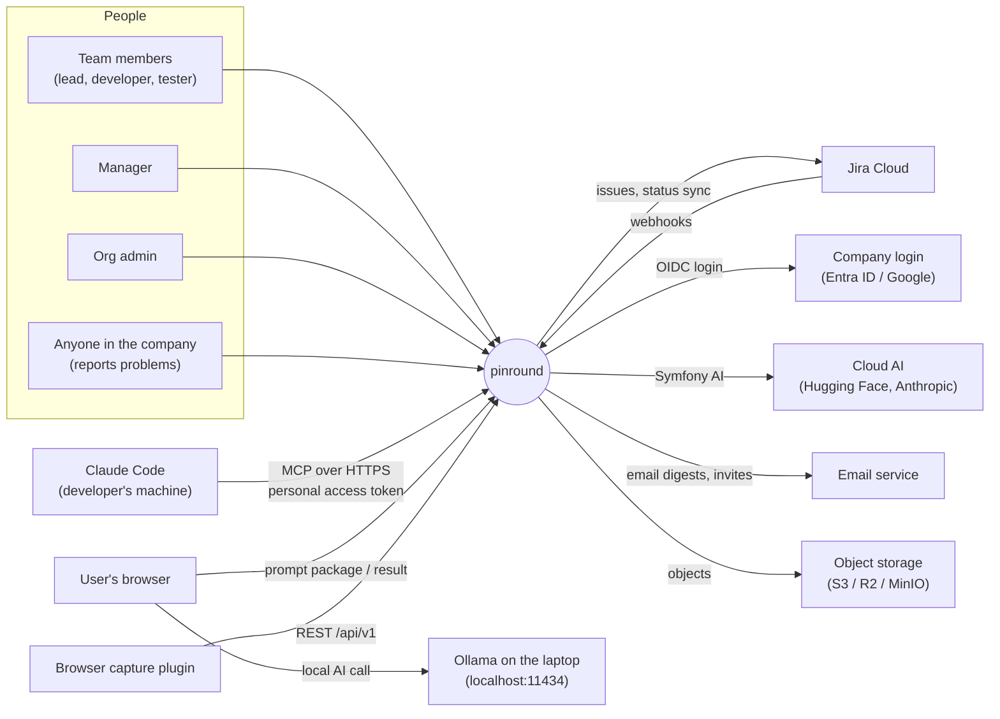
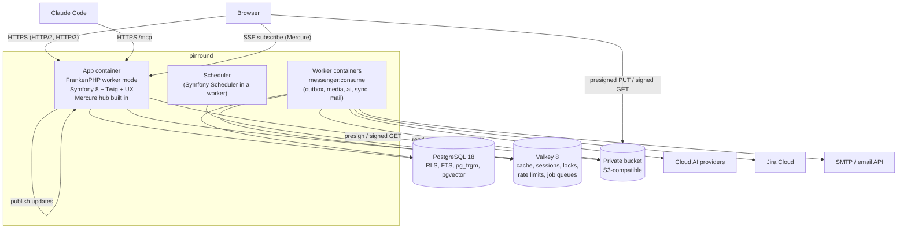
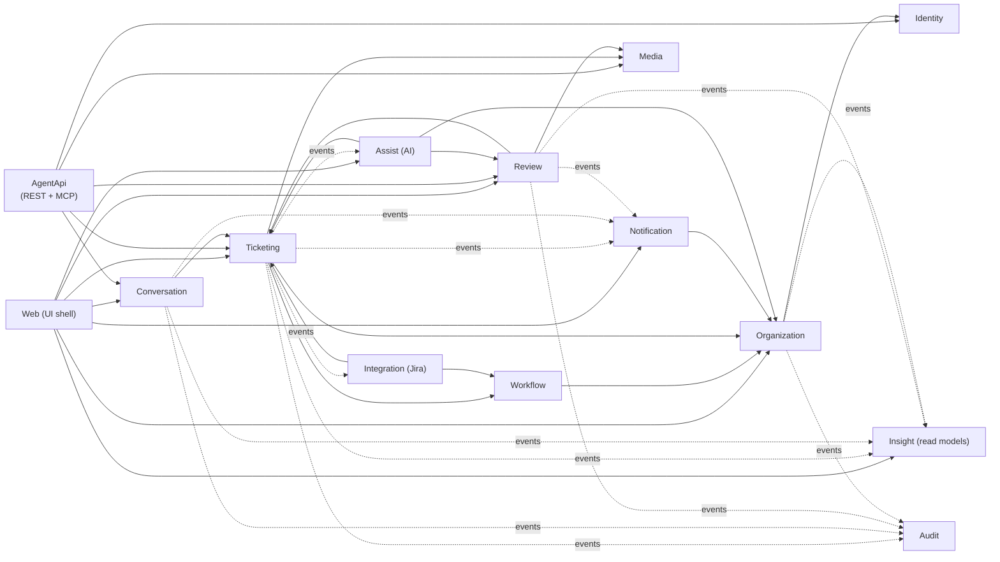
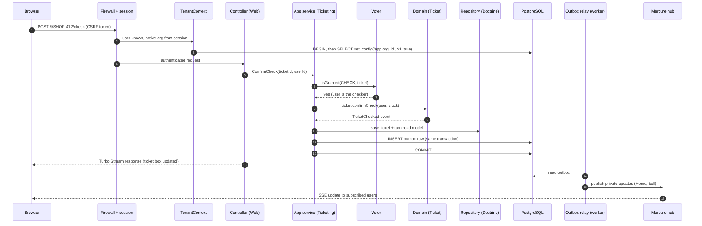

# Architecture overview

How pinround is built, told through the life of one ticket, with the big diagrams and links to every decision.

## Index

- [The story of one ticket](#the-story-of-one-ticket) — a bug from report to done, and which module does each part.
- [Architecture in one page](#architecture-in-one-page) — the shape of the system in eight sentences.
- [System context (C4 level 1)](#system-context-c4-level-1) — people and outside systems around pinround.
- [Containers (C4 level 2)](#containers-c4-level-2) — the running parts: app, workers, database, cache, storage.
- [Modules (C4 level 3)](#modules-c4-level-3) — the modules inside the app and how they talk.
- [Request lifecycle](#request-lifecycle) — what happens, step by step, when someone clicks a button.
- [Background work](#background-work) — what runs outside the request, and why.
- [Quality attribute scenarios](#quality-attribute-scenarios) — measurable scenarios for security, performance, scale, usability.
- [Where to read next](#where-to-read-next) — the other architecture documents.
- [All decisions (ADRs)](#all-decisions-adrs) — links to every ADR.

## The story of one ticket

Mia is a tester at Acme Foods. She sees that the order total on the shop page is twice what it should be.

1. **Report.** Mia clicks "Report a problem". She takes a screenshot and drops two pins on it. While she types the title, pinround shows two older tickets that look similar. They are about something else, so she sends her report. It becomes ticket `SHOP-412` right away. There is no approval gate.
   *Modules:* Ticketing creates the ticket. Review stores Round 0 (the report) with its pins. Media stores the screenshot. Search for duplicates runs in Ticketing (PostgreSQL full-text search). If AI is allowed, Assist suggests type, priority and duplicates.
2. **Check.** pinround found possible duplicates, so it flags the ticket "maybe the same as an older ticket". Lena, the team lead, sees it on her Home under "New tickets to check". She clicks "Looks fine" and gives it to Omar.
   *Modules:* Ticketing stores the check flags and the checker. Insight puts the ticket into Lena's "needs you" list. Workflow checks that Lena may assign it. Notification tells Omar.
3. **Build.** Omar opens his Home. `SHOP-412` is in his top 5 with the line "Start building". He clicks "Start work", and the step changes to In progress.
   *Modules:* Workflow runs the transition. Insight updates "whose turn". Audit records the change.
4. **Draft round with Claude Code.** Omar fixes the bug with Claude Code. Claude Code reads the ticket and the pins through pinround's MCP server. It takes two screenshots of the fixed page and adds them to Omar's private draft round. Omar marks one "Not right yet" and writes a note. He tells Claude Code, "Read my pinround notes and fix it." Claude Code reads the note, fixes it, and adds a new screenshot. Omar marks it "Looks right".
   *Modules:* AgentApi (MCP tools) calls Review through its public Api. Review keeps the draft private to Omar (owner-only voter). Media stores the screenshots.
5. **Review round.** Omar clicks "Send to code review". pinround asks him: share the draft as round 2, or keep it private? He shares it. Lena reviews the code and clicks "Approve code".
   *Modules:* Workflow (the "nobody approves their own code" rule). Review publishes the round. Notification sends Lena one notification.
6. **Test.** It is Mia's turn. She opens round 2, compares before and after, and marks each pin "Fixed". She clicks "Pass it". The ticket is done.
   *Modules:* Review (pin verdicts). Workflow (the "only the tester moves to Done" rule). Insight removes it from everyone's lists. Notification auto-clears pings on this ticket.
7. **Everyone sees it.** Mia's "My reports" page shows all four dots filled. Raj, the manager, sees one more ticket in the "Done" part of the team bar. If the team uses Jira, the Integration module moves the Jira issue too.

## Architecture in one page

- pinround is **one Symfony application**: a modular monolith with 13 modules plus a shared kernel. Module boundaries are enforced by Deptrac ([ADR-0002](../03-adr/0002-modular-monolith.md)).
- It runs on **FrankenPHP in worker mode**, with the Mercure hub built in ([ADR-0008](../03-adr/0008-frankenphp-runtime.md)).
- **PostgreSQL 18 is the only primary store** ([ADR-0004](../03-adr/0004-postgresql.md)).
  - Every tenant row carries `organization_id`.
  - Isolation is enforced twice: by a Doctrine filter and by Row-Level Security ([ADR-0005](../03-adr/0005-multi-tenancy.md)).
- **Screenshots live in a private S3-compatible bucket**, never in the database ([ADR-0011](../03-adr/0011-screenshot-storage-and-processing.md)).
- **Pages are rendered on the server** with Twig and Symfony UX (Turbo, Stimulus, Live Components). There is no SPA ([ADR-0007](../03-adr/0007-server-rendered-ui.md)).
- **Slow or risky work runs on workers** through Symfony Messenger. Domain events go through a transactional outbox ([ADR-0009](../03-adr/0009-async-messaging-and-outbox.md)).
  - Examples: image processing, AI, Jira sync, email.
- **"Whose turn" and "needs you" are stored as a read model** and updated on every change. Home pages are then simple indexed reads ([ADR-0015](../03-adr/0015-turn-read-model.md)).
- **AI goes through one gateway** that applies the organization's AI policy ([ADR-0018](../03-adr/0018-ai-provider-abstraction.md)). Laptop AI runs in the browser ([ADR-0019](../03-adr/0019-browser-local-ai.md)). Claude Code connects through an MCP server that uses the same permission checks as the web UI ([ADR-0021](../03-adr/0021-mcp-server.md)).

## System context (C4 level 1)

Who uses pinround, and which outside systems it talks to.

Notes:

- pinround never connects to a laptop. Laptop AI is always called by the user's own browser ([ADR-0019](../03-adr/0019-browser-local-ai.md)).
- Jira is an integration. pinround keeps its own data (rounds, pins, comments made in pinround) as its own source of truth ([ADR-0025](../03-adr/0025-jira-integration.md)).

## Containers (C4 level 2)

The processes that run in production. The same Docker images serve SaaS and self-hosted installs ([ADR-0030](../03-adr/0030-deployment-model.md)).

| Container | Job | Scales by |
|---|---|---|
| App (FrankenPHP) | HTTP pages, `/api/v1`, `/mcp`, Mercure hub | More replicas behind a load balancer. The app is stateless: sessions live in Valkey. |
| Workers | Outbox relay, image processing, AI calls, Jira sync, email | More replicas per transport. Queues are split so slow AI never blocks the outbox. |
| Scheduler | Ping digests, quiet-hour release, retention purge, partition creation | One active instance, guarded by a Lock. |
| PostgreSQL 18 | All business data, outbox, FTS | Vertical first, then read replicas for Insight reads. Big tables are partitioned. |
| Valkey 8 | Cache, sessions, Lock, RateLimiter, job transports | Vertical; a replica for failover. |
| Object storage | Screenshot originals and variants | Managed service; practically no limit. |

When there is more than one app replica, the Mercure hub runs in a separate FrankenPHP or Mercure container with a shared transport. Verify the multi-node Mercure setup at implementation.

## Modules (C4 level 3)

The app is split into modules. Each module owns its tables and offers a small public `Api` namespace. Modules call each other only through that `Api`, or react to domain events. The full catalogue is in [modules.md](modules.md).

Solid arrows are synchronous calls to another module's `Api` inside the same transaction. Dotted arrows are domain events, delivered through the outbox ([ADR-0009](../03-adr/0009-async-messaging-and-outbox.md)).

## Request lifecycle

Lena clicks "Looks fine" on a new ticket. This is what happens.

Rules shown in this flow:

1. **Authentication** comes first. Every route except login, invite accept, health and webhooks needs a session or a token ([ADR-0012](../03-adr/0012-authentication.md)).
2. **The tenant is set before any query.** The firewall fills `TenantContext`; the DBAL middleware `TenantMiddleware` reads it and runs `SELECT set_config('app.org_id', $1, true)` (transaction-local) at the start of the transaction. RLS then rejects rows from other organizations, even if a query forgets its filter ([ADR-0005](../03-adr/0005-multi-tenancy.md)).
3. **Every action asks a Voter**, and the voter denies by default ([ADR-0013](../03-adr/0013-authorization.md)).
4. **Domain objects enforce the rules.** Controllers stay thin.
5. **One transaction covers** the state change, the read model update ([ADR-0015](../03-adr/0015-turn-read-model.md)) and the outbox row. Either all of them happen, or none.
6. **Side effects run later**, from the outbox: notifications, audit, Mercure pushes, Jira sync.
7. **The response is a Turbo Stream** that replaces only the changed part of the page ([ADR-0007](../03-adr/0007-server-rendered-ui.md)).

## Background work

| Transport | Examples | Why async |
|---|---|---|
| `outbox` (Doctrine table, same DB) | Domain events → Insight (non-critical parts), Notification, Audit, Integration | Must never be lost. Written in the same transaction as the change. |
| `media` (Valkey) | Verify upload, re-encode, thumbnails | CPU heavy, 0.2–2 s per image |
| `ai` (Valkey) | Summaries, intake suggestions, embeddings | Slow (2–30 s), external, rate limited |
| `sync` (Valkey) | Jira import, webhooks, outbound transitions | External API, retries, back-off |
| `mail` (Valkey) | Invites, digests | External, retries |
| `failed` (Doctrine) | Messages that failed all retries | Visible to operators, can be retried |

Every handler is idempotent. It checks a message id or the entity version before it acts. Retries never send two emails or create two Jira comments.

## Quality attribute scenarios

Each scenario lists the source, the stimulus, the response, and how we measure success. The full requirements are in [non-functional-requirements.md](../01-requirements/non-functional-requirements.md).

### Security

| # | Source | Stimulus | Response | Measure |
|---|---|---|---|---|
| S1 | Logged-in user of org A | Changes a ticket id in the URL to one from org B | 404 (not 403), nothing leaks | Tenant-isolation test suite in CI covers every route. RLS blocks the read even if the Doctrine filter is off. |
| S2 | Manager outside a team | Opens a ticket marked "only the team and admins" | Not found; it is also missing from lists, search and Home counts | Voter tests + list/search tests for restricted tickets |
| S3 | Ticket text contains "ignore your instructions and…" | AI summary or MCP read | The text is treated as data. The output is checked against a schema. No write happens without a human click | Prompt-injection test fixtures in the AI test suite ([ADR-0020](../03-adr/0020-ai-safety-and-prompt-injection.md)) |
| S4 | Attacker | Uploads a PNG with a hidden script (polyglot) | The worker re-encodes the image. The original is never served. Wrong magic bytes → rejected | Upload test corpus; 0 originals served |
| S5 | Leaked MCP token | Used from an unknown place | Scopes limit the damage. The admin can revoke it at once, and every call is in the audit log | Revocation takes effect on the next request |

### Performance

| # | Source | Stimulus | Response | Measure |
|---|---|---|---|---|
| P1 | Lead with 30 waiting items | Opens Home | Top 5 + grouped rest from the `ins_ticket_turn` read model | p95 ≤ 250 ms server time at the design point |
| P2 | Tester | Opens the ticket list (50 rows) in a project with 200k tickets | Keyset pagination on a covering index | p95 ≤ 200 ms |
| P3 | Reporter | Uploads a 4 MB screenshot | Direct PUT to storage. A thumbnail is ready in the background | Thumbnail ready p95 ≤ 5 s; the page never waits on the app server |
| P4 | Anyone | Types a title in "Report a problem" | Duplicate suggestions from FTS + trigram | p95 ≤ 300 ms, at most 1 query per 400 ms of typing (debounced) |

### Scalability

| # | Source | Stimulus | Response | Measure |
|---|---|---|---|---|
| SC1 | Growth | 500 orgs, 2M tickets, 20M screenshots | Partitioned event tables. Objects live outside the DB. Stateless app replicas | Same p95 budgets in the k6 test at the design point (phase 12) |
| SC2 | Traffic peak | 500 req/s | Add app replicas. Workers scale per queue | Error rate < 0.1 %, queue age < 60 s |
| SC3 | AI provider slow | 30 s responses | AI is queued and isolated on its own transport. The UI shows "Thinking…" | Ticket pages are not slowed at all |

### Usability

| # | Source | Stimulus | Response | Measure |
|---|---|---|---|---|
| U1 | New developer, first day | Opens Home | Sees what to do first and why, in plain words | First correct action in < 60 s in a usability test |
| U2 | Reporter | Wants to know what happened to a report | "My reports" shows a 4-dot progress line and who has it now | Answers "where is it?" without opening the ticket |
| U3 | Keyboard or screen-reader user | Uses the ticket page | All actions reachable. Pins have text equivalents | WCAG 2.2 AA audit passes ([frontend.md](frontend.md)) |

## Where to read next

- [modules.md](modules.md) — every module, its tables, its Api and its events.
- [data-model.md](data-model.md) — tables, indexes, partitions, sizes.
- [workflow-engine.md](workflow-engine.md) — steps, groups, verbs, whose turn, needs-you score.
- [frontend.md](frontend.md) — Twig, Symfony UX, Stimulus, routes.
- [realtime-and-notifications.md](realtime-and-notifications.md) — Mercure and pings.
- [security.md](security.md), [performance-and-scale.md](performance-and-scale.md), [ai-architecture.md](ai-architecture.md), [media-pipeline.md](media-pipeline.md), [integrations.md](integrations.md), [operations.md](operations.md), [testing-strategy.md](testing-strategy.md), [trade-offs.md](trade-offs.md).

## All decisions (ADRs)

| ADR | Decision |
|---|---|
| [0001](../03-adr/0001-record-architecture-decisions.md) | Record decisions as ADRs (MADR) |
| [0002](../03-adr/0002-modular-monolith.md) | Modular monolith with enforced boundaries |
| [0003](../03-adr/0003-php-and-symfony-versions.md) | PHP 8.4+, Symfony 8.1 → 8.2 → 8.4 LTS |
| [0004](../03-adr/0004-postgresql.md) | PostgreSQL 18 as the only primary store |
| [0005](../03-adr/0005-multi-tenancy.md) | Shared schema, `organization_id`, Doctrine filter + RLS |
| [0006](../03-adr/0006-identifiers.md) | UUIDv7 ids + human ticket keys |
| [0007](../03-adr/0007-server-rendered-ui.md) | Twig + Symfony UX, no SPA |
| [0008](../03-adr/0008-frankenphp-runtime.md) | FrankenPHP worker mode with Mercure |
| [0009](../03-adr/0009-async-messaging-and-outbox.md) | Messenger + transactional outbox |
| [0010](../03-adr/0010-cache-sessions-locks.md) | Valkey for cache, sessions, locks, rate limits |
| [0011](../03-adr/0011-screenshot-storage-and-processing.md) | Private bucket, presigned upload, re-encode |
| [0012](../03-adr/0012-authentication.md) | Password + TOTP + OIDC SSO, tokens |
| [0013](../03-adr/0013-authorization.md) | Org roles + team roles, voters, deny by default |
| [0014](../03-adr/0014-status-model-five-groups.md) | Five fixed groups, steps by policy, verbs |
| [0015](../03-adr/0015-turn-read-model.md) | Stored "whose turn" read model |
| [0016](../03-adr/0016-direct-ticket-creation-with-check-flags.md) | Direct ticket creation with check flags |
| [0017](../03-adr/0017-private-draft-rounds.md) | Private draft rounds |
| [0018](../03-adr/0018-ai-provider-abstraction.md) | AI gateway on Symfony AI with org policy |
| [0019](../03-adr/0019-browser-local-ai.md) | Browser-local AI through Ollama |
| [0020](../03-adr/0020-ai-safety-and-prompt-injection.md) | AI safety and prompt injection |
| [0021](../03-adr/0021-mcp-server.md) | MCP server for Claude Code |
| [0022](../03-adr/0022-search-and-duplicates.md) | Postgres FTS + trigram, optional pgvector |
| [0023](../03-adr/0023-realtime-mercure.md) | Mercure private topics |
| [0024](../03-adr/0024-notifications-and-pings.md) | Pings: rate limits, grouping, auto-clear |
| [0025](../03-adr/0025-jira-integration.md) | Jira as an integration |
| [0026](../03-adr/0026-audit-log.md) | Append-only audit log |
| [0027](../03-adr/0027-secrets-and-encryption.md) | Secrets and encryption |
| [0028](../03-adr/0028-testing-and-quality-gates.md) | Testing and quality gates |
| [0029](../03-adr/0029-observability.md) | Observability with OpenTelemetry |
| [0030](../03-adr/0030-deployment-model.md) | Deployment model |
