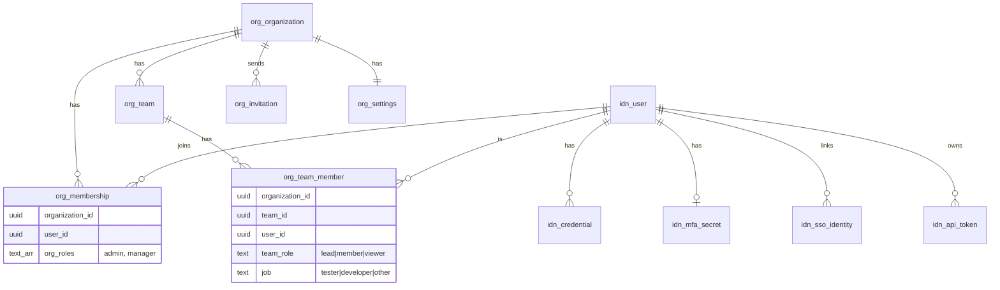
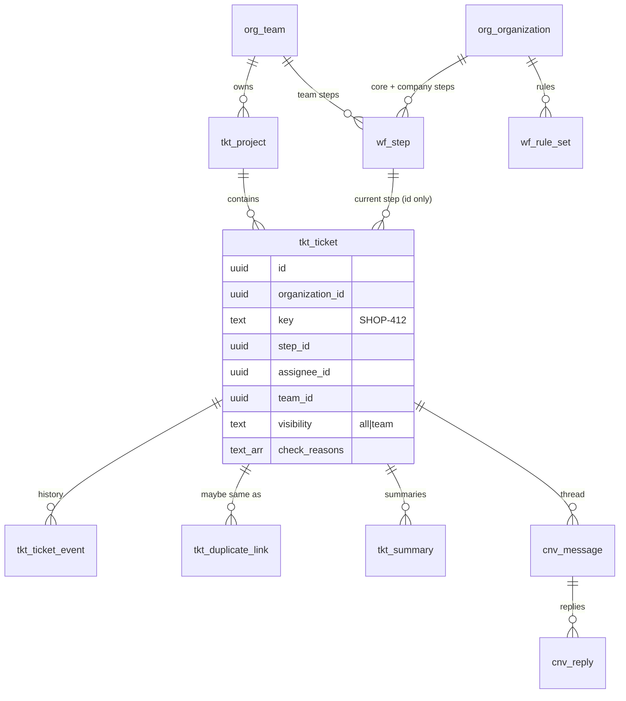
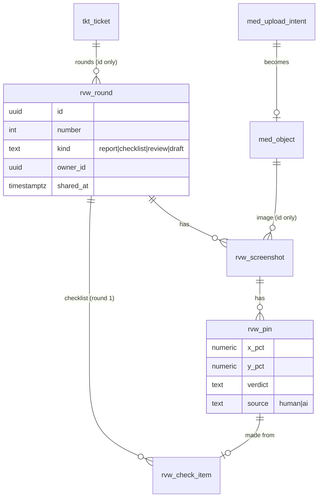
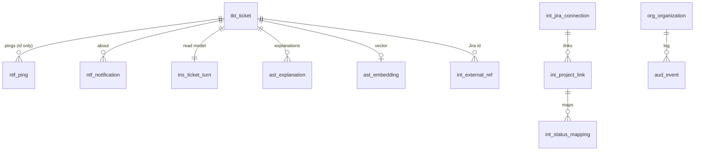

# Data model

The PostgreSQL tables, keys, indexes, partitions, row-level security, read models, and how big each table gets.

## Index

- [The story behind the shape](#the-story-behind-the-shape) — why the tables look the way they do.
- [General rules](#general-rules) — ids, tenant column, timestamps, naming, JSONB, enums.
- [Diagram 1 — people and organizations](#diagram-1--people-and-organizations) — Identity and Organization tables.
- [Diagram 2 — tickets and workflow](#diagram-2--tickets-and-workflow) — Ticketing, Workflow, Conversation.
- [Diagram 3 — rounds, screenshots and media](#diagram-3--rounds-screenshots-and-media) — Review and Media.
- [Diagram 4 — notifications, AI, integration, audit](#diagram-4--notifications-ai-integration-audit) — the supporting modules.
- [Table specifications](#table-specifications) — columns, constraints and indexes per table.
- [Read models](#read-models) — `ins_ticket_turn` and the other Insight tables.
- [Row-level security](#row-level-security) — the policy every tenant table gets (`TenantTable::enableRls`), how the tenant is set (`TenantContext`, `TenantMiddleware`, and for Messenger `TenantStamp`, `TenantStampMiddleware` and `RejectMessageForAnotherTenantMiddleware`), roles, and the resolver functions (owned by `pinround_resolver`, reading through `TenantTable::allowResolverRead`) that run before the tenant is known, and what `CatalogTest` enforces.
- [Ticket visibility predicate](#ticket-visibility-predicate) — the one canonical rule for who may see a restricted ticket.
- [Index catalogue](#index-catalogue) — the single list of indexes on hot tables.
- [Query patterns](#query-patterns) — the grouped list, Home, duplicates, ticket history, with SQL.
- [Partitions and retention](#partitions-and-retention) — monthly partitions and purge rules.
- [Migrations policy](#migrations-policy) — expand/contract, zero downtime.
- [Size estimates](#size-estimates) — rows and GB per table at the design point.

## The story behind the shape

Lena's Home must load in a quarter of a second, even when her company has 200,000 tickets. Mia's screenshots must never be readable by another company. Sara must be able to say "keep data for two years", and pinround must keep that promise.

These needs give the model its shape:

- every tenant row carries `organization_id`, and every index starts with it;
- "whose turn" is stored, not computed;
- screenshots are only references to objects in a bucket;
- history tables are partitioned by month, so old data can be dropped cheaply.

## General rules

- **Primary keys:** `uuid` with UUIDv7 values, generated in PHP (Symfony Uid) ([ADR-0006](../03-adr/0006-identifiers.md)). They are time-ordered, so B-tree inserts stay local, and nobody can guess the next id. Sequential integers are never exposed.
- **Tenant column:** `organization_id uuid NOT NULL` on every tenant table ([ADR-0005](../03-adr/0005-multi-tenancy.md)).
  - Every index and unique constraint starts with it.
  - Foreign keys that point inside the tenant are composite where useful: `(organization_id, ticket_id)`. A child can then never point to another tenant's parent.
- **Global tables (no tenant):** `idn_user`, `idn_credential`, `idn_mfa_secret`, `idn_sso_identity`, `idn_login_attempt`. One person can belong to several organizations through `org_membership`. These tables are reached only through Identity, never joined from tenant modules.
- **Time:** `timestamptz` everywhere, stored in UTC. `created_at` and `updated_at` are set by the application `Clock`.
- **Optimistic locking:** `version int NOT NULL DEFAULT 1` on aggregates that people edit at the same time: tickets, rounds, settings.
- **Enums:** stored as `text` with a `CHECK` constraint, not as PostgreSQL enum types (adding a value then needs no migration lock).
- **JSONB:** only for data that is always read and written as a whole (settings, variants, suggestion results). Anything we filter on gets a real column.
- **Text search:** a generated `tsvector` column with a GIN index ([ADR-0022](../03-adr/0022-search-and-duplicates.md)).
- **Names:** snake_case. Tables are singular and carry the module prefix.

## Diagram 1 — people and organizations

The Identity and Organization tables. `idn_*` tables are global; `org_*` tables are per tenant.



## Diagram 2 — tickets and workflow

Ticketing, Workflow and Conversation. Only the `Ticketing → Workflow` link (`step_id`) crosses a module. It is stored as an id; there is no Doctrine relation.



## Diagram 3 — rounds, screenshots and media

Review and Media. Review stores only `media_id`. The bytes live in the bucket.



## Diagram 4 — notifications, AI, integration, audit

The supporting modules. They point to tickets by id only.



## Table specifications

Only the important columns are listed. Every tenant table also has `organization_id uuid NOT NULL` and `created_at timestamptz NOT NULL`. Each index below already starts with `organization_id`.

### Identity (global)

| Table | Columns | Constraints / indexes |
|---|---|---|
| idn_user | id, email `citext`, name, status (`active`/`blocked`), locale, time_zone, created_at | `UNIQUE (email)` |
| idn_credential | user_id PK, password_hash (argon2id), changed_at | FK user |
| idn_mfa_secret | user_id PK, secret_enc `bytea` (sodium, key id), confirmed_at, recovery_codes_hash `text[]` | — |
| idn_sso_identity | id, user_id, provider_config_id (the org's IdP config), issuer (`iss`), subject (`sub`), linked_at | `UNIQUE (provider_config_id, issuer, subject)`. Never matched by email; linking to an existing account needs the account password + MFA ([ADR-0012](../03-adr/0012-authentication.md)) |
| idn_sso_provider | id, organization_id, issuer, client_id, secret_enc, allowed_domains `text[]` (each proven by a DNS TXT record), verified_at | `UNIQUE (organization_id, issuer)`. Read before login through a resolver function (see [Row-level security](#row-level-security)) |
| idn_api_token | id, organization_id, user_id, name, token_hash (SHA-256 of a 32-byte random value plus a server pepper; tokens look like `pr_…`), prefix (8 characters, for display), scopes `text[]`, expires_at, last_used_at, revoked_at | `UNIQUE (token_hash)`; `(organization_id, user_id)` |
| idn_login_attempt | id, email_hash, ip_hash, success, at | `(email_hash, at)`; purged after 30 days |

### Organization

| Table | Columns | Constraints / indexes |
|---|---|---|
| org_organization | id (= organization_id), name, slug, status, created_at | `UNIQUE (slug)` |
| org_membership | organization_id, user_id, org_roles `text[]` (`admin`, `manager`), joined_at | `PK (organization_id, user_id)`; `(organization_id, org_roles)` GIN only if needed |
| org_team | id, organization_id, name, lead_user_id | `UNIQUE (organization_id, lower(name))` |
| org_team_member | organization_id, team_id, user_id, team_role (`lead`/`member`/`viewer`), job (`tester`/`developer`/`other`) | `PK (organization_id, team_id, user_id)`; `(organization_id, user_id)` |
| org_invitation | id, organization_id, email, org_roles, team_id, team_role, token_hash, expires_at (72 h), accepted_at | `UNIQUE (token_hash)`; `(organization_id, email)` |
| org_settings | organization_id PK, version, data `jsonb` | One row per org. Data keys: `ping_limit_hours`, `auto_clear`, `quiet_hours`, `lead_check`, `triager_id`, `step_policy` (`locked`/`extend`/`team`), `ai` {on, who, send, sync, where, model}, `retention` (`1y`/`2y`/`all`) |

### Workflow

| Table | Columns | Constraints / indexes |
|---|---|---|
| wf_step | id, organization_id, team_id NULL, name, grp (`todo`/`doing`/`check`/`wait`/`done`), core_code NULL (`backlog`, `todo`, `progress`, `review`, `test`, `input`, `hold`, `done`), origin (`core`/`company`/`team`), position, archived_at | `(organization_id, team_id, grp, position)`; `UNIQUE (organization_id, team_id, core_code)` where core_code is not null |
| wf_rule_set | organization_id, team_id NULL, tester_moves_done bool, no_self_review bool, review_before_test bool | `PK (organization_id, coalesce(team_id, nil uuid))` (team row only under policy `team`) |

### Ticketing

| Table | Columns | Constraints / indexes |
|---|---|---|
| tkt_project | id, organization_id, team_id, key (`SHOP`), name, next_number int | `UNIQUE (organization_id, key)` |
| tkt_ticket | id, organization_id, project_id, number int, key text, title, description, type (`bug`/`story`/`task`), priority (`blocker`/`critical`/`major`/`normal`/`minor`), priority_rank smallint (0 = blocker … 4 = minor, set with priority), step_id, previous_step_id NULL, assignee_id NULL, pending_assignee_id NULL, reviewer_id NULL, tester_id NULL, waiting_on_user_id NULL, waiting_on_label NULL, reporter_id, team_id NULL, visibility (`all`/`team`), release NULL, parent_id NULL, components `text[]`, check_reasons `text[]`, checked_at, checked_by, closed_as_duplicate_of NULL, closed_at NULL (set when the step's group becomes `done`, cleared on reopen), version, created_at, updated_at, search `tsvector` GENERATED (title weight A, description B) STORED | `UNIQUE (organization_id, project_id, number)`; `UNIQUE (organization_id, key)`; indexes: see [Index catalogue](#index-catalogue) |
| tkt_ticket_event | id, organization_id, ticket_id, actor_id, type, from_step, to_step, payload `jsonb`, at | Partitioned by `RANGE (at)` monthly; `PRIMARY KEY (id, at)` (a partitioned table's key must contain the partition column); `(organization_id, ticket_id, at DESC)` |
| tkt_duplicate_link | organization_id, ticket_id, candidate_id, score real, source (`fts`/`ai`), decided (`same`/`different`/NULL) | `PK (organization_id, ticket_id, candidate_id)` |
| tkt_summary | id, organization_id, ticket_id, text, source (`sync`/`ai`/`explanation`/`human`), author_id NULL, model NULL, is_current bool, created_at | `(organization_id, ticket_id, created_at DESC)`; partial `UNIQUE (organization_id, ticket_id) WHERE is_current` |

Ticket numbers come from `tkt_project.next_number`. The app runs `UPDATE … SET next_number = next_number + 1 RETURNING next_number` inside the create transaction: a row lock, short, per project ([ADR-0006](../03-adr/0006-identifiers.md)).

### Conversation

| Table | Columns | Constraints / indexes |
|---|---|---|
| cnv_message | id, organization_id, ticket_id, author_id, kind (`comment`/`question`), to_user_id NULL, body, resolved_at NULL, resolved_by NULL, created_at | `(organization_id, ticket_id, created_at)`; partial `(organization_id, to_user_id) WHERE kind='question' AND resolved_at IS NULL` |
| cnv_reply | id, organization_id, message_id, author_id, body, is_answer bool, created_at | `(organization_id, message_id, created_at)` |

### Review and Media

| Table | Columns | Constraints / indexes |
|---|---|---|
| rvw_round | id, organization_id, ticket_id, number int NULL (set when shared), kind (`report`/`checklist`/`review`/`draft`), owner_id, shared_at NULL, decided_at NULL, state (`open`/`closed`), version | `(organization_id, ticket_id, number)`; partial `UNIQUE (organization_id, ticket_id, owner_id) WHERE kind='draft' AND shared_at IS NULL` (one open draft per person per ticket) |
| rvw_screenshot | id, organization_id, round_id, media_id, position, variant_label (`before`/`after`/NULL), verdict (`looks_right`/`not_right`/NULL), note | `(organization_id, round_id, position)` |
| rvw_area | id, organization_id, round_id, name, position, verdict (`pass`/`needs_fix`/`question`/NULL), note, decided_by NULL, decided_at NULL | `(organization_id, round_id, position)`. A screen area of a review round. Saving a verdict never moves the ticket; when every area has a verdict, the tester is offered "Pass it" or "Needs changes"; "Question" asks the lead. |
| rvw_pin | id, organization_id, screenshot_id, number, x_pct numeric(5,2), y_pct numeric(5,2), note, verdict (`fixed`/`still_wrong`/NULL), source (`human`/`ai`), ai_state (`suggested`/`kept`/`dismissed`/NULL), author_id | `(organization_id, screenshot_id, number)`; `CHECK (x_pct BETWEEN 0 AND 100 AND y_pct BETWEEN 0 AND 100)` |
| rvw_check_item | id, organization_id, round_id, pin_id, state (`open`/`fixed`/`ok`/`not_fixed`), changed_by, changed_at | `(organization_id, round_id)` |
| med_object | id, organization_id, storage_key, sha256, mime, bytes, width, height, status (`pending`/`ready`/`rejected`), reject_reason, variants `jsonb` ({thumb: key, full: key}), uploaded_by, created_at | `(organization_id, sha256)`; `(organization_id, status, created_at)` |
| med_upload_intent | id, organization_id, user_id, purpose, max_bytes, mime_allowed `text[]`, storage_key, expires_at, used_at | `(organization_id, expires_at)`; purge after 1 day |

### Notification, Assist, Integration, Audit, AgentApi

| Table | Columns | Constraints / indexes |
|---|---|---|
| ntf_ping | id, organization_id, ticket_id, from_id, to_id, body, created_at, deliver_after NULL (quiet hours), cleared_at NULL, cleared_reason (`done`/`acted`) | `(organization_id, to_id, cleared_at, created_at DESC)` |
| ntf_notification | id, organization_id, user_id, ticket_id NULL, kind, data `jsonb`, read_at, created_at | Partitioned monthly; `(organization_id, user_id, read_at, created_at DESC)`; kept 90 days |
| ntf_mute | organization_id, user_id, ticket_id | `PK (organization_id, user_id, ticket_id)` |
| ast_explanation | id, organization_id, ticket_id, user_id, prompt, text, model, shared_at NULL, created_at | `(organization_id, ticket_id, user_id)` |
| ast_suggestion | id, organization_id, user_id, purpose (`intake`/`pins`), result `jsonb`, model, created_at | Purge after 7 days |
| ast_embedding | organization_id, ticket_id PK part, model, embedding `vector(n)` | HNSW index per org-size bucket. Optional; verify the pgvector index choice at implementation |
| ast_usage | id, organization_id, user_id, purpose, provider, model, tokens_in, tokens_out, ms, at | Partitioned monthly; no content columns |
| ast_local_package | id, organization_id, user_id, ticket_id, purpose, expires_at (5 min, single use), used_at | — |
| int_jira_connection | id, organization_id, base_url, auth_type, secret_enc `bytea`, key_id, status | — |
| int_project_link | id, organization_id, connection_id, jira_key, project_id | `UNIQUE (organization_id, jira_key)` |
| int_status_mapping | organization_id, project_link_id, jira_status, step_id | `PK (organization_id, project_link_id, jira_status)` |
| int_external_ref | organization_id, entity, entity_id, system, external_id, external_version | `UNIQUE (organization_id, system, external_id)`; `(organization_id, entity, entity_id)` |
| aud_event | id, organization_id, actor_id NULL, actor_kind (`user`/`token`/`system`), action, target_type, target_id, data `jsonb` (old/new values, never ticket text), ip_hash, at | Partitioned monthly; `(organization_id, at DESC)`; `(organization_id, target_type, target_id, at DESC)` |
| api_idempotency_key | organization_id, key, token_id, response_hash, created_at | `PK (organization_id, key)`; purge after 24 h |
| messenger_outbox | Symfony Messenger Doctrine transport table (queue `outbox`) | Managed by Messenger. Verify the table layout at implementation |

## Read models

Read models are owned by Insight and rebuilt from events if needed (`bin/console insight:rebuild --org=…`).

### ins_ticket_turn (the most important table for speed)

One row per **open** ticket. The row is deleted when the ticket is done.

| Column | Meaning |
|---|---|
| ticket_id PK, organization_id | The ticket |
| team_id, project_id | For filters |
| grp | The group of the current step |
| turn_user_id NULL | Whose turn it is. NULL means an outside party (customer, owner) or nobody |
| turn_label | Display text when there is no user ("Customer", "Product owner") |
| kind | `answer`, `check`, `review`, `test`, `assign`, `input`, `decide`, `build` |
| base_score int | Kind + priority + release points (see [workflow-engine.md](workflow-engine.md#needs-you-kinds-and-score)) |
| waiting_since timestamptz | When the turn last changed. Drives "waiting 12d" and the time part of the score |
| check_user_id NULL | Set when the ticket needs a check (the lead or the triager) |
| visibility, team_id, reporter_id, assignee_id, pending_assignee_id, reviewer_id, tester_id, waiting_on_user_id | Copied from the ticket, so Home, Whose turn and workload can apply the [ticket visibility predicate](#ticket-visibility-predicate) without a join |

Indexes: see [Index catalogue](#index-catalogue).

Updated **synchronously** in the same transaction as the change, by `TurnProjector` ([ADR-0015](../03-adr/0015-turn-read-model.md)).

Home and "Whose turn?" read this table joined with `tkt_ticket_list_v`, a read-only SQL view owned by Ticketing (key, title, priority, release, step). Only Insight's query service may use that join ([ADR-0015](../03-adr/0015-turn-read-model.md)).

### Other Insight tables

- `ins_team_counts (organization_id, team_id, grp, step_id, visibility, open_count)` — the manager's "Teams at a glance". Counted per visibility, so a viewer outside the team gets only the `all` rows: restricted tickets never show up as numbers to people who may not see them. Updated by events, and corrected nightly by a full recount.
- `ins_project_counts (organization_id, project_id, visibility, open_count, done_count)` — the counts on the project rail of the Tickets page. Same visibility rule.
- Whose turn and workload counts read `ins_ticket_turn`, which carries `visibility` and the people columns, so they apply the [ticket visibility predicate](#ticket-visibility-predicate) in the same query.
- `ins_release_progress (organization_id, team_id, release, grp, count)` — the release bar.
- My reports needs no table: it reads `tkt_ticket` by `(organization_id, reporter_id, created_at DESC)` joined to `ins_ticket_turn` (through the Ticketing view `tkt_ticket_list_v`). It is keyset-paginated: open groups first (up to 50 cards), Done loaded on demand, 50 per page.

## Row-level security

Every tenant table gets the same policy. The app's database role has no `BYPASSRLS`, and `FORCE ROW LEVEL SECURITY` makes the table owner obey the policy too. The migration that creates the table passes the statements of `App\SharedKernel\Infrastructure\Doctrine\Migration\TenantTable::enableRls('<table>')` to `addSql()` (it accepts only a plain lowercase name of up to 63 characters and quotes it). These are the statements; the table rights are separate grants in the same migration (see below).

```sql
ALTER TABLE tkt_ticket ENABLE ROW LEVEL SECURITY;
ALTER TABLE tkt_ticket FORCE ROW LEVEL SECURITY;
CREATE POLICY tenant_isolation ON tkt_ticket
  USING      (organization_id = NULLIF(current_setting('app.org_id', true), '')::uuid)
  WITH CHECK (organization_id = NULLIF(current_setting('app.org_id', true), '')::uuid);
```

**How the tenant is set**

- `App\SharedKernel\Application\TenantContext` holds the current `OrganizationId` (a lowercase canonical UUIDv7) for the request or message. The DBAL driver middleware `App\SharedKernel\Infrastructure\Doctrine\TenantMiddleware`, registered on every connection, runs `SELECT set_config('app.org_id', ?, true)` with the id bound, right after each outermost `BEGIN`, when `TenantContext` holds an organization. The third argument `true` makes it transaction-local, like `SET LOCAL`, and unlike `SET LOCAL` it accepts a bound parameter (no string building, no SQL injection). The setting ends with the transaction, which is safe with PgBouncer in transaction mode and with FrankenPHP worker mode.
- **Contract:** set the tenant before the transaction begins. On the default connection, a switch to another organization while a transaction is open is refused (`TenantSwitchRefused`). Only setting the first tenant while a transaction is open, or a change seen by another connection such as `migrator`, waits for the next transaction. Nested transactions (savepoints) never set it again. If `BEGIN` or `set_config` fails, every connection's DBAL class `App\SharedKernel\Infrastructure\Doctrine\CloseOnFailedBeginConnection` (doctrine.yaml `wrapper_class`) closes the connection and rethrows the failure, when the failing `BEGIN` is the outermost one. Closing ends the half-begun transaction on the server and resets DBAL's transaction count, so the next transaction starts on a fresh connection instead of sending `SAVEPOINT` outside a transaction. A failed nested savepoint is not covered: the connection and its outer transaction stay, but DBAL's nesting level stays one too high (DBAL's own behaviour, not fixed; a unit test pins it). A statement outside a transaction (autocommit) never has a tenant, so it sees no tenant rows. `TenantContext` is reset by the kernel between requests, so no tenant survives into the next one.
- **Why `NULLIF`:** on a pooled connection that has already run a transaction-local setting, `current_setting('app.org_id', true)` returns an empty string `''` (not NULL) once that transaction is over. `''::uuid` would raise an error. `NULLIF(…, '')` turns it into NULL, `organization_id = NULL` is never true, so **no rows** match. This fails closed.
- **Two layers, two behaviours when no tenant is set.** The database layer fails closed silently: raw SQL without a tenant returns zero rows with no error (the P00.T3 isolation criterion). The application layer is loud: `TenantFilter`, the Doctrine SQL filter for `TenantOwned` entities, throws `TenantNotSet` for an ORM query when the current transaction has no tenant (also outside any transaction), so a missing tenant fails in tests instead of returning nothing.
- **`TenantFilter`:** adds `organization_id = NULLIF(current_setting('app.org_id', true), '')::uuid` (the `TenantSetting::CURRENT_ORG_SQL` constant) to every `TenantOwned` query. The SQL text is the same for every organization, so Doctrine's query cache entry is shared. Its only filter parameter is the `is_tenant_set` marker, which `TenantFilterMiddleware` sets at each outermost `BEGIN` (true when the transaction has an organization) and clears at `COMMIT` and `ROLLBACK`.
- **One transaction per web request:** `RequestTransaction` begins a transaction on every main request at `kernel.request` priority 7, just below the firewall's 8, so `TenantContext` is already filled. It commits on the response, rolls back on an exception, and has a safety net on `kernel.finish_request` and `kernel.terminate`. A streamed body runs after the commit, so it sees zero tenant rows.
- **No ORM result cache:** the result cache is a `NullAdapter` in every environment, on purpose. The filter SQL holds no organization id, so a result cache key could not tell organizations apart. Never add a result cache for tenant data without a tenant-aware key.
- **Switching organization:** `TenantContext` refuses (`TenantSwitchRefused`) a switch to another organization, or `clear()`, while a database transaction is open or the EntityManager holds any entity. A loop over organizations must end the transaction, flush and clear first.
- **No server-side prepares:** `Pdo\Pgsql::ATTR_DISABLE_PREPARES` is on for every connection (PgBouncer-safe, one round trip per bound query).
- `tests/Integration/Tenancy/TenantIsolationTest` proves this on a test-only table `zz_tenant_probe`, which exists only in the test database while that test class runs (its fixture drops and recreates it through the migrator connection, then drops it; no migration creates it).
- **Messenger workers:** every handler runs inside the `doctrine_transaction` middleware. `App\SharedKernel\Infrastructure\Messenger\TenantStampMiddleware` sits directly before it on every bus (messenger.yaml; `MessengerBusMiddlewareTest` fails for a bus without it there) and reads the message's `TenantStamp` (`App\SharedKernel\Infrastructure\Messenger\TenantStamp`, which holds the organization id as a string). When `doctrine_transaction` opens the transaction, `TenantMiddleware` runs `set_config` as for any other transaction. The middleware runs at dispatch and at handling, so its rules hold for sync and async messages alike:
  1. **No stamp:** the message passes on unchanged and runs under whatever organization is set; in a worker that is none. A message without an org (system jobs) can only touch global tables or call the resolver functions below.
  2. **Stamp, no organization set, no open transaction and no entity in the EntityManager:** it sets the stamp's organization, passes the message on, and afterwards (also when the handler throws) clears the EntityManager and then `TenantContext` through `TenantSwitchGuard`, so no entity loaded for that organization stays for the next message. A transaction the handler leaves open is rolled back; a message that otherwise succeeded then fails with a `LogicException`, because nothing written in it was saved.
  3. **Stamp, no organization set, but a transaction open or an entity in the EntityManager** (`TenantSwitchGuard` would refuse; for example a request without a tenant, such as a signup, queuing a message for the new organization): the message passes on without setting the organization. Queued, it gets the organization when a worker receives it (case 2). Handled at once, it runs with no tenant: raw SQL sees no tenant rows and an ORM query throws `TenantNotSet` (fails closed and loud).
  4. **Stamp, the same organization set** (a dispatch inside a web request or another handler): the message passes on and the organization stays set afterwards.
  5. **Stamp, another organization set:** `MessageForAnotherTenantRefused` is thrown before anything runs, also for a message routed to an async transport, because the middleware runs at dispatch too. Dispatching a message for organization B inside a request of organization A is refused on purpose; the organization never changes in the middle of a request or message. A message a handler dispatches with `DispatchAfterCurrentBusStamp` is refused the same way: `RejectMessageForAnotherTenantMiddleware` (same namespace) checks it against the organization set before `dispatch_after_current_bus` holds it back, because when it is released `TenantStampMiddleware` has already cleared the handler's organization and would see case 2. For that order every bus sets `default_middleware: false` and lists the framework's middleware by hand; `MessengerBusMiddlewareTest` checks both middleware positions on every bus and pins the default bus's full list.
  - When rolling back a transaction a handler left open fails, `TenantStampMiddleware` logs a warning with the exception class, SQLSTATE and code only (never the message, which can quote row values) and closes the connection.
- **Worker mode:** after an exception the EntityManager is closed; the kernel reset resets it before the next request or message. A test throws inside a request and checks the next request works and carries no tenant ([ADR-0008](../03-adr/0008-frankenphp-runtime.md)).
- `bin/check-tenant-setting` (run by `composer lint`, so in CI) bans `SET`, `SET LOCAL`, `SET SESSION` and `RESET` of `app.org_id`, any `set_config('app.org_id', …, false)`, and any `set_config` for `app.org_id` outside `TenantConnection`, `TenantMiddleware` and the few test files that assert or simulate them. Reading it with `current_setting('app.org_id', true)` is fine. `TenantSettingCheckTest` proves it on fixtures.

**Database roles** ([ADR-0005](../03-adr/0005-multi-tenancy.md)) — the same five names everywhere:

| Role | Login | BYPASSRLS | Used by |
|---|---|---|---|
| `pinround_app` | yes | no | web, API, MCP, workers |
| `pinround_migrator` | yes | no | migrations and partition creation (owns the tables; `FORCE RLS` still applies to its data access) |
| `pinround_retention` | yes | **yes — the only one** | the nightly retention purge job only |
| `pinround_readonly` | yes | no | support queries and reporting, with the same tenant setting |
| `pinround_resolver` | **no** | no | nobody logs in as it; it owns the resolver functions only (see "Lookups before the tenant is known" below) |

The roles live in `docker/postgres/roles.sql`. The Postgres admin account runs it on each database before migrating (`make db-roles` in `make up`, a step in CI, the operator in production), with the four login passwords as psql variables. It is safe to re-run. It creates missing roles and re-asserts their attributes. It makes `pinround_migrator` the only member of `pinround_resolver`, with `SET` but without `INHERIT`: the migrator can hand a function to that role, but never acts with its rights or policies. It removes any other member. It makes `pinround_migrator` the owner of the database and of every table, view and sequence in `public`. It revokes all rights of `PUBLIC` on the database and on schema `public`, so only the four login roles get `CONNECT` and nobody but the owner gets `CREATE` or `TEMPORARY`. It grants schema `USAGE` to `pinround_app`, `pinround_readonly`, `pinround_retention` and `pinround_resolver`, and revokes `CREATE` on the schema from `pinround_resolver`. It grants **no table or sequence rights**, sets no default privileges, and removes any that an older version of the script left, including all rights of `pinround_app` and `pinround_readonly` on `doctrine_migration_versions`.

**Table rights live in the migration that creates the table.** That migration grants `pinround_app` and `pinround_readonly` exactly what they need, for example `SELECT, INSERT` only for an append-only table. It never grants `TRUNCATE`, `REFERENCES` or `TRIGGER`, and never grants on a child partition (only the parent). A plain sequence (not an identity column, which needs no grant) gets `USAGE` in the same migration. Re-running `roles.sql` never widens these grants. `make test` and CI run it once more on the migrated test database before PHPUnit, to test this. `DatabaseRolesTest` checks five things on that database:

- No default privilege grants anything to `pinround_app` or `pinround_readonly`.
- A plain table and a child partition the migrator creates start with no rights, and a partitioned parent has only what was granted on it.
- No child partition in `public` has a grantee other than its owner.
- Neither role holds `TRUNCATE`, `REFERENCES` or `TRIGGER` on anything in `public`.
- Only the owner has rights on `doctrine_migration_versions`. `pinround_retention` gets its table rights from the retention job's migration (P11).

**Lookups before the tenant is known (the only RLS exceptions)**

Some lookups must find a row before the app knows which organization the request belongs to. They do not get `BYPASSRLS`. Each one is a `SECURITY DEFINER` SQL function owned by a role without login (`pinround_resolver`), with `SET search_path = pg_catalog, public, pg_temp` fixed in the function definition (`pg_temp` last, so a temporary table never shadows a table it reads). It takes one exact key, named with a `p_` prefix: in a `LANGUAGE sql` body a column of the same name wins over the parameter, so `token_hash = token_hash` would match every row, and `CREATE OR REPLACE` cannot rename an input later. It **returns ids only** (`uuid` columns; never names, text, secrets, dates or status). The caller then sets the tenant and reads scopes, dates, status and org roles under the normal policy. `pinround_app` gets `EXECUTE` on these functions and nothing else from the owner role; `PUBLIC` and the other roles get no `EXECUTE`.

| Function | Input | Returns | Used by |
|---|---|---|---|
| `resolve_api_token(p_token_hash bytea)` | hash of a presented PAT | `token_id, organization_id, user_id` | API and MCP authentication |
| `resolve_user_orgs(p_user_id uuid)` | the logged-in user | `organization_id`, one row per organization | org picker after login, membership checks |
| `resolve_invitation(p_token_hash bytea)` | hash of an invite token | `invitation_id, organization_id` | accepting an invite |
| `resolve_sso_provider(p_issuer text, p_domain text)` | issuer or email domain at login | `provider_config_id, organization_id` | company login start and callback |
| `resolve_jira_connection(p_connection_id uuid)` | id from the webhook URL | `organization_id` | Jira webhook intake |
| `resolve_laptop_package(p_package_id uuid)` | id of a laptop-AI package | `organization_id, user_id` | laptop AI result intake |

- **Where they live:** migration `Version20261106140000` creates all six as stubs that return no row, with these signatures. The names are listed once in PHP, `App\SharedKernel\Infrastructure\Doctrine\Migration\ResolverFunctions::NAMES`, which the tests read. The phase that adds a function's table replaces its body with `CREATE OR REPLACE FUNCTION`, keeping the signature (and so the `EXECUTE` grants).
- **How a resolver reads under `FORCE ROW LEVEL SECURITY`:** `pinround_resolver` has no `BYPASSRLS`, so the tenant policy applies to it too. The migration that creates a table a resolver reads adds the statements of `TenantTable::allowResolverRead('<table>', [<columns>])` after `enableRls`: an opt-in policy `resolver_read ... FOR SELECT TO pinround_resolver USING (true)` and `GRANT SELECT (<columns>)` to `pinround_resolver`. Grant only the columns a resolver returns or matches on, and on a partitioned table the parent only.
- **Owner and migrator:** a new owner needs `CREATE` on the schema, so the migration grants it to `pinround_resolver` just for `ALTER FUNCTION ... OWNER TO pinround_resolver` and revokes it again; the role keeps no `CREATE`. `EXECUTE` is granted before the owner change, because the migrator does not inherit the owner's rights. To replace or drop a function later, a migration runs `SET ROLE pinround_resolver` first (and, for `CREATE OR REPLACE`, grants and revokes `CREATE` the same way), then `RESET ROLE`. Because the migrator has no `INHERIT`, the `resolver_read` policy never applies to it.

`tests/Integration/Tenancy/ResolverFunctionTest` checks each function's owner, `SECURITY DEFINER`, fixed `search_path`, `p_` inputs, `uuid`-only output and `EXECUTE` rights, that an unknown key gives no row, and that `pinround_readonly` is refused. On a test-only table it proves a function owned by `pinround_resolver` finds another organization's row through `resolver_read`, cannot read an ungranted column, that an input named like its column matches every row while a `p_` input matches only its key, and that the migrator does not get the policy. When the tables arrive, every resolver gets a test: right key → ids; wrong key → no row; it can never return rows of another org for a guessed key. `tests/Integration/Tenancy/CatalogTest` (in CI's `integration` job) fails unless the `SECURITY DEFINER` functions in every schema but the system ones (`pg_catalog`, `information_schema`, `pg_toast` and the per-session temporary schemas; extension functions included, since the migrator owns the extensions and could hide a function in one) are exactly `ResolverFunctions::NAMES` in `public`, one per name, each owned by `pinround_resolver`, and fails on any function `pinround_resolver` owns that `NAMES` does not list.

**Partitioned tables:** grants are given on the **parent** table only. `roles.sql` revokes nothing on partitions and migrations never grant on a child partition, so `pinround_app` and `pinround_readonly` cannot query a partition directly and skip the parent's policy. No partition job exists yet; when it comes, it must run `TenantTable::enableRls` on every child partition it creates as well as on the parent, and `CatalogTest` fails on a child without it: a query through the parent applies the parent's policy, but a direct query on a child uses the child's own settings, and PostgreSQL copies neither the RLS flags nor the policy to a new partition. `allowResolverRead` stays on the parent only. `DatabaseRolesTest::noChildPartitionInTheSchemaHasDirectGrants` reads `pg_class.relispartition` and fails on any grant on a child partition to a role other than its owner.

- `TenantFilter` adds the same `organization_id = NULLIF(current_setting('app.org_id', true), '')::uuid` condition to ORM queries. Both checks must agree; a CI test turns the filter off and expects RLS to still block ([testing-strategy.md](testing-strategy.md)).
- `tests/Integration/Tenancy/CatalogTest` reads the catalog as `pinround_app` in CI's `integration` job. A tenant table is a table with an `organization_id` column in any schema but the system ones (`pg_catalog`, `information_schema`, `pg_toast` and the per-session temporary schemas), plus every partition or inheritance child below it; tables an extension owns count too. The test fails when a tenant table lacks `ENABLE` or `FORCE ROW LEVEL SECURITY`, or lacks a `tenant_isolation` policy identical (permissive, `FOR ALL`, `TO PUBLIC`, same `USING` and `WITH CHECK`) to the one `TenantTable::enableRls` writes; when a tenant table has any other policy that is not identical to the `resolver_read` of `TenantTable::allowResolverRead`; when a role other than `pinround_retention` has `BYPASSRLS` (superusers left out: they bypass RLS anyway, and the only one is the admin account that runs `roles.sql`); when `pinround_resolver` holds a table-wide privilege on any relation, any default privilege, or a column grant that is not `SELECT` on a table with a `resolver_read` policy; and when `pinround_app` is a member of any role. Each table, policy, function and privilege rule is proved to fire on a throwaway object the migrator creates in a rolled-back transaction. The migrator cannot create roles or grant membership, so the two role rules are proved on roles that exist: with `pinround_migrator` as the allowed role the `BYPASSRLS` rule reports `pinround_retention`, and the membership rule run for `pinround_migrator` reports `pinround_resolver`.

## Ticket visibility predicate

This is the **one canonical rule** for who may see a ticket with `visibility = 'team'` (a restricted, security-sensitive ticket). It is defined here and in [ADR-0013](../03-adr/0013-authorization.md); every other document references it instead of restating it. In code it lives in one place: `App\Ticketing\Api\TicketVisibility` (SQL fragment + PHP check used by `TicketVoter`), so list, search, duplicate suggestions, My reports, Home, Whose turn, workload counts, Mercure signals, emails, AI inputs, MCP tools and exports all use the same rule.

```sql
-- :me = current user, :teams = ids of teams the user belongs to (any team role),
-- :is_admin = user has the org role Admin, :triager = org setting triager_id
(   t.visibility = 'all'
 OR t.team_id = ANY(:teams)
 OR :me IN (t.reporter_id, t.assignee_id, t.pending_assignee_id,
            t.reviewer_id, t.tester_id, t.waiting_on_user_id)
 OR :is_admin
 OR (t.team_id IS NULL AND :me = :triager) )
```

- A reporter outside the team keeps seeing their own security report, and can answer a question sent to them.
- A non-admin triager sees restricted tickets that have no team yet.
- Managers see restricted tickets only if one of the lines above is true for them.
- A personal access token never widens this rule; it can only narrow it with scopes.
- Counts follow the same rule: read models keep `visibility` (and the people columns) so counts for outsiders include only `all` tickets ([Read models](#read-models)).

## Index catalogue

The single list of indexes on the hot tables. Other documents link here instead of repeating them. Every index starts with `organization_id`.

| Table | Index | Serves |
|---|---|---|
| tkt_ticket | `(organization_id, project_id, step_id, priority_rank, updated_at DESC, id DESC)` | list of one project, grouped by step, keyset |
| tkt_ticket | `(organization_id, step_id, priority_rank, updated_at DESC, id DESC)` | list across "All projects" of a team |
| tkt_ticket | `(organization_id, reporter_id, created_at DESC, id DESC)` | My reports |
| tkt_ticket | `(organization_id, assignee_id) WHERE closed_at IS NULL` | person filter, workload |
| tkt_ticket | GIN `(search)`; GIN `(title gin_trgm_ops)` | search and duplicates (see the RLS note under [Query patterns](#query-patterns)) |
| tkt_ticket_event | `(organization_id, ticket_id, at DESC)` | "What happened" |
| ins_ticket_turn | `(organization_id, turn_user_id, base_score DESC)` | Home, part 1 |
| ins_ticket_turn | `(organization_id, check_user_id, base_score DESC) WHERE check_user_id IS NOT NULL` | Home, part 2 (checks) |
| ins_ticket_turn | `(organization_id, team_id, turn_user_id, waiting_since)` | Whose turn (team, all projects), workload |
| ins_ticket_turn | `(organization_id, project_id, turn_user_id, waiting_since)` | Whose turn filtered by project |
| ins_ticket_turn | `(organization_id, team_id, grp)` | manager bars |
| cnv_message | `(organization_id, ticket_id, created_at)`; partial `(organization_id, to_user_id) WHERE kind='question' AND resolved_at IS NULL` | thread, open questions |
| ntf_ping | `(organization_id, to_id, cleared_at, created_at DESC)` | bell, pings tray |
| rvw_screenshot / rvw_pin | `(organization_id, round_id, position)` / `(organization_id, screenshot_id, number)` | rounds |

## Query patterns

All examples run as `pinround_app` with the tenant set, and all add the [ticket visibility predicate](#ticket-visibility-predicate) (written `<visible(t)>` below).

**Ticket list grouped by step — one query for all steps** (the list budget is ≤ 5 queries per page, so no query per step). A `LATERAL` subquery takes the first 51 rows of each step (51 = 50 shown + 1 to know there is more); "Show more" in one step then uses keyset pagination for that step only:

```sql
SELECT s.id AS step_id, x.*
FROM wf_step s
CROSS JOIN LATERAL (
  SELECT t.id, t.key, t.title, t.priority_rank, t.assignee_id, t.updated_at
  FROM tkt_ticket t
  WHERE t.organization_id = :org
    AND t.project_id = ANY(:projects)          -- one project, or all of the team's projects
    AND t.step_id = s.id
    AND <visible(t)>
  ORDER BY t.priority_rank, t.updated_at DESC, t.id DESC
  LIMIT 51
) x
WHERE s.organization_id = :org AND s.id = ANY(:visible_step_ids);
```

**"Show more" in one step** (keyset, no `OFFSET`):

```sql
... AND t.step_id = :step
    AND (t.priority_rank > :last_rank
         OR (t.priority_rank = :last_rank AND (t.updated_at, t.id) < (:last_updated, :last_id)))
ORDER BY t.priority_rank, t.updated_at DESC, t.id DESC
LIMIT 51;
```

The cursor is sent to the browser as an opaque, signed string. The turn data for the rows is read in one batch from `ins_ticket_turn` by the Insight query service (the only allowed Ticketing + Insight join, through the view `tkt_ticket_list_v`).

**Home "needs you"** — two index scans, no full read of the user's turns. The time part of the score is `LEAST(days_waiting, 60) × 0.5`, so it is at most 30 points. A row whose `base_score` is more than 30 below the 5th best `base_score` can never reach the top 5:

```sql
WITH cand AS (
  (SELECT ticket_id, kind, base_score, waiting_since FROM ins_ticket_turn tt
   WHERE organization_id = :org AND turn_user_id = :me AND <visible(tt)>
   ORDER BY base_score DESC LIMIT 100)
  UNION ALL
  (SELECT ticket_id, 'check', base_score, waiting_since FROM ins_ticket_turn tt
   WHERE organization_id = :org AND check_user_id = :me AND <visible(tt)>
   ORDER BY base_score DESC LIMIT 100)
), cut AS (
  SELECT base_score - 30 AS floor FROM cand ORDER BY base_score DESC OFFSET 4 LIMIT 1
)
SELECT ticket_id, kind,
       base_score + LEAST(EXTRACT(EPOCH FROM (now() - waiting_since)) / 86400, 60) * 0.5 AS score
FROM cand
WHERE base_score >= COALESCE((SELECT floor FROM cut), -1)
ORDER BY score DESC
LIMIT 5;
```

The "Also waiting on you" groups come from a **separate count query** (`SELECT kind, count(*) … GROUP BY kind`, same filters), so no limit can cut the counts. A group's items are loaded when it is opened (keyset, 20 at a time). If a ticket comes from both parts (my turn and my check), the app keeps it once, with the higher score. Titles are loaded in one batch (`WHERE id = ANY(:ids)`), never one by one. (`<visible(tt)>` uses the people and visibility columns copied into `ins_ticket_turn`.)

**Duplicate candidates** while typing — take 20 candidates by rank, apply the word rule of FR-INT-15 in PHP, then keep the top 3. Taking only 3 first could return none after the rule:

```sql
SELECT id, key, title,
       ts_rank(search, websearch_to_tsquery('simple', :q)) AS rank,
       similarity(title, :title) AS sim
FROM tkt_ticket t
WHERE t.organization_id = :org
  AND t.closed_at IS NULL
  AND <visible(t)>
  AND (t.search @@ websearch_to_tsquery('simple', :q) OR t.title % :title)
ORDER BY (rank * 0.6 + sim * 0.4) DESC
LIMIT 20;
```

**RLS and these indexes (important).** The text-search operator `@@`, the trigram operator `%` and `similarity()`, and the pgvector distance operators are **not `LEAKPROOF`**. Under row-level security PostgreSQL may then refuse to use the GIN or HNSW index before the policy is applied, and scan the whole organization instead. So:

1. A CI test runs `EXPLAIN` on the search, duplicate and embedding queries **as `pinround_app` with the tenant set**, on a seeded database, and fails if the plan does not use the GIN/HNSW index.
2. If it does not, the query moves into a `SECURITY DEFINER` function (owner `pinround_resolver`, fixed `search_path`) that takes the organization id and the visibility inputs as explicit `p_`-prefixed arguments (`p_organization_id`, never `organization_id`), filters on them first, and returns ticket ids only. It is listed with the resolver functions in [Row-level security](#row-level-security).

The thresholds are tuned in phase 6. The text-search configuration ('simple' or a language) is chosen per org ([ADR-0022](../03-adr/0022-search-and-duplicates.md)).

**"What happened" (last 6 events)** — add a lower bound so the planner skips old partitions:

```sql
SELECT … FROM tkt_ticket_event
WHERE organization_id = :org AND ticket_id = :ticket AND at >= :ticket_created_at
ORDER BY at DESC LIMIT 6;
```

## Partitions and retention

| Table | Partition | Kept |
|---|---|---|
| tkt_ticket_event | monthly by `at` | per org retention (1y / 2y / always) |
| aud_event | monthly by `at` | per org retention, minimum 1 year for security events |
| ntf_notification | monthly by `created_at` | 90 days |
| ast_usage | monthly by `at` | 13 months (billing and limits) |

- The scheduler creates partitions three months ahead. It runs as the `pinround_migrator` role.
- **Retention** is per organization. Because some orgs choose "always", partitions of `tkt_ticket_event` are normally **not dropped**; the purge deletes rows instead (below). Partitions of `ntf_notification` and `ast_usage` have one fixed lifetime for everyone and are dropped whole. A partition of `aud_event` or `tkt_ticket_event` may be dropped only when no org with a longer retention has rows in it (checked by the job).
- **Ticket events follow the ticket:** events are deleted only together with their closed ticket (§10.3 rule: open tickets and their history are never deleted). The nightly job, as `pinround_retention`, finds closed tickets older than the org's cutoff and deletes, in chunks of 5,000 rows, their events, messages, rounds, pins and media references, then the tickets. Audit events are purged by `at < cutoff` per org, with a minimum of 1 year for security events.
- The purge writes its own audit event per org and run.
- Partitioned tables (`tkt_ticket_event`, `aud_event`, `ntf_notification`, `ast_usage`) are **excluded from the Doctrine schema diff** (`schema_filter`), and their DDL lives in hand-written migrations. Verify the exact Doctrine option at implementation.
- Open tickets are never deleted, whatever their age. Media is deleted from the bucket by a worker. Bucket lifecycle rules catch orphans after 7 days.
- **Export** before deletion is the admin's job. pinround shows a warning 30 days before the first purge after a change.

## Migrations policy

- Doctrine Migrations, one migration per change, reviewed like code.
- **Expand / contract** for zero downtime ([ADR-0030](../03-adr/0030-deployment-model.md)):
  1. expand — add the column or table (nullable or with a default) and deploy code that writes both;
  2. backfill in batches with a Messenger job;
  3. switch reads;
  4. contract — drop the old column in a later release.
- **Never in one migration:** rename a column that is in use, add `NOT NULL` to a big table without a default, create an index without `CONCURRENTLY` on a big table. (`CREATE INDEX CONCURRENTLY` cannot run in a transaction, so such migrations disable the transaction wrapper. Verify the Doctrine Migrations option at implementation.)
- Every new tenant table must come with: an `organization_id` column, the RLS policy, an index that starts with `organization_id`, and a tenant-isolation test. `CatalogTest` fails on a tenant table or partition without the RLS flags and policy (see [Row-level security](#row-level-security)); no check enforces the index yet.

## Size estimates

At the design point in [non-functional-requirements.md](../01-requirements/non-functional-requirements.md): 500 orgs, 50k users, 2M tickets, 20M screenshots. These are planning numbers, not promises.

| Table | Rows | Avg row | Data + indexes |
|---|---|---|---|
| tkt_ticket | 2 M | ~1.5 KB (text + tsvector) | ~5 GB |
| tkt_ticket_event | 40 M (≈20 per ticket) | ~300 B | ~16 GB (partitioned) |
| cnv_message + cnv_reply | 12 M | ~600 B | ~9 GB |
| rvw_round | 6 M | ~150 B | ~1.5 GB |
| rvw_screenshot | 20 M | ~200 B | ~6 GB |
| rvw_pin | 60 M (≈3 per screenshot) | ~200 B | ~18 GB |
| med_object | 20 M | ~350 B | ~9 GB |
| ins_ticket_turn | ~400 k open | ~200 B | < 0.3 GB |
| ntf_notification (90 days) | ~90 M | ~250 B | ~30 GB (partitioned, rolling) |
| aud_event | ~2 M per month | ~400 B | ~1 GB per month |
| ast_embedding (optional, 384 dims) | 2 M | ~1.6 KB | ~4 GB + HNSW index |
| **Total in PostgreSQL** | | | **~100–130 GB** |
| Object storage (originals + WebP variants) | 20 M objects | ~300 KB | **~6 TB** |

The database fits on one good managed PostgreSQL instance. The biggest tables are partitioned history and notifications, which retention keeps flat. See [performance-and-scale.md](performance-and-scale.md) for the capacity plan.
