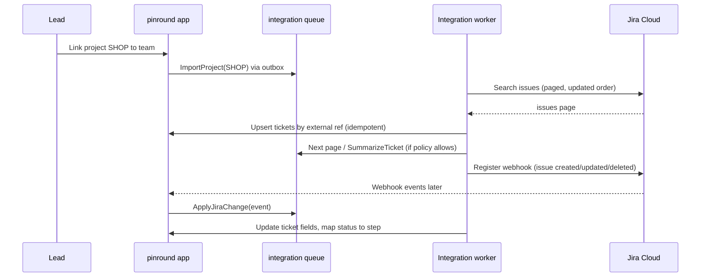

# Integrations

How pinround connects to Jira, company login, email, the browser capture extension and Claude Code.

## Index

- [Why integrations, and the one rule](#why-integrations-and-the-one-rule) — the scene and the source-of-truth rule.
- [Jira](#jira) — connect, import, webhooks, status mapping, sync back, conflicts, limits.
- [Company login (OIDC SSO)](#company-login-oidc-sso) — Microsoft Entra, Google, any OIDC provider.
- [Email](#email) — invites, digests, security notices.
- [Browser capture extension](#browser-capture-extension) — Chrome MV3, personal access tokens.
- [Claude Code through MCP](#claude-code-through-mcp) — pointer to the MCP design.
- [Later: Slack and Microsoft Teams](#later-slack-and-microsoft-teams) — what we expect to add.
- [Shared mechanics](#shared-mechanics) — external refs, idempotency, retries, secrets.

## Why integrations, and the one rule

Lena's team has years of tickets in Jira. They want to try pinround without moving everything on day one. So Lena links two Jira projects. pinround imports the open tickets, keeps them in sync, and sends status changes back. Lena's manager still sees the Jira board for now.

The one rule: **pinround owns what is made in pinround** (rounds, pins, verdicts, questions, pings, AI summaries, check reasons). Jira owns its own fields. For the fields both sides share (title, description, status, assignee, priority), the last change wins per field, and every conflict is logged. See [ADR-0025](../03-adr/0025-jira-integration.md).

## Jira

### Connect

- Admin → Connections → Jira. Preferred: OAuth 2.0 (3LO) for Jira Cloud. Fallback: an API token with an email address.
- The base URL must be `https` and match `*.atlassian.net` or `api.atlassian.com`. All calls use the guarded outbound HTTP client (private, loopback and link-local addresses refused at connect time, no redirects) — see [security.md › Outbound requests (SSRF)](security.md#outbound-requests-ssrf).
- Tokens are stored with field encryption ([ADR-0027](../03-adr/0027-secrets-and-encryption.md)).
- After connecting, a lead links Jira projects to a team (Team page → Projects → "Add project", with search).

### Import



- Paged import with a cursor stored in `int_sync_state`, so a crash resumes where it stopped.
- Each ticket gets an `external_ref(entity = ticket, system = jira, external_id = issue id, version = updated timestamp)`.
- Jira user accounts are matched to pinround users by email (when Jira exposes it) or by a manual mapping table. Unknown people show as names without accounts.
- Jira descriptions (Atlassian Document Format) are converted to safe Markdown. Verify the current Jira REST API version and fields at implementation time.

### Webhooks

- Endpoint per connection: `/integrations/jira/{connectionId}/webhook`.
- Authenticity: shared secret or signature, depending on what Jira Cloud offers for the chosen registration method (verify at implementation). Unknown connections and bad signatures get `404`, no detail.
- The webhook is a **trigger only**. The handler stores the issue key and event type and queues it. The worker re-fetches the issue over the REST API with the connection's own credentials and applies that; the webhook body is never trusted. A forged webhook can at most cause one extra fetch.
- `connectionId` is resolved through the `resolve_jira_connection` resolver function, because the tenant is not known yet ([data-model.md › Row-level security](data-model.md#row-level-security)).
- Issues with a Jira security level, or whose text matches the security word list, are imported with `visibility = 'team'`.
- Replays are harmless: we compare `version` and skip older or equal events.

### Status mapping

- Admin → Connections shows a table: Jira status → pinround step (and its group). Defaults are suggested by name ("In Progress" → In progress).
- Unmapped statuses go to a "needs mapping" list and keep the ticket's current step.
- The mapping is data (`int_status_mapping`), never code.

### Sync back

- When a ticket moves in pinround, an outbox event `TicketMoved` leads to a `PushJiraTransition` job.
- The worker finds a Jira transition that reaches the mapped status. If none exists, it logs a sync problem and shows a small note on the ticket ("Could not update Jira: no transition to Testing").
- Comments made in pinround are **not** sent to Jira by default (they may contain pins and private context). Admin can turn "copy comments to Jira" on later.

### Conflicts

- Per field, last writer wins, using Jira's `updated` timestamp vs our `updated_at`.
- Every overwrite is written to the ticket's activity: "Title changed in Jira by Raj".
- If the same field changed on both sides within 60 seconds, we keep the Jira value and add an activity note. People can fix it by hand.

### Rate limits and errors

- One worker lane per connection, with a token bucket (RateLimiter). On HTTP 429 we respect `Retry-After`.
- Retries with exponential backoff, then the failure transport and an admin notice ("Jira sync paused: token expired").
- Admin sees last sync time and errors in Connections.

## Company login (OIDC SSO)

- OpenID Connect, Authorization Code flow with PKCE, `state` and `nonce` checked.
- Providers: Microsoft Entra ID and Google Workspace as presets; any OIDC provider by discovery URL (fetched through the guarded outbound client, `https` only).
- **Identity key:** SSO identities are stored and found by `(provider_config_id, iss, sub)`. pinround **never auto-links an SSO login to an existing account by email** — an org admin controls their IdP and could otherwise claim anyone's email. Linking to an existing account needs that account's password + MFA. For Entra, `email` and `upn` claims are not used as identity.
- **Org scope:** a session opened through org X's provider opens only org X memberships.
- **Allowed domains:** first login of an invited person, or of someone in an allowed domain, creates a **new** account. A domain counts as allowed only after DNS TXT proof. Unknown people get "Ask your admin to invite you".
- The provider is found before the tenant is known through `resolve_sso_provider` ([data-model.md › Row-level security](data-model.md#row-level-security)). See [security.md › Single sign-on safety](security.md#single-sign-on-safety).
- When SSO is on, admins can require it for everyone except a break-glass admin account with MFA.
- Group-to-role sync (for example an Entra group → Manager) is a later option, not day one.
- Implementation library: a maintained OAuth2/OIDC client for Symfony; choose and verify in phase 10. See [ADR-0012](../03-adr/0012-authentication.md).

## Email

- Symfony Mailer with an SMTP or API transport set per environment (Mailpit in development).
- Sent mails: invites, password reset, MFA changes, role changes (to other admins), daily or hourly digest of pings and questions (per user setting), export ready, quota and budget notices.
- No ticket text in emails by default: subject and body name the ticket key and title only if the ticket is not restricted, plus a link. Restricted tickets: "You have a new question on a restricted ticket."
- Sent through the `notify` queue. Bounces are recorded to stop sending to dead addresses.

## Browser capture extension

- Chrome Manifest V3 extension (phase 10). Later Firefox and Edge (Edge runs Chrome extensions).
- The person signs in once by creating a personal access token with scope `rounds:write` in pinround, and pastes it (or uses a short device-code style pairing page; decide in phase 10).
- Flow: capture the visible tab → ask pinround for an upload intent → upload with the presigned URL → open "Report a problem" (or a draft round) with the media attached.
- The extension only talks to the configured pinround address. CORS on the API allows the extension origin only.
- See [media-pipeline.md](media-pipeline.md#other-inputs).

## Claude Code through MCP

Claude Code connects to pinround's MCP server over HTTPS with a personal access token. It can list your tickets, read round notes, add screenshots and set verdicts in your draft round. The design lives in [ADR-0021](../03-adr/0021-mcp-server.md) and [ai-architecture.md](ai-architecture.md). Example setup (verify the exact flags in the Claude Code docs at implementation time):

```bash
claude mcp add --transport http pinround https://pinround.example.com/mcp \
  --header "Authorization: Bearer pr_xxxxxxxx"
```

## Later: Slack and Microsoft Teams

- Deliver pings and questions to a chat app as a notification channel, with a link back. No ticket text for restricted tickets.
- Built on the Notification module's channel interface ([realtime-and-notifications.md](realtime-and-notifications.md)), so it adds a channel, not a new flow.

## Shared mechanics

- **External refs:** one table `int_external_ref(organization_id, entity, entity_id, system, external_id, version)` with a unique index on `(organization_id, system, external_id)`.
- **Idempotency:** every inbound event and job has a key; handlers check and skip duplicates.
- **Queues:** all integration work runs on the `integration` transport, isolated from notifications and AI.
- **Secrets:** field-encrypted, never logged, rotated on reconnect.
- **Audit:** connect, disconnect, mapping changes and project links are audit events ([ADR-0026](../03-adr/0026-audit-log.md)).
