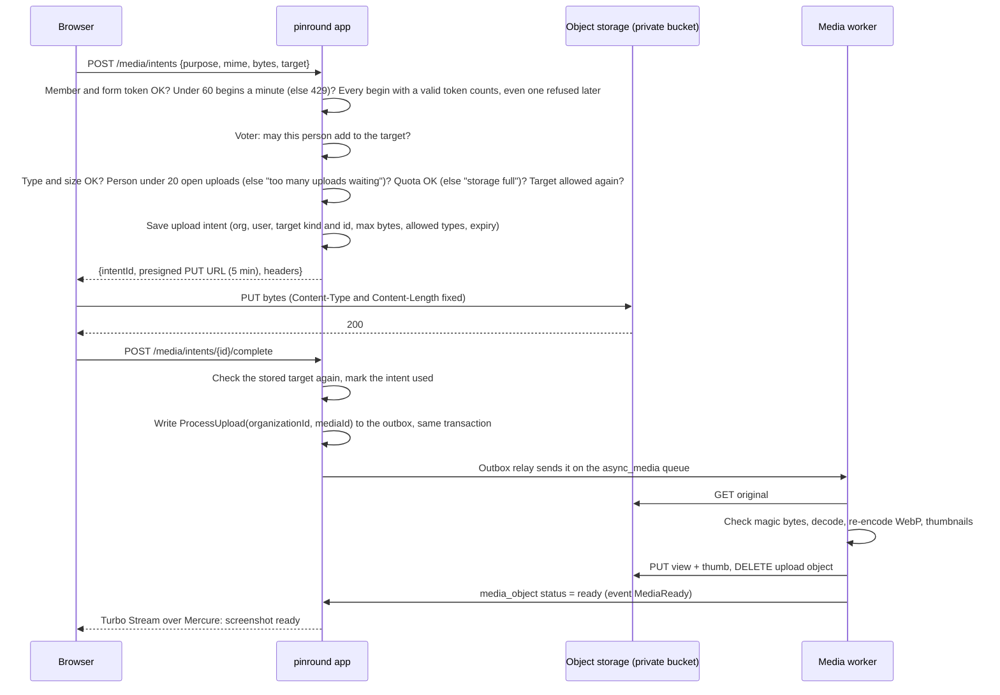

# Media pipeline

How screenshots get from a person's screen into pinround safely, and how they are stored, shown and deleted.

## Index

- [Why screenshots need their own pipeline](#why-screenshots-need-their-own-pipeline) — the scene.
- [Upload flow](#upload-flow) — presigned PUT, sequence diagram.
- [Upload status](#upload-status) — `GET /media/{id}/status`: who may read it, how the form polls.
- [Validation rules](#validation-rules) — checks before the presigned URL (with what the URL pins) and checks in the worker.
- [Processing worker](#processing-worker) — verify, re-encode, thumbnails; how the `vips` tool runs.
- [Storage key layout](#storage-key-layout) — where each file lives.
- [Serving images](#serving-images) — signed URLs after a voter check.
- [Deduplication](#deduplication) — same image twice in one org.
- [Quotas](#quotas) — per org limits.
- [Retention and lifecycle](#retention-and-lifecycle) — deleting old images.
- [Failure handling](#failure-handling) — what the person sees when something breaks.
- [Other inputs](#other-inputs) — browser capture extension, Claude Code via MCP.
- [Pin coordinate model](#pin-coordinate-model) — why pins survive resizing.

## Why screenshots need their own pipeline

Mia drags a 6 MB PNG of the invoice screen into a report. She expects it to show up in a second, with her pins on the right numbers. Lena opens the ticket a week later on a small laptop and the pins still point at the right numbers. Nobody outside Acme Foods can ever open that image, even with the link.

To get there, images never pass through PHP request memory, every image is re-encoded before anyone sees it, and every view needs a fresh, short-lived permission. See [ADR-0011](../03-adr/0011-screenshot-storage-and-processing.md).

## Upload flow



The browser shows a local preview at once (from the file it already has), so the person can start placing pins while processing runs. Pins are saved against the media id and do not depend on processing.

## Upload status

`GET /media/{id}/status` answers `{"status": "pending" | "ready" | "rejected"}` with `Cache-Control: no-store`, for a form that waits for its screenshot (P05.T5). Only a member of the organization who uploaded that picture (`med_object.uploaded_by`) may read it, decided by `UploadStateVoter` (`MediaPermission::VIEW_UPLOAD_STATE` on an `UploadedMediaId`, deny by default; `statesOf` filters by uploader again): a person with no organization context, a malformed id, an unknown one, another person's and another organization's all answer 404 "Nothing you uploaded has that id.", so the answer does not tell them apart. A logged-out visitor is sent to `/login`. No form token: it is a GET with no side effect. A person may poll 120 times a minute (`media_upload_status_per_user`, per user id); past that the answer is 429 with `Retry-After`. Behind it is `Media\Api\UploadedMedia::statesOf(OrganizationId, UserId, list<string>)`: one query, at most 50 ids.

The `presigned-upload` controller polls it once a second after `complete`, at most 15 times (15 s). `ready` sets `data-media-state="ready"` on the field and fires `presigned-upload:ready`; `rejected` shows "We could not process this image. Try again.", empties the hidden media id and fires `presigned-upload:rejected` (`detail: { mediaId }`); after 15 polls still pending it fires `presigned-upload:still-processing` (`detail: { mediaId }`) and keeps the id, with no text of its own: the form that listens shows "Still processing your screenshot. Try again in a moment." when the server refuses a submit with a pending picture. A poll that fails or is refused (offline, 404, 429) shows nothing and counts as pending; the next one asks again.

## Validation rules

Before the presigned URL:

In this order:

- The caller is a member of the organization and sends a valid form token.
- A per-person rate limit on starting uploads: 60 a minute, then 429 with a Retry-After header. It is spent right after the member and token checks, before the body is read or anything else is asked, so every begin with a valid token counts, even one refused later.
- The person may add a screenshot to this round or report (voter).
- MIME declared as `image/png`, `image/jpeg` or `image/webp`.
- Size ≤ 15 MB.
- The person has fewer than 20 open (unused, unexpired) intents. This and the quota check run under one per-org lock.
- The org is under its quota (skipped when the quota is unlimited): stored images plus open upload intents, counted in one statement.
- The target's authorizer allows it again, inside the same transaction.
- **Upload URL:** the presigned PUT pins the declared `Content-Type` and the exact `Content-Length`, so the storage refuses any other type or length.

In the worker:

- **Size first:** the worker does a `HEAD` on the upload object and checks its size against the intent's `max_bytes`. If it is bigger, the object is deleted and the `MediaObject` is rejected (`MediaObject::reject`). The intent itself has no rejected state; it only records the limits and whether it was used.
- Magic bytes must match a PNG, JPEG or WebP signature.
- **Dimensions from the header, before decoding:** width × height ≤ 40 megapixels is read from the image header (libvips header-only load). Only then is the image decoded fully. This stops decompression bombs before they use memory.
- libvips must then decode it fully.
- Animated images are refused.
- Optional: ClamAV scan of the original (org setting; required for SaaS later if contracts need it).

## Processing worker

Runs on the `media` transport ([ADR-0009](../03-adr/0009-async-messaging-and-outbox.md)).

1. `HEAD` the upload object and check its size against the intent's `max_bytes` (delete it and reject the `MediaObject` if too big).
2. Download it to a temp file (limited size) and validate (see above; header dimensions before full decode).
3. Re-encode with libvips to WebP:
   - `view`: max 1920 px wide, quality ≈ 85.
   - `thumb`: max 480 px wide, quality ≈ 75.
   - Re-encoding drops EXIF, GPS, ICC oddities and any data hidden after the image (polyglots).
4. Compute `sha256` of the re-encoded `view` for deduplication.
5. Store variants, write `med_object` (`status = ready`, width, height, bytes, variants JSON).
6. Delete the upload object.
7. Publish `MediaReady` (outbox) so Review can update the round and Notification can push the change.

**How libvips runs:** `VipsImageEncoder` runs the `vips` command-line tool (Debian bookworm's `libvips-tools`, pinned to `8.14.1-*` in the Dockerfile's base stage) through `symfony/process`, with an argument list and never a shell string. This needs no FFI extension, no PECL extension and no new Composer package, and a crash or a runaway decode stays in a child process. The child inherits only `PATH`, `HOME`, `TMPDIR` and `LANG`: every other variable of the worker (database URLs, the storage secret, the encryption keys) is withheld. Per upload, in a new directory only the worker's user can open (0700), deleted when the encoder returns:

- `vips pngload|jpegload|webpload <original> decoded.v --fail-on error`: the loader of the format the signature showed, and no other, decodes the whole file; a file cut short or broken fails. Bytes after the image data (a polyglot's tail) are never read.
- `vips thumbnail decoded.v view.webp[strip,Q=85] 1920 --height 16383 --size down --export-profile srgb`, and the same with `thumb.webp[strip,Q=75] 480`: scaled down to fit 1920 (or 480) px wide and 16,383 px high, never up, aspect ratio kept, turned upright by its orientation tag and made sRGB. The height cap is WebP's largest side (14 bits): `UploadPolicy` allows 16,384 px, and `webpsave` refuses a picture of 16,384 px ("image too large"), so a 600 × 16,384 picture becomes a 600 × 16,383 view.
- libvips 8.14 writes an EXIF chunk into a WebP even with `strip`, so the encoder keeps only the picture chunks (`VP8X`, `VP8 `, `VP8L`, `ALPH`) and clears the ICC, EXIF and XMP flags of `VP8X`; its other flags (alpha) stay. Width and height come from the result's header.
- Each run has a 30 s timeout. How a run ends decides what happens to the object:

| vips ends with | Result | Object |
|---|---|---|
| exit code 0 and a WebP variant | the variant | ready |
| any exit code other than 0, 126 and 127 (vips refuses with 1) | `UndecodableImage` | rejected as unreadable |
| a crash signal: SIGILL, SIGABRT, SIGBUS, SIGFPE or SIGSEGV | `UndecodableImage` | rejected as unreadable |
| the 30 s timeout | `UndecodableImage` | rejected as unreadable |
| exit code 0 and no variant, or an empty one | `UndecodableImage` | rejected as unreadable |
| exit code 126 or 127, or no process could be started | `RuntimeException` | pending; the message is retried |
| any other signal (SIGKILL from the OOM killer, SIGTERM) | `RuntimeException` | pending; the message is retried |
| exit code 0 and a variant that is no WebP container | `RuntimeException` | pending; the message is retried |

**What the package brings:** `libvips-tools` with `--no-install-recommends` still pulls every loader libvips 8.14 is built with (171 packages in its dependency tree, many already in the base image): ImageMagick 6 (`libmagickcore-6.q16-6`), librsvg, poppler, OpenSlide, libheif, libjxl, matio, cfitsio, OpenEXR, libtiff and libgsf among them. They are accepted: the encoder names its loader (`pngload`, `jpegload` or `webpload`) for the original and reads only its own `.v` file after that, so no other loader is ever given an upload. `VIPS_BLOCK_UNTRUSTED` cannot shut them off in 8.14, because it blocks `vipsload` too.

Tests: `tests/Unit/Media/Infrastructure/Processing/VipsImageEncoderTest.php` runs the encoder against a stand-in for the tool; `tests/Integration/Media/Processing/VipsImageEncoderTest.php` (group `libvips`) runs the real tool and is skipped where `vips` is not on the PATH. CI's `build` job runs that group in a container of the dev image, with `--fail-on-skipped` (step "Run the libvips tests in the app image"); the `integration` job excludes it. Time per image (the p95 ≤ 10 s target for a 15 MB image) is not measured yet.

## Storage key layout

```text
uploads/{orgId}/{intentId}                      # temporary, deleted after processing (lifecycle rule: 1 day)
media/{orgId}/{yyyy}/{mm}/{mediaId}/view.webp
media/{orgId}/{yyyy}/{mm}/{mediaId}/thumb.webp
exports/{orgId}/{exportId}.zip                   # org exports, lifecycle rule: 7 days
```

- `mediaId` is a UUIDv7 and is not guessable. Knowing a key alone is still useless, because the bucket is private.
- The org id prefix lets us apply per-org lifecycle rules and delete one org's data completely.

## Serving images

- The page asks `SignedUrls::forVariants` for signed GET URLs **after** the caller's voter confirms the viewer may see the round or ticket; Media itself takes no user.
- A URL works 5 minutes from its signing time, which is rounded down to the minute, so it works at least 4 minutes and renders in one minute give the same URL; it asks for `Cache-Control: private, max-age=240, immutable`. The caller signs a whole page of pictures with one `SignedUrls::forVariants` call ([ADR-0041](../03-adr/0041-sign-page-images-at-render-time.md)). Pages that stay open refresh URLs through a small endpoint when an image fails to load.
- Response headers are set through the signed URL parameters where the storage supports them (`response-content-type`, `response-content-disposition`), plus bucket defaults: `X-Content-Type-Options: nosniff`.
- The app never proxies image bytes through PHP.
- Draft round images use the same rules: the voter only allows the owner until the round is shared ([ADR-0017](../03-adr/0017-private-draft-rounds.md)).

## Deduplication

- Key: `(organization_id, sha256)` of the re-encoded `view`.
- If the same image already exists in the org, the new `med_object` points to the existing variants (reference count), and the duplicate files are deleted.
- Never across orgs: the same image in two companies is stored twice. This keeps deletion and isolation simple.

## Quotas

- Default per org: 50 GB for SaaS; unlimited for self-host (set by the operator).
- Per upload: 15 MB. Per round: 50 screenshots.
- At 80% the admins get a notice; at 100% new uploads are refused with a plain message and a link to the Data settings.

## Retention and lifecycle

- Org setting "Keep data": 1 year / 2 years / always (Admin → Data).
- A scheduled job finds tickets closed longer than the retention period, deletes their rounds, pins and media objects, then deletes the files. The audit log records counts, not names.
- Bucket lifecycle rules clean `uploads/` (1 day) and `exports/` (7 days).
- Bucket versioning is on for disaster recovery ([operations.md](operations.md#backups)). Deleted versions expire after 30 days, so retention deletes really finish within a known time.

## Failure handling

| Failure | What the person sees | What the system does |
|---|---|---|
| Upload interrupted | "Upload stopped. Try again." with a retry button | Intent expires after 1 day |
| File rejected (type, size, not an image) | "This file is not a PNG, JPEG or WebP screenshot." | Upload object deleted, intent `rejected` with reason |
| Processing failed (worker error) | Spinner turns into "We could not process this image. Try again." | Messenger retries 3 times with backoff, then failure transport + alert |
| Signed URL expired on an open page | Image reloads automatically | Browser requests a new URL |
| Quota full | "Your company's storage is full. Ask your admin." (422) | Nothing stored. Admin notice not built yet |
| Too many uploads waiting (20 open) | "You have too many uploads waiting. Finish or wait for them, then try again." (422) | Nothing stored |
| Starting uploads too fast | "You are adding files too fast. Wait a minute and try again." (429) | Nothing stored |

## Other inputs

- **Browser capture extension** (phase 10): takes a screenshot of the current tab, asks pinround for an upload intent with a personal access token (`rounds:write`), uploads with the presigned URL, then opens the report form with the media id attached. Same validation and processing.
- **Claude Code through MCP** (phase 9): the `add_screenshot` tool never takes image bytes. The client first gets an upload intent (presigned PUT), uploads the file to storage, then calls `add_screenshot` with the `upload_id`. The server runs the same validation and processing. MCP request bodies stay ≤ 1 MB. See [ai-architecture.md](ai-architecture.md) and [ADR-0021](../03-adr/0021-mcp-server.md).

## Pin coordinate model

- A pin stores `x_pct` and `y_pct` as decimal percentages (0–100, two decimals) of the image's width and height, plus a `number` and a `note`.
- The UI places pins over the image with `left: x%; top: y%`, so they stay on the same spot at any display size.
- Because coordinates are relative to the re-encoded image, which keeps the aspect ratio of the original, pins placed on the local preview before processing finishes are still correct.
- Pin numbers are per screenshot, in order of creation. Deleting a pin does not renumber the others (people refer to "pin 3" in comments).
- The look is not part of the stored model: the UI draws each pin as a hollow ring (dark outer and white inner outline, number in a tab at the ring edge, note in a bubble on hover, focus or select) centred on that point, so the element under it stays readable. See FR-RND-02.
