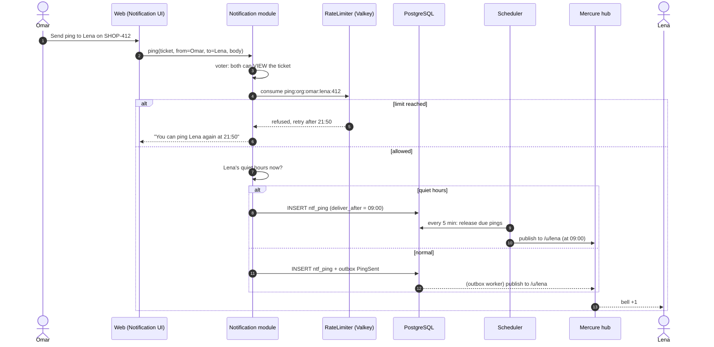
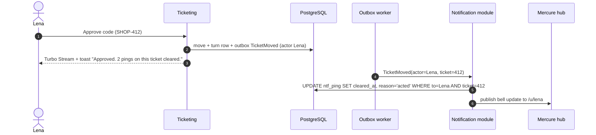
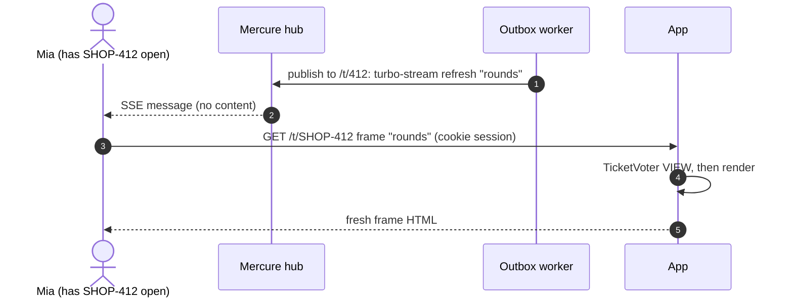

# Real-time updates and notifications

How open pages stay fresh (Mercure), and how pings and notifications are created, limited, grouped, held at night, cleared and emailed.

## Index

- [The story](#the-story) — a ping, a quiet evening, and a ping that clears itself.
- [Principles](#principles) — the rules that keep notifications useful and safe.
- [Mercure topics](#mercure-topics) — topic names, what is pushed, and how access is checked.
- [What is pushed when](#what-is-pushed-when) — the event → push table.
- [Notification kinds](#notification-kinds) — which events notify whom, and when a question notification closes.
- [Ping lifecycle](#ping-lifecycle) — create, rate limit, deliver or hold, group, clear.
- [The bell](#the-bell) — grouping and counts.
- [Email digest](#email-digest) — when email is sent, and what it contains.
- [Sequence diagrams](#sequence-diagrams) — ping with a rate limit and quiet hours, auto-clear, live ticket update.
- [Settings and storage](#settings-and-storage) — admin settings, tables, retention.
- [Failure handling](#failure-handling) — what happens when Mercure or email is down.

## The story

Omar pings Lena at 17:50: "Code review is ready when you are." Lena gets one notification, and her bell shows "Omar · pinged you". At 17:55 Omar tries again. pinround says: "You can ping Lena again at 21:50." At 18:30 Mia pings Lena about another ticket. Quiet hours have started, so the ping waits and arrives at 09:00. The next morning Lena approves Omar's code. Omar's ping disappears from her bell by itself, because she acted on that ticket.

No spam, no stale pings, and nobody has to clear the bell by hand.

## Principles

1. **The Home page is the to-do list; the bell is for people.** The bell shows pings and the few events where a person asked something of you. Home shows all your work.
2. **One notification per real event.** A question sends one notification. Moves notify only the person whose turn it becomes.
3. **Limits are kept on the server.**
   - One ping per sender, per recipient, per ticket, per N hours (the admin chooses 1, 4, 8 or 24).
   - Quiet hours hold every bell row made from 18:00 to 09:00 in the recipient's time zone (a ping, a question, an answer, a reply or an assignment) until 09:00. The row is created at that time, and its push goes out only when the release job releases it.
4. **Pings clear themselves** when the recipient acts on that ticket (admin switch "auto-clear", on by default).
5. **Never push what the viewer may not see.** Pushes carry either per-user content or a content-free "refresh" signal ([ADR-0023](../03-adr/0023-realtime-mercure.md)).
6. **Mutes win.** A user who mutes a ticket in My reports gets no notifications or emails about it. It still shows in their lists.

## Mercure topics

The Mercure hub is built into FrankenPHP ([ADR-0008](../03-adr/0008-frankenphp-runtime.md)). All topics are **private**: a subscriber needs a JWT that lists the topics it may read. That JWT is a short-lived (**10 minutes**) HttpOnly cookie, scoped to the hub path. Rendering a page sets no cookie: the `live-updates` Stimulus controller asks `POST /realtime/token` for it before every connect (the first one and each reopen after a dropped or refused stream, after a step of 5 s doubling to at most 60 s, each wait a random time between half the step and the whole so tabs do not all reconnect at once after a hub restart), and again every 8 minutes. All tabs of a browser share that one cookie and the hub reads it only as a stream connects, so a tab holds the Web Lock `pinround-live-updates-cookie` from its ask until its stream has connected (the ask and the connect each give up after 5 s, so at most 10 s); no other tab's ask, for other topics, lands in between. Each call checks the session, the current memberships and the asked tickets again, so after logout or removal from the org, renewal fails and the subscription stops within 10 minutes.

| Topic (URI template) | Who may subscribe | Payload |
|---|---|---|
| `https://pinround.app/o/{orgId}/u/{userId}` | only that user | Turbo Streams with content for that user: bell count and items, Home section refresh, toasts, "AI suggestion ready" |
| `https://pinround.app/o/{orgId}/t/{ticketId}` | users the TicketVoter allowed to VIEW the ticket when the page was rendered | **No content.** Only `<turbo-stream action="refresh">`, or "reload frame X". The browser then fetches the frame through normal HTTP, so the voter runs again |
| `https://pinround.app/o/{orgId}/admin` | org admins | Admin-only signals (for example "export ready") |
| `https://pinround.app/o/{orgId}/team/{teamId}/lists` | members of that team (and managers/admins) | **No content.** "Something changed in this team's lists" signal; never used for team-only tickets ([ADR-0023](../03-adr/0023-realtime-mercure.md)) |

Why the ticket topic carries no content:

- If Lena loses access (the visibility changes to "team"), her subscription token may still be valid for up to 10 minutes. But she only ever receives "refresh", and the refresh request is checked again and denied.
- Without this rule, a content push could leak data in that window.

Implementation notes:

- Publishing happens in outbox handlers (workers), never inside the web request.
- Use Symfony's Mercure component and UX Turbo's Mercure stream support. Verify the exact Twig helper and JWT cookie options at implementation.
- **One hub for all app containers.** The hub built into FrankenPHP works for a single app container (self-hosted Compose). With 2 or more app containers (SaaS), each built-in hub would only know its own subscribers, so a publish from one container would miss users connected to another. SaaS therefore runs **one shared hub service** (the standalone Mercure hub, with a transport that supports several instances if it is scaled; verify the options at implementation), and the app containers only publish to it. That one hub serves every organization: each topic starts with its organization (`/o/{organizationId}/…`), so a subscriber reads only the topics its cookie lists.
- **Coalescing.** Ticket and team-list signals are coalesced per topic for about 2 seconds, so 20 quick changes send 1 signal as they start and 1 after them: worker-notify publishes when it takes the lock `realtime-refresh:{ticketId}` (2 s) on the state Valkey, and otherwise queues one delayed try (`RefreshTicketPagesHandler`) that waits until that lock's window ends (its PTTL plus 50 ms, a full 2 s when the store cannot say); the lock `realtime-refresh-trailing:{ticketId}` that keeps a burst to one such try lives only until that try is due, so a change after it published queues the next one, and the last change of a burst shows at most about 2 s after the signal before it. The browser refetches with a random 0–1 s delay (jitter), and only when the page is visible (`document.visibilityState`); a hidden tab refetches once when it becomes visible. A reopened stream gets nothing the hub sent while it was down, so once it opens the page refetches once, as for a signal.
- **Refetches leave flashes alone.** Every fetch a signal sends carries `X-Live-Refresh`, and pages read session flashes only through `page_flashes()` (`SharedKernel\UI\PageFlashes`), which returns none for such a request; so an action's toast or notice flashed before its 303 waits for the redirected page (`PageFlashesTest`, `BaseLayoutToastTest`).
- **What a signal refetches.** The page marks its parts with `data-live-refresh`: a `turbo-frame` with a `src` (the thread) reloads, and any other marked element with an id (the ticket's state, next step, people and activity) is swapped for the element of the same id in a fresh GET of the page. A page with no marks reloads through a Turbo visit. A part with a field being typed in, an open dialog or an open edit form is held, so no text is lost, and is fetched once the hold ends (focus moves, the dialog or the edit form closes); a focused button holds nothing, and its copy in the fresh part takes the focus back (found by the nearest id around it and its place among the controls there with the same tag and label); the comment composer is `data-turbo-permanent`, so a draft survives the thread's reload. The `LiveUpdates` element is `data-turbo-permanent` with an id that follows its subscribe URL: a Turbo visit back to the same ticket keeps the stream and asks for no cookie, and a visit to another ticket opens a new one (`tests/e2e/live-updates.spec.ts`).
- The per-user topic follows the [ticket visibility predicate](data-model.md#ticket-visibility-predicate): content about a team-only ticket is published only to users who pass it at publish time.

## What is pushed when

| Domain event | Pushed to | Push |
|---|---|---|
| TicketMoved, TicketAssigned, TicketChecked, TicketVisibilityChanged | ticket topic; user topics of the old and new turn owners | refresh ticket frames; refresh the Home "needs you" frame for the users whose list changed |
| QuestionAsked / QuestionAnswered | ticket topic; user topic of the asked person (and of the asker on answer) | refresh; bell push; toast "Mia answered your question." on the answer; on the answer the asked person's push follows marking their `question` row done |
| CommentPosted, ReplyPosted, CommentResolved, MessageEdited | ticket topic | refresh the thread frame |
| MessageRemoved | ticket topic; user topic of each person whose `question` or `reply` row about the message it marks done | refresh the thread frame; one bell push per such person, none when nothing was open |
| RoundShared, PinVerdictSet, ChecklistItemChanged | ticket topic; user topic of the next turn owner | refresh the rounds frame |
| PingSent (delivered) / PingCleared | user topic of the recipient | bell push |
| SuggestionReady, SummaryGenerated | user topic of the requester; ticket topic for summaries | refresh the report form or summary frame |
| MediaReady | user topic of the uploader | replace the "processing" placeholder with the thumbnail |

A bell push is a `RefreshBell` on `async_notify`, sent once the notification row (or the clear) commits: worker-notify publishes the new badge, a fresh lazy popover frame that the page loads again through the person's own session, and the toast when there is one. It never carries bell cards, whose forms need that session's CSRF token. A reply or an assignment that adds a bell row pushes the same way, with no toast. A row of any kind held for quiet hours pushes nothing when it is made: its push goes out only when `ReleaseHeldNotifications` releases it, one push per released recipient, with no toast.

A redelivered bell push publishes once: `RefreshBell` is handled under `OnceOnlyHandling` with the handler name `notification.refresh_bell`.

Bell pushes are not grouped per user, because each push can carry its own toast and grouping would drop toasts. A Done on a group sends one push per cleared ping. While the popover is open, the browser does not swap in the push's fresh frame: it reloads the open frame in place on each push (`GET /bell`, focus kept), so a Done on a group costs one small count query, one publish and one popover reload per cleared ping. A push that comes while the popover's first load still runs is swapped in as sent, and its fresh frame loads the cards.

Pushes are hints. If a push is lost, the next page load or frame refresh is still correct, because pages always read from the database.

## Notification kinds

| Kind | Trigger | Recipient | In bell | In email digest |
|---|---|---|---|---|
| `ping` | someone pings you | recipient | yes | yes |
| `question` | QuestionAsked to you | asked person | yes | yes |
| `answer` | QuestionAnswered | asker | yes | no |
| `reply` | ReplyPosted on a message; a shown reply within 120 s of the last one folds into the unread `reply` notification for the same message (a shown one, or a held one whose hold has ended); a reply held for quiet hours folds only into a reply held until the same time, for the whole hold | the message's author | yes | no |
| `assigned` | TicketAssigned to you | assignee | yes | yes |
| `your_turn` | a move makes it your turn to review or test | reviewer / tester | no (Home shows it) | yes, in the "waiting on you" list |
| `check` | a new ticket needs your check | checker | no (Home shows it) | yes |
| `round_shared` | RoundShared on a ticket where you are the tester or the reporter | them | yes | no |
| `closed_duplicate` | your report was closed as a duplicate | reporter | yes | yes |

The actor never notifies themselves. Muted tickets are skipped. For restricted tickets (`visibility = team`), recipients are checked again at delivery time.

A `question` notification closes with its question. When the question is answered (QuestionAnswered) or withdrawn (MessageRemoved), `MarkMessageNotificationsDone` marks done the `question` row about it, and on a withdrawal or a removed comment also the `reply` rows about the message, held rows included, so neither the bell nor the digest lists them once a hold ends. A QuestionAsked handled after its question closed writes no row: `NotifyRecipients` checks `QuestionQueries::isOpen` under the same per-message lock (`Notifications::lockAboutMessage`) that the marking takes, so one of the two always sees the other.

## Ping lifecycle

1. **Create.** The user opens "Ping {name}" on a ticket (person list, or My reports) and edits the suggested text. The Notification module then:
   - checks with the TicketVoter that the sender and the recipient can both VIEW the ticket;
   - checks that the recipient is not the sender;
   - checks that the body is 1–500 characters long.
2. **Rate limit.** A Symfony RateLimiter (storage: Valkey, policy: fixed window of N hours) uses the key `ping:{org}:{from}:{to}:{ticket}`.
   - If the limit is hit, nothing is stored. The sender sees "You can ping Lena again at 21:50."
   - The dialog always says the rule: "Lena gets one notification. You can ping again after 4 hours (set by your admin)."
3. **Deliver or hold.** If quiet hours are on and it is between 18:00 and 09:00 in the recipient's time zone, `deliver_after` is set to the next 09:00. Every 5 minutes a scheduler job (`ReleaseHeldNotifications`) releases the held bell rows that are due and pushes the recipients' bells; the bell already shows a due row on its next read, so the release only adds the push. Otherwise the ping is delivered at once: a `ntf_ping` row, then `PingSent` → push to the recipient's topic.
4. **Group.** The bell groups pings by (sender, ticket): "Omar · 2 pings · SHOP-412", with the newest text shown. Groups are sorted by size, then by age.
5. **Clear.** A ping is cleared when either:
   - the recipient clicks "Done" (`cleared_reason = done`); or
   - auto-clear is on and the recipient acts on that ticket (`cleared_reason = acted`). "Acts" means: any move, comment, reply or answer, verdict, check action or assignment made by the recipient.
   The Notification module listens to those events, where `actorId` = the recipient, and clears all their open pings on that ticket. The toast after the action says so: "Approved. 2 pings on this ticket cleared."
6. **Expire.** Uncleared pings older than 30 days are archived (hidden from the bell, kept for the audit trail).

## The bell

- The badge counts the person's open bell rows in `ntf_notification`: of a bell kind, delivered (`deliver_after` empty or past), not done, with a sender and a ticket the person may still see. A read row stays counted until it is done. The badge shows "99+" above 99; a screen reader hears "Pings, N open".
- The popover is a lazy Turbo frame, `GET /bell`, loaded again on every open. It shows groups (sender + ticket), largest first, each with "Done" and "Open".
- `POST /bell/{senderId}/{ticketId}/done` marks the group's open rows done. A Turbo form gets one Turbo Stream answer that replaces the badge (`#bell-badge`), the popover body and shows the toast "Marked done."; a plain form is sent Home with that toast.
- `POST /bell/{senderId}/{ticketId}/open` marks the group read and goes to the ticket, whose page checks again that the person may see it.
- All three routes need ORG_VIEW (OrganizationVoter) and take the person from the session, never from the URL. A malformed id, a group with nothing open, and another person's group are not found (404) and change nothing; a missing or wrong CSRF token is refused (422). Proven by `BellTest`.
- Home shows the top 3 groups in "Pings for you" and "Show N more", which opens the bell.
- The count is read from `ntf_notification` with indexes that start with `(organization_id, user_id)`. It is cached per user for 60 s (`cache.bell_count`) and invalidated after the commit of every change for that user.

## Email digest

Email is a safety net, not a second inbox.

- **When:** every 15 minutes `QueueDigests` reads the resolver `digest_recipients` (no tenant set, see [data-model.md](data-model.md#row-level-security)) and sends one `SendDigest` per (organization, person) with a `ping` or `question` row that is unread, not done, delivered and at least 1 hour old, with that organization's TenantStamp, to `async_notify`. It sends at most 10,000 a run (`QueueDigests::MAX_DIGESTS_PER_RUN`); past that it logs a warning with the cap only and leaves the rest to a later run, in an order shuffled per run so the same people are not left out every time.
- **Who gets one:** `SendDigestHandler`, in worker-notify under the tenant, sends nothing when the person's last digest is under 3 hours old, when it is their quiet hours (the org's quiet hours on, 18:00–09:00 on their clock; the first run after 09:00 sends it), when nothing new waits, or when they have no address. Each digest lists the items since the previous digest's cover time (send time − 1 hour), so no item is listed twice or falls between two digests.
- **What:** "3 things wait on you in pinround". Only `ping` and `question` rows are listed (FR-PNG-09); the other kinds marked "yes" under [Notification kinds](#notification-kinds) are not in it yet. At most 20 items are listed, newest first, and all are counted ("And N more in pinround."). For each item: the person, the kind, the ticket key, the title, and an absolute link to `/t/{key}`.
  - For restricted tickets the title is replaced with "a restricted ticket in team Shop".
  - Ticket descriptions, comments and AI text are never in emails.
- **Settings:** users will be able to choose "Daily at 09:00" or "Off"; that digest setting is not built yet, so every user gets the 3-hour digest, and the footer links to `/me/profile` without offering to turn it off.
- **How:** the handler first takes the person's digest lock (`Deliveries::lockFor`, a transaction-scoped advisory lock), held until it commits, so a second run, even one just past a slot boundary, waits and then sees the first one's digest; it records the digest in `ntf_delivery` under the 3-hour UTC slot (`digest:<slot start>`), so of two runs in one slot only one sends; the email (`SendEmailMessage`) is dispatched after the bus commits, so a rollback sends nothing, and the Symfony Mailer sends it from worker-notify on `async_notify`, like all app mail ([ADR-0033](../03-adr/0033-valkey-transports-workers-and-outbox-relay.md)).

## Sequence diagrams

**A ping, with a rate limit and quiet hours**

**Auto-clear when the recipient acts**

The toast already knows the count because the web request reads the open pings (one indexed count) before it answers. The actual clearing happens in the handler, so a failure there never breaks the move.

**Live update on an open ticket page**

## Settings and storage

| Setting (org, Admin → Pings) | Values | Default |
|---|---|---|
| Ping limit | 1 h, 4 h, 8 h, 24 h | 4 h |
| Auto-clear | on / off | on |
| Quiet hours (18:00–09:00, recipient's time zone) | on / off | off |

| Setting (user) | Values | Default |
|---|---|---|
| Email digest (not built yet) | Every 3 hours / Daily at 09:00 / Off | Every 3 hours |
| Time zone | IANA name | from the browser at sign-up |

Tables (details in [data-model.md](data-model.md)):

- `ntf_ping`;
- `ntf_notification` (partitioned by month, kept 90 days);
- `ntf_mute`;
- `ntf_delivery` (digest windows sent, for idempotency).

Settings live in `org_settings`.

## Failure handling

| Failure | Effect | Handling |
|---|---|---|
| Mercure hub down | Pages stop getting live updates | Pages still work. Turbo refreshes on navigation. Publishing failures are retried twice, then dropped (pushes are hints). An alert fires on a publish error rate > 5 % for 5 minutes ([operations.md](operations.md)) |
| Valkey down | Rate limits cannot be checked | Pings **fail closed**: "Pings are paused for a moment. Try again soon." Everything else that does not need Valkey keeps working |
| Email provider down | Digests are delayed | The email's `SendEmailMessage` on `async_notify` retries 3 times (1 s, 10 s, 60 s, [ADR-0009](../03-adr/0009-async-messaging-and-outbox.md)), then waits in `failed`. The digest is already recorded in `ntf_delivery`, so the job never sends those items again: retry the message from `failed`. The record stops a second digest in the same slot, but a redelivered `SendEmailMessage` can send the same email twice |
| Outbox backlog | Bell and pushes arrive late | An alert fires when the oldest outbox message is > 60 s old. The workers on `outbox` scale out |
