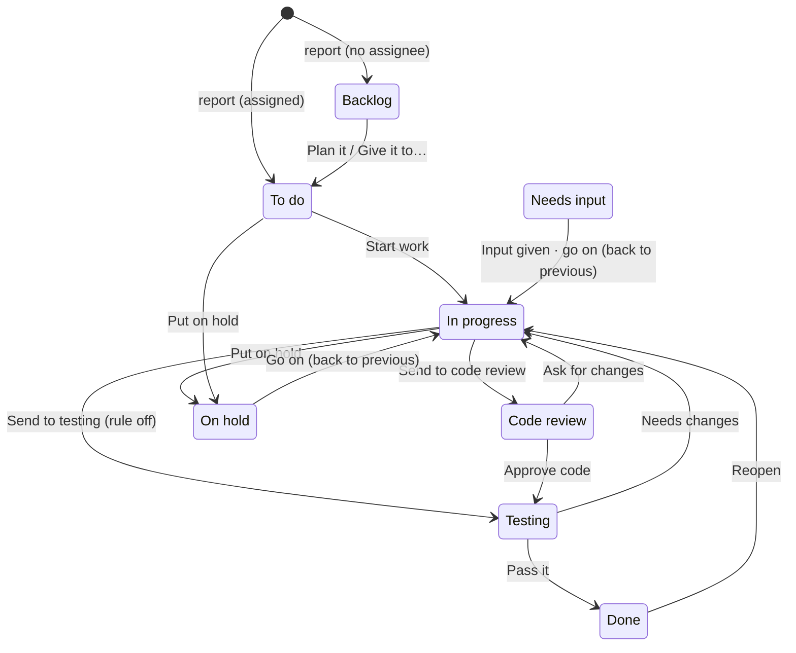

# Workflow engine

How tickets move: the five groups, steps, policies, rules, the verb buttons, whose turn it is, the "Now / Next" sentences, and the needs-you score.

## Index

- [Why verbs, not statuses](#why-verbs-not-statuses) — the problem with status dropdowns, as a story.
- [Five groups and core steps](#five-groups-and-core-steps) — the fixed groups and the eight core steps.
- [Company steps, team steps and the step policy](#company-steps-team-steps-and-the-step-policy) — who may add steps, and where.
- [Rules (guards)](#rules-guards) — the three rules and how they are coded.
- [Transition catalogue](#transition-catalogue) — every verb: from, to, who, guards, side effects, events; which moves close the open shared round.
- [State diagram](#state-diagram) — the core steps and verbs as a picture.
- [Whose turn](#whose-turn) — the exact rules, in order.
- [Now and Next sentences](#now-and-next-sentences) — the exact sentence for each step.
- [Your next step box](#your-next-step-box) — the sentence at the top of the action box.
- [Needs-you kinds and score](#needs-you-kinds-and-score) — how Home orders work.
- [Questions: pause and resume](#questions-pause-and-resume) — how a question stops and restarts a ticket.
- [New tickets and check flags](#new-tickets-and-check-flags) — how check flags change the turn.
- [Jira status mapping](#jira-status-mapping) — how Jira statuses map onto steps.
- [Implementation notes](#implementation-notes) — classes, storage, and why not the Symfony Workflow component.

## Why verbs, not statuses

In most ticket tools, Omar finishes his code and opens a dropdown with fourteen statuses. He is not sure if "Review", "In Review" or "Code Review Phase" is right. He picks one, and nobody gets told.

In pinround, Omar sees one button: **"Send to code review"**. Under the title it says **"Now: Lena reviews the code. Next: Mia tests it."** He does not need to know the status names. The button knows the next step, the rules, and who should hear about it.

## Five groups and core steps

Every step belongs to exactly one of five fixed groups. The groups never change. This is what lets a manager compare teams that use different steps ([ADR-0014](../03-adr/0014-status-model-five-groups.md)).

| Group | Code | Colour token | Meaning |
|---|---|---|---|
| To do | `todo` | `--group-todo` (#6f7976) | Not started |
| Doing | `doing` | `--group-doing` (#006b5f) | Being built |
| Checking | `check` | `--group-check` (#2f6fd6) | Being reviewed or tested |
| Waiting | `wait` | `--group-wait` (#c98a00) | Someone outside the work must act first |
| Done | `done` | `--group-done` (#006c51) | Finished |

The eight core steps exist in every organization and cannot be removed:

| Core code | Name | Group |
|---|---|---|
| `backlog` | Backlog | To do |
| `todo` | To do | To do |
| `progress` | In progress | Doing |
| `review` | Code review | Checking |
| `test` | Testing | Checking |
| `input` | Needs input | Waiting |
| `hold` | On hold | Waiting |
| `done` | Done | Done |

Lists show the groups in this order: Waiting, Checking, Doing, To do, Done. Things that block others come first.

## Company steps, team steps and the step policy

Admins choose one policy for the whole organization (`org_settings.step_policy`):

| Policy | Company steps | Team steps | Rules |
|---|---|---|---|
| `locked` — Admin only | Admin may add | No | Set by admin for everyone |
| `extend` — Company steps plus team steps (default) | Admin may add | Lead may add, inside a group | Set by admin for everyone |
| `team` — Team decides | Admin may add | Lead may add, inside a group | Lead may change the rules for the team |

- A new step needs a name and a group. The group cannot be `done`. Only the core Done step is "done".
- Steps are ordered inside their group by `position`.
- Removing a team step is allowed only when no open ticket is in it. Otherwise the lead must first move those tickets; the UI offers "Move N tickets to …".
- Switching the policy to `locked` hides team steps from new moves. Tickets already in a team step keep it until they move on.
- Managers always see teams in the five groups. Team steps show only when a manager opens "Show this team's own steps".

## Rules (guards)

Three rules exist today. Each is stored per org, and per team under the `team` policy (`wf_rule_set`).

| Rule | Default | Effect | Note shown when it blocks |
|---|---|---|---|
| `tester_moves_done` | on | Only a team member with job "tester" may use Pass it (→ Done). With the rule off, the lead may pass too; in a team without a tester it blocks nobody, as the Testing turn is the lead's | "Team rule: only the tester moves a ticket to Done." |
| `no_self_review` | on | The assignee may not Approve code on their own ticket | "Team rule: nobody approves their own code. Lena reviews it." |
| `review_before_test` | on | In progress → Testing directly is not allowed. "Send to testing" is hidden | "Team rule: code review comes before testing." |

Which rule set applies to a team (built in P02.T3: `Workflow\Api\RuleQueries::rulesFor`, `Infrastructure\Doctrine\DbalRuleQueries`): under the policy `team`, the team's own row when it has one, else the organization's; under `extend` and `locked` always the organization's row, even if the team still has an old row of its own. An organization with no row has all three rules on. Under the policy `locked`, `StepQueries::moveTargetsFor` leaves the team's own steps out of the steps a ticket may be moved to; a ticket already in a team step keeps it.

Each rule is one guard class that implements `Workflow\Application\Transition\Guard` (built in P02.T4: `TesterMovesDone`, `NoSelfReview`, `ReviewBeforeTest`). An open question is not a guard: `QuestionOpenPause`, which no team can turn off, is the pause check the policy runs first, once per ticket, before any verb. Guards are in Application, not Domain, because they read Workflow's Api types:

```php
interface Guard
{
    /**
     * Returns null when allowed, or the plain note when blocked; the note keeps people as ids ("{reviewer} reviews it.").
     * $team is the TeamFacts the turn rules got, so a rule sees the same chosen reviewer and the same testers.
     */
    public function check(TicketState $ticket, Transition $transition, ActorInTeam $actor, RuleSetView $rules, TeamFacts $team): ?RuleNote;
}
```

`ActorInTeam` is the person's team role (lead, member, viewer or none) and job in the ticket's team, plain data; org roles grant no move. What they let the person do (leads the team, moves tickets, is a tester) is `Application\Transition\MoveRights`. A guard is asked also about a person who may not use the verb, so its note can explain the rule to them, as the assignee in code review is told who reviews their code.

New rules are added as new guard classes plus a column in `wf_rule_set`, plus an ADR if they change behaviour for everyone.

## Transition catalogue

"Lead" means the lead of the ticket's team. "Assignee" means the ticket's assignee. "Turn" means the person whose turn it is (see [Whose turn](#whose-turn)).

| Verb (button) | From | To | Who may | Guards | Side effects | Event |
|---|---|---|---|---|---|---|
| Plan it | Backlog | To do | Lead | — | — | TicketMoved |
| Give it to… | To do (no assignee), or Backlog (then also → To do) | same / To do | Lead (also the checker during a check, only while the ticket has no assignee; the route `POST /t/{key}/assign` asks `TicketPermission::ASSIGN`, a lead's only) | Assignee must be the lead or a team member who is not a viewer, and not the assignee now | Person picker sorted by load; notify assignee | From Backlog: TicketAssigned and TicketMoved; in To do: TicketAssigned only |
| Give it to someone else… (the label of give_it_to on an assigned ticket) | To do (assigned) | To do | Lead | same | notify both | TicketAssigned only (no TicketMoved, as the step does not change) |
| Start work | To do (assigned) | In progress | Assignee | — | — | TicketMoved |
| Send to code review | In progress | Code review | Assignee; Lead when nobody is assigned | — | sets reviewer (see below); draft-round dialog ([ADR-0017](../03-adr/0017-private-draft-rounds.md)) | TicketMoved |
| Send to testing | In progress | Testing | Assignee | `review_before_test` must be off (the button is hidden without a note; `check()` refuses with the rule's note) | sets tester; draft-round dialog | TicketMoved |
| Approve code | Code review | Testing | Turn (the reviewer) | `no_self_review` | sets tester | TicketMoved |
| Ask for changes | Code review | In progress | Turn (the reviewer) | — | — | TicketMoved |
| Pass it | Testing | Done | Tester; Lead when `tester_moves_done` is off or the team has no tester | `tester_moves_done` (blocks nobody in a team without testers) | sets `closed_at`; removes the turn row | TicketMoved |
| Needs changes | Testing | In progress | Tester | — | — | TicketMoved |
| Input given · go on | Needs input | previous step (or To do) | Turn, or Lead | — | — | TicketMoved |
| Go on | On hold | previous step (or In progress) | Lead | — | — | TicketMoved |
| Reopen | Done | In progress | Lead, Tester | — | clears `closed_at` | TicketMoved |
| Put on hold | any except On hold and Done | On hold | Lead | — | remembers the previous step | TicketMoved |
| Move on to <next core step> | a company or team step | next core step by group: To do → In progress, Doing → Code review, Checking → Testing, Waiting → previous step (or In progress; the button reads "Move on to the previous step" in the first case) | Assignee, Lead; in a Checking step also the Tester, whose turn it is there | none blocks it: `review_before_test` and `no_self_review` are about other core moves | — | TicketMoved |
| Move to another step… | any | any step of the team | Lead | `review_before_test` blocks In progress → Testing | asks "waiting on whom?" when the target is Needs input | TicketMoved |

Rules for every move:

- **The draft-round question follows the person, not the verb.** Any verb or Move to by someone who owns an undecided draft round with a screenshot on the ticket asks "Share your draft round?" first ([ADR-0017](../03-adr/0017-private-draft-rounds.md)); a give asks nothing. Since [ADR-0044](../03-adr/0044-whose-turn-it-is-may-keep-a-draft-round.md) that owner can be the tester or the reviewer, so "Needs changes" and "Ask for changes" ask too. The Side effects column names it only on the assignee's hand-off verbs.
- **A move can close the open shared round** ([ADR-0048](../03-adr/0048-tries-in-a-draft-and-one-open-round-per-ticket.md)). In the move's transaction, after the ticket is saved and before a share in the same move, `MoveTicket` calls `ShareDraftQuestion::closeRoundsOnMove` with `MoveFacts`: the mover, the assignee, whether the move is lead-only (a verb only the Lead may use, or Move to another step…, from Workflow's `Decision::isLeadOnlyMove`) and whether it was the mover's turn before the move (`TurnRules`). A lead-only move closes no round, whoever makes it. Any other move by the person whose turn it was closes each open shared round of the ticket, except a round that person shared with "Share now"; the assignee's move also closes an open findings round outside their turn. A move by anyone else closes nothing. Because the close comes first, a hand-off that closes the open round may share the mover's draft in the same move as the next number; when a round stays open, the draft question says so and a share in that move is refused with the round's reason, and the move rolls back.
- **No button while a question is open.** The ticket is paused; the box says "Paused until Mia answers the question below."
- **Previous step is remembered** (`tkt_ticket.previous_step_id`, and in the history `tkt_ticket_event.from_step`), so the "go on" verbs return to it.
- **Side effects on every move** (inside the same transaction): reproject the turn row; write `TicketMoved` to the outbox; auto-clear the actor's own pings on this ticket ([realtime-and-notifications.md](realtime-and-notifications.md)); record the move for the activity list.
- **Reviewer choice:** the reviewer is the team lead. If the lead is the assignee, it is the other developer in the team with the fewest open reviews. The reviewer is stored in `tkt_ticket.reviewer_id` and can be changed by the lead.
- **Tester choice:** the team's tester. If the team has several, it is the one with the fewest tickets in Testing. Stored in `tkt_ticket.tester_id`.
- **Fallbacks:** no tester in the team → `tester_id` stays empty and the Testing turn goes to the lead; there `tester_moves_done` blocks nobody, so the lead may Pass it and say Needs changes. The lead is the author and there is no other developer → the lead reviews their own code; this override is written to the ticket history (the "nobody approves their own code" rule is shown as overridden, never silently ignored).
- **When the ids are stored** (since P03.T7): a move whose target is the core Code review step stores `reviewer_id`, and one whose target is the core Testing step stores `tester_id`, both by a verb and by "Move to another step…" (`Ticketing\Application\MoveTicket\MoveTicket` asks Workflow's `Api\TurnPeopleChoice`, `Application\Turn\LoadBasedTurnPeopleChoice`). The person is the one `ReviewerChoice` / `TesterChoice` pick from the same loads the move's turn row is built from, so the stored person, the turn and who may approve agree. Only the first entry stores: a ticket that already has a reviewer or tester keeps it on every later entry (`Ticket::move` only fills an empty id). Nothing is stored for the two fallbacks: on the lead-reviews-own-code override the reviewer stays empty, so each turn refresh writes the note again; with no tester the tester stays empty, so a tester who joins later gets the turn. The lead's change of a stored person is not built yet (expected with P03.T8). Open question: a team or company step in the Checking group stores no tester; there the tester is still re-picked from current loads on every read.
- **Verbs follow the turn:** with no reviewer or tester stored, the verbs ("Reviewer" and "Tester" in the table), `no_self_review`'s note, the turn and the Now and Next sentences all use the same chosen person (`Application\Turn\ReviewerChoice::reviewerOf`, `TesterChoice::testerOf`), so whoever's turn it is in a team gets at least one verb. A person with an open question is the exception by design: the ticket is paused for everyone until they answer.
- **Managers and viewers** see no move buttons: "Managers can read and comment. Only the team moves tickets."
- **Review verdicts never move a ticket** (P05.T7, FR-RND-05). On a review round page the reviewer sets Fixed or Still wrong on each pin of the earlier round (`rvw_pin.verdict`) and Pass, Needs fix or Question, with an optional note, on each screen area (`rvw_area`, [data-model.md](data-model.md#review-and-media)). The ticket's tester (or any tester of its team while none is stored) and the team's lead may set them, while they may view and edit the ticket, never on an unshared draft (`Review\Api\VerdictPermission::SET`, `VerdictVoter`). A verdict writes Review's rows and one Review event (`PinVerdictSet`, `PinVerdictUndone`, `AreaVerdictSaved`) that What happened records; it never calls a move. Once every area has a verdict, the side panel offers the tester the matching next step as a link: any Question → "Ask <lead>" (the question composer addressed to the lead; asking pauses the ticket as every question does); else any Needs fix → "Needs changes on <key>"; else "Pass it on <key>". The two verb links open the ticket's [Your next step box](#your-next-step-box), so the move runs through this catalogue and its guards (`tester_moves_done`) and a person clicks it. The lead may give verdicts but is not offered a move. Proof: `tests/Functional/Review/VerdictControllerTest.php::theMatchingVerbIsOfferedOnlyOnceEveryAreaHasAVerdictAndNeverMovesTheTicket`, `tests/Integration/Review/Verdict/UseCaseVerdictCommandsTest.php`.

The `previous_step_id`, `reviewer_id`, `tester_id`, `waiting_on_user_id` and `waiting_on_label` columns are part of `tkt_ticket` ([data-model.md](data-model.md#ticketing)).

## State diagram

The core steps and the verbs between them. Team and company steps sit inside a group and leave by "Move on to …".



## Whose turn

`TurnRules::turnFor()` is a pure function. Its result is stored in `ins_ticket_turn` ([ADR-0015](../03-adr/0015-turn-read-model.md)). The rules apply **in this order**; the first match wins.

1. **An open question** → the person it was asked to.
2. **A new ticket that needs a check and has no assignee** → the checker (the team lead, or the org triager when there is no team).
3. **Done** → nobody.
4. **Backlog or On hold** → the team lead.
5. **Code review** → the reviewer (never the assignee when `no_self_review` is on).
6. **Testing**, or any other step in the Checking group → the tester.
7. **Needs input** → `waiting_on_user_id` if set, else `waiting_on_label` ("Customer", "Product owner", "Technical owner"), else the reporter.
8. **Anything else** → the assignee, or the team lead when nobody is assigned.

A ticket that needs a check **and** has an assignee keeps the assignee's turn. The checker gets it as an extra "check" item on their Home (`check_user_id`). Both can act at the same time, unless the admin's lead-check rule holds the assignment back (see [New tickets and check flags](#new-tickets-and-check-flags)).

## Now and Next sentences

Below the title, every ticket shows "Now: …" and, when not done, "Next: …". The first name of the person is used (`{f}`); "you" replaces it on the viewer's own items in lists.

**Now:**

| Situation | Sentence |
|---|---|
| Open question | "{to} answers {by}'s question" |
| Needs a check, no assignee | "{checker} takes a quick look at the new ticket" |
| Done | "Done. Nobody needs to act." |
| Backlog | "{f} plans it" |
| To do, assigned | "{f} starts building" |
| To do, not assigned | "{f} picks a developer" |
| In progress | "{f} builds it" |
| Code review | "{f} reviews the code" |
| Testing | "{f} tests it" |
| Needs input | "Waiting for input from {who}" |
| On hold | "{f} decides if it goes on" |
| Team or company step | "{step name} · {f}" |

**Next:**

| Situation | Sentence |
|---|---|
| Open question | "it goes back to {current step name}" |
| Needs a check, no assignee | "{pending assignee} gets it", or "it is planned like any ticket" |
| Backlog, To do | "{assignee or 'a developer'} builds it, {reviewer} reviews, {tester} tests" (without the review part when `review_before_test` is off and there is no reviewer) |
| In progress | "{reviewer} reviews the code, then {tester} tests it" (with the rule off: "{tester} tests it") |
| Code review | "{tester} tests it" |
| Testing | "Done" |
| Needs input, On hold | "it goes back to work" |
| Team or company step | none: the line shows "—", as the step it moves on to is not known until the move |

The status pill shows the step name in the group's colours. While a question is open it shows "Waiting · question to {to}" in the Waiting colours.

## Your next step box

The top line of the action box on the ticket page:

| Situation | Sentence |
|---|---|
| Open question to me | "Answer {by}'s question below." |
| Open question to someone else | "Wait for {to}'s answer. You get one notification." |
| Done | "Nothing. This ticket is done." |
| I am the checker of a new ticket | "Take a quick look at this new ticket." |
| It is my turn | the verb sentence: "Plan it.", "Start building.", "Pick a developer.", "Build it.", "Review {f}'s code.", "Test it.", "Give input.", "Decide: go on or stop." |
| Manager or viewer | "Nothing for you. {Now sentence}." |
| Otherwise | "Nothing for you now. {f}'s turn." |

## Needs-you kinds and score

Home shows the items where it is the viewer's turn, plus the new tickets they must check ([ADR-0015](../03-adr/0015-turn-read-model.md)).

**Kind** (one per item):

| Kind | When | Group title on Home | Start button |
|---|---|---|---|
| `answer` | an open question to me | Questions for you | Answer them one by one |
| `check` | I am the checker of an unchecked new ticket | New tickets to check | Check them |
| `review` | Code review, my turn | Code reviews | Start reviews |
| `test` | Testing, my turn | Tests | Start testing |
| `assign` | To do, no assignee, my turn | Need a developer | Go through them |
| `input` | Needs input, my turn | Your input | Go through them |
| `decide` | On hold, my turn | On hold | Go through them |
| `build` | anything else, my turn | Your building work | Go through them |

Backlog tickets are not "needs you" items. They appear in the list, not on Home.

**Score:**

```text
score = base(kind) + priority(p) + release(r) + min(days_waiting, 60) × 0.5

base:     answer 100 · check 70 (+40 when a check reason is "risk") · review 30 · test 30
          assign 25 · input 20 · decide 15 · build 10
priority: Blocker 50 · Critical 40 · Major 20 · Normal 8 · Minor 3
release:  in the current release 30 · in any release 10 · none 0
days_waiting: days since the turn last changed (ins_ticket_turn.waiting_since)
```

- `base + priority + release` is stored as `base_score`; the time part is added in SQL at read time ([data-model.md](data-model.md#query-patterns)).
- The "current release" is the org's next release by date. Teams set it on the Team page (phase 7).
- Home shows the top 5 with a "Why" line, for example: "Lena is blocked until you answer · Critical · in release 2026.45 · no change for 9 days".
- The rest is grouped by kind, in the order of the table above.
- The "AI ORDER" label means this score. A later AI re-rank may only reorder inside the top 10, and only when the org allows AI.

## Questions: pause and resume

1. Lena asks Mia a question on `SHOP-412` (Conversation: `QuestionAsked`).
2. The ticket's **step does not change**. Insight reprojects the turn to Mia, kind `answer`. The pill shows "Waiting · question to Mia". Move buttons hide.
3. Mia answers, either on the ticket or inline in My reports. The answer is a reply with `is_answer = true`, and it sets `resolved_at` (`QuestionAnswered`).
4. The turn is reprojected from the step again. The ticket is "back" at its step without any move, and "Next" said exactly that: "it goes back to Code review".
5. Only one question can be open per ticket. A second question waits until the first is answered, or the asker withdraws it.

## New tickets and check flags

New tickets are created at once ([ADR-0016](../03-adr/0016-direct-ticket-creation-with-check-flags.md)). Check reasons are computed when the ticket is created:

| Reason | When |
|---|---|
| `dupe` | duplicate candidates were shown and the reporter kept their own ticket |
| `info` | the description is shorter than 40 characters and there are no pins, or the AI says key information is missing |
| `team` | the reporter chose "Not sure" for the team |
| `risk` | security, data-loss or outage words, or the AI says so |
| `rule` | the admin switch "every new ticket needs a lead check" is on |

- **Checker** = the lead of the ticket's team, or the org triager when there is no team.
- **Initial step:** To do when an assignee is given and the `rule` reason is absent; otherwise Backlog.
- **When `rule` is present,** the chosen assignee is stored as `pending_assignee_id`. The ticket is not given to anyone until "Looks fine".
- **Check actions:**
  - Looks fine — sets `checked_at`, applies the pending assignee and → To do;
  - Give it to…;
  - Ask {reporter} for more — a question; available when the reason is `info`;
  - Same problem · close this one — → Done with `closed_as_duplicate_of`, plus a comment on both tickets;
  - Move to team — when the reason is `team`.
- **Security words** set `visibility = team` at creation. Who can then see it is decided by the [ticket visibility predicate](data-model.md#ticket-visibility-predicate) (team, admins, the people working on it incl. the reporter, and the triager while it has no team).

## Jira status mapping

When a team links a Jira project, each Jira status is mapped to one pinround step (`int_status_mapping`). Admins edit the table in Admin → Connections. Defaults for common Jira names:

| Jira status (example) | Step |
|---|---|
| Backlog, Selected for Development | Backlog |
| To Do, Open | To do |
| In Progress | In progress |
| In Review, Code Review | Code review |
| Testing, QA | Testing |
| Waiting for customer, Waiting for input | Needs input |
| On Hold, Blocked | On hold |
| Done, Closed, Resolved | Done |

Unknown statuses map to To do and show a warning in Admin until someone maps them. Outbound moves pick the Jira transition whose target status maps to the new step ([integrations.md](integrations.md), [ADR-0025](../03-adr/0025-jira-integration.md)).

## Implementation notes

- **Why not the Symfony Workflow component?** Its places and transitions are configured statically (YAML/PHP config, compiled into the container). pinround's steps are data, and they differ per organization and team at runtime. So we keep a small engine of our own: transitions are a fixed catalogue of verbs (the table above), steps come from `wf_step`, and guards are classes. This decision is recorded in [ADR-0014](../03-adr/0014-status-model-five-groups.md).
- **Classes:**
  - `Workflow\Application\Transition\CatalogueTransitionPolicy` behind `Workflow\Api\TransitionPolicy` (built in P02.T4 and P02.T5: lists the verbs a person may use and checks one, each with where it goes (`MoveTarget`, from `Domain\MoveSideEffects`), and gives the lead the "Move to another step…" list (`moveChoices`) and its check (`checkMoveTo`), over `Domain\TransitionCatalogue` and the guards; pure, the caller passes `TicketState`, `ActorInTeam`, `RuleQueries::rulesFor` and the `TeamFacts` it gives `TurnRules::turnFor`; in Application, not Domain, per [ADR-0037](../03-adr/0037-transition-engine-in-workflow-application.md));
  - `Workflow\Application\Turn\OrderedTurnRules` behind `Workflow\Api\TurnRules` (pure; `ReviewerChoice` and `TesterChoice` pick the reviewer and tester when none is stored);
  - `Workflow\Application\Turn\PlainNowNext` behind `Workflow\Api\NowNext` and `PlainVerbFor` behind `Workflow\Api\VerbFor` (the sentences above; pure, they return plain strings);
  - `Ticketing\Application\Move\MoveTicketHandler` (loads the ticket, asks the engine, applies the move, projects the turn, writes the event).
- **Tests:** a table-driven unit test per transition × role × rule combination. Two seeded property tests of 1,000 cases each: what the policy offers is what it allows, and whoever the turn rules give the turn to gets at least one verb. A golden test locks the Now/Next sentence for every row of the tables above, so copy changes are deliberate.
- **Concurrency:** moves use the ticket's `version` (optimistic lock). When two people act at once, the second one sees "This ticket changed. Here is the new state." and the page refreshes through Turbo.
