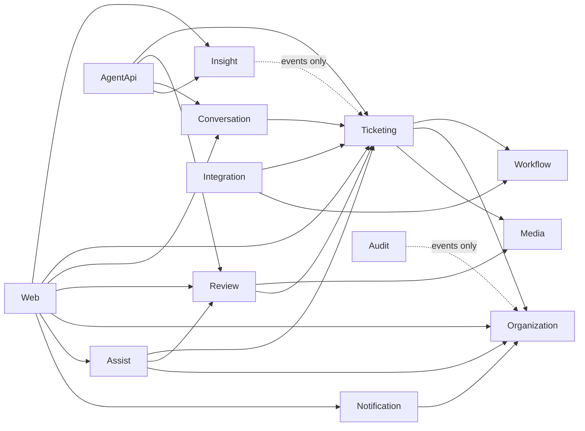

# ADR-0002 — Build pinround as a modular monolith

pinround is one Symfony application split into modules with hard, checked boundaries.

## Index

- [Status](#status) — accepted, date, deciders.
- [Context and problem statement](#context-and-problem-statement) — why the shape of the codebase matters.
- [Decision drivers](#decision-drivers) — team size, deadline, security, scale.
- [Considered options](#considered-options) — microservices, layered monolith, modular monolith.
- [Decision outcome](#decision-outcome) — the module list, the rules, a diagram, consequences.
- [Confirmation](#confirmation) — Deptrac, schema checks, review rules.
- [Pros and cons of the options](#pros-and-cons-of-the-options) — trade-off analysis.
- [Clarifications (2026-11-06)](#clarifications-2026-11-06) — same decision, details made explicit.
- [More information](#more-information) — links and revisit triggers.

## Status

Accepted · 2026-11-06 · Deciders: Zairan Mir (lead) with the team.

Superseded in part by [ADR-0032](0032-module-call-edges-follow-modules-catalogue.md): the "Allowed dependencies" diagram under "Rules" is replaced by the "Depends on" lines in `modules.md`. Everything else here still stands.

## Context and problem statement

Lena's team builds pinround: tickets, rounds with screenshots and pins, pings, AI help,
an MCP server for Claude Code, and a Jira sync. Three people build it, with many short
Claude Code sessions. In a year, Omar wants to change how pings are rate limited without
breaking how tickets move. If everything can call everything, he cannot.

How do we shape the code so it is simple to run today, safe to change for years,
and can grow to the scale in NFR-SCAL (2M tickets, 20M screenshots, 500 req/s peak)?

## Decision drivers

- Team of 3, hackathon deadline 2026-11-22 (C-01, C-02): little time for operations.
- Clear ownership of data, so that security rules (tenancy, visibility) live in one place.
- Fast pages: Home and lists must hit indexed read models, not cross-service calls (NFR-PERF).
- Changes in one area must not break others; Claude Code sessions work on one module at a time.
- A path to split a module out later if one part needs to scale alone.

## Considered options

1. Microservices (one service per area, own database, network calls).
2. Classic layered monolith (Controller / Service / Repository for the whole app).
3. Modular monolith: one app, one database, modules as bounded contexts with public APIs.

## Decision outcome

Chosen option: **modular monolith**, because it gives clear boundaries and data
ownership with the low operating cost of one deployable app and one database.

### Modules

Each module lives in `src/<Module>/` with the folders `Domain`, `Application`,
`Infrastructure`, `UI` and `Api`. Each module owns its tables (fixed table prefix).

| Module | Prefix | Owns |
|---|---|---|
| SharedKernel | — | ids, Clock, TenantContext, event base types |
| Identity | `idn_` | users, credentials, MFA, SSO identities, sessions, API tokens |
| Organization | `org_` | organizations, teams, memberships, roles, invitations, org settings |
| Workflow | `wf_` | steps, groups, policies, rules, transitions |
| Ticketing | `tkt_` | projects, key counters, tickets, assignment, visibility, check flags, summaries |
| Conversation | `cnv_` | comments, questions, replies, resolve |
| Review | `rvw_` | rounds, screenshots, pins, verdicts, checklists, draft rounds |
| Media | `med_` | stored objects, upload intents, variants, signed URLs |
| Notification | `ntf_` | pings, notifications, rate limits, quiet hours, mutes, live push |
| Insight | `ins_` | read models: whose turn, needs-you, workload, my reports, team overview |
| Assist | `ast_` | AI gateway, policy, prompts, summaries, explanations, suggestions |
| Integration | `int_` | Jira connections, mappings, sync, webhooks, external ids |
| Audit | `aud_` | audit events, retention, exports |
| AgentApi | `api_` | REST `/api/v1` and MCP tools (thin adapters) |
| Web | — | layout, navigation, Home composition, Twig components |

### Rules

1. A module may use another module only through that module's `Api` namespace
   (query services, command interfaces, DTOs) or by listening to its domain events.
2. `Domain` depends on nothing outside the module except SharedKernel.
3. No SQL join across module prefixes. A module that needs data from others builds a
   read model from events (this is the job of Insight).
4. One user action = one database transaction in the module that owns the change.
   Side effects in other modules run from outbox events ([ADR-0009](0009-async-messaging-and-outbox.md)).
5. Web and AgentApi hold no business rules. They call module `Api` services.

Allowed dependencies (arrows mean "may call the Api of"):

### Consequences

- Good: one deploy, one database, one transaction per action; easy local setup.
- Good: security rules (tenant scope, visibility) live with the data owner.
- Good: a module can later move to its own service, because its contract is already its `Api`.
- Bad: the rules need discipline and tooling; without Deptrac they rot.
- Bad: read models cost extra writes and code; they can lag slightly when built from async events.
- Neutral: all modules share one PHP version and one release cycle.

## Confirmation

- **Deptrac** runs in CI (`composer deptrac`) with one layer per module and per folder.
  Any call outside the allowed list fails the build.
- A PHPUnit architecture test fails if a Doctrine entity maps a table with another module's prefix.
- A CI script fails if a SQL query in `Infrastructure` names tables from two prefixes
  (string scan on repository classes; exceptions need a comment linking this ADR).
- Code review checklist: "New cross-module call? Is it in the Api namespace?"

## Pros and cons of the options

### Microservices

- Good, because each service scales and deploys on its own.
- Bad, because 3 people would run 10+ services, queues and databases.
- Bad, because every page (Home needs tickets, turns, pings) becomes many network calls; NFR-PERF budgets get hard.
- Bad, because transactions across services need sagas; tenancy checks repeat in every service.

### Classic layered monolith

- Good, because it is the fastest to start.
- Bad, because nothing stops ticket code from reading ping tables directly; boundaries rot within months.
- Bad, because a Claude Code session cannot know what it may touch.

### Modular monolith

- Good, because it is as simple to run as a monolith and as clear as services.
- Good, because Deptrac can check the rules automatically.
- Bad, because a bug in one module can still take down the whole process.

## Clarifications (2026-11-06)

- **One allowed exception to "no cross-module joins":** Insight's query service may join `ins_ticket_turn` with the read-only SQL view `tkt_ticket_list_v` that Ticketing owns and keeps stable ([ADR-0015](0015-turn-read-model.md)). It is a single, named Deptrac rule. Any other cross-module read goes through an `Api` interface or an event-built read model.

## More information

- Module details: [modules.md](../02-architecture/modules.md). Overview: [architecture-overview.md](../02-architecture/architecture-overview.md).
- Revisit when: one module needs more than 50% of CPU at peak, or needs a different release cycle,
  or the team grows above 4 separate teams. Then consider extracting that module only.
