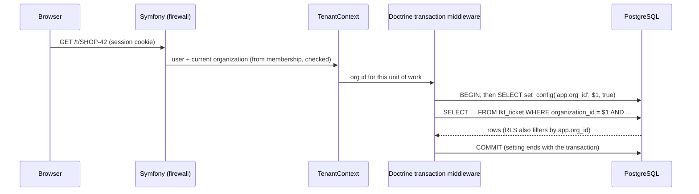

# ADR-0005 — Shared schema multi-tenancy with row-level security

Many organizations share one database; every row is tagged with its organization and the database itself blocks cross-tenant reads.

## Index

- [Status](#status) — accepted, date, deciders.
- [Context and problem statement](#context-and-problem-statement) — why isolation must not depend on memory.
- [Decision drivers](#decision-drivers) — security, cost, scale, self-host.
- [Considered options](#considered-options) — database per tenant, schema per tenant, shared schema.
- [Decision outcome](#decision-outcome) — two walls: Doctrine filter + PostgreSQL RLS; the request flow.
- [Confirmation](#confirmation) — isolation tests and schema checks.
- [Pros and cons of the options](#pros-and-cons-of-the-options) — trade-offs.
- [Clarifications (2026-11-06)](#clarifications-2026-11-06) — exact policy form, resolver functions, partitions, workers.
- [More information](#more-information) — links and revisit triggers.

## Status

Accepted · 2026-11-06 · Deciders: Zairan Mir (lead).

## Context and problem statement

Acme Foods files a ticket about a data leak in their product. Their screenshots show
customer names. On the same pinround server, another company works on its own tickets.
One day Omar writes a new report query and forgets the `WHERE organization_id = …`.
With a single wall, Acme's data would leak. That must be impossible.

How do we serve many organizations cheaply while making cross-tenant leaks
impossible even when a developer makes a mistake?

## Decision drivers

- Sensitive company data, including security bugs (NFR-SEC, NFR-PRIV).
- Isolation must hold even if one query forgets the filter (defense in depth).
- Cost: hundreds of small organizations must share infrastructure (NFR-SCAL: 500 orgs).
- One code base for SaaS and for a self-hosted single organization.
- Simple migrations: one schema to change.

## Considered options

1. Database per tenant.
2. Schema per tenant (one PostgreSQL schema per organization).
3. Shared schema with `organization_id` on every tenant row, a Doctrine filter, and PostgreSQL row-level security.

## Decision outcome

Chosen option: **shared schema with two walls**:

1. **Doctrine SQL filter** adds `organization_id = :org` to every ORM query on tenant entities.
2. **PostgreSQL row-level security** on every tenant table, so even raw SQL cannot read other tenants.

How a request is scoped:

Details:

- Every tenant table has `organization_id uuid NOT NULL`. Every index starts with it.
- RLS on every tenant table:
  `ALTER TABLE … ENABLE ROW LEVEL SECURITY; ALTER TABLE … FORCE ROW LEVEL SECURITY;`
  `CREATE POLICY tenant_isolation ON … USING (organization_id = NULLIF(current_setting('app.org_id', true), '')::uuid) WITH CHECK (organization_id = NULLIF(current_setting('app.org_id', true), '')::uuid);`
- If `app.org_id` is not set, `current_setting(..., true)` returns NULL, or `''` on a pooled connection that used the setting before; `NULLIF(…, '')` turns both into NULL, so no row matches (fail closed). In addition, `TenantContext` throws before any tenant query runs without an org, so the mistake is loud in tests.
- The setting is applied with `SELECT set_config('app.org_id', $1, true)` (transaction-local like `SET LOCAL`, but it takes a bound parameter) inside the transaction that a Doctrine/Messenger
  middleware opens. All reads also run inside a transaction. This is safe with
  PgBouncer transaction pooling and with FrankenPHP worker mode, because nothing outlives the transaction.
- Database roles: `pinround_app` (runtime, `NOBYPASSRLS`, no DDL, no `TRUNCATE`),
  `pinround_migrator` (table owner, DDL, no `BYPASSRLS`; used by migrations and the partition-creation job), `pinround_retention` (`BYPASSRLS` — the only role with it; only the nightly retention job; DELETE/DROP on retention-managed tables), `pinround_readonly` (support, RLS applies).
- Global tables without a tenant (for example `idn_user`, which can belong to several orgs)
  have no RLS. Access to them goes only through the Identity module `Api`.
- Messenger workers set the tenant from the message envelope (a `TenantStamp`), never from global state.
- Cross-tenant jobs (retention purge, metrics) run as a separate, audited command with its own role.

### Consequences

- Good: one schema, one migration path, cheap for many small orgs.
- Good: a forgotten filter returns nothing instead of leaking.
- Bad: every query needs a transaction and a set tenant; tooling must make this automatic.
- Bad: RLS adds a small planner cost; indexes must lead with `organization_id`.
- Bad: one very large tenant shares resources with others (noisy neighbour).
- Neutral: a self-hosted install is just one organization in the same model.

## Confirmation

- **Tenant isolation test suite** (runs in CI): creates two orgs, and for every repository
  and every Api query service asserts that org B data is never returned while org A is set.
- **Schema test**: every table with `organization_id` must have RLS enabled and forced and a
  `tenant_isolation` policy; every index on it must start with `organization_id`.
- **Role test**: `pinround_app` has `rolbypassrls = false` and no DDL rights.
- **Raw SQL test**: running `SELECT count(*) FROM tkt_ticket` without `app.org_id` must fail.

## Pros and cons of the options

### Database per tenant

- Good, because isolation is very strong and noisy neighbours are easy to move.
- Bad, because 500 databases mean 500 migrations, pools and backups.
- Bad, because of high cost per small org.

### Schema per tenant

- Good, because isolation is strong with one server.
- Bad, because migrations run once per schema; catalog bloat at hundreds of schemas.
- Bad, because cross-tenant ops (metrics, purge) get complicated.

### Shared schema + filter + RLS

- Good, because it is cheap and simple to migrate, with two independent walls.
- Bad, because it needs strict tooling and tests to keep every table covered.

## Clarifications (2026-11-06)

These make the decision exact. The decision itself is unchanged.

- **Policy form.** `NULLIF(current_setting('app.org_id', true), '')::uuid`, because a pooled connection returns `''` (not NULL) after an earlier transaction-local setting, and `''::uuid` would raise an error instead of failing closed.
- **Setting the tenant.** `SELECT set_config('app.org_id', $1, true)` as the first statement of each transaction. `SET LOCAL` cannot take a bound parameter. A static check bans `SET app.org_id` without `LOCAL` and `set_config(…, false)`. (Enforced by `bin/check-tenant-setting`, which is stricter: it bans `SET`, `SET LOCAL`, `SET SESSION` and `RESET` of `app.org_id`, any `set_config` for `app.org_id` whose third argument is not `true` (in every file), and any `set_config` for `app.org_id` outside the tenant middleware files, with the name written literally or as `TenantSetting::NAME`. Full rule list in [data-model.md › Row-level security](../02-architecture/data-model.md#row-level-security).)
- **Messenger.** Every handler runs in the `doctrine_transaction` middleware; a pinround middleware reads the `TenantStamp` and sets the tenant at the start of that transaction.
- **Worker mode.** After an exception the EntityManager is reset before the next request or message; a test proves the next request works and has no tenant left over.
- **Lookups before the tenant is known** (PAT by hash, the org picker after login, invite tokens, SSO provider by issuer/domain, the Jira webhook connection id, laptop-AI packages). These never use `BYPASSRLS`. Each is a `SECURITY DEFINER` function owned by a no-login role `pinround_resolver`, with a fixed `search_path`, one exact-key input, returning **ids only**. They are the only RLS exceptions. The list and the tests live in [data-model.md › Row-level security](../02-architecture/data-model.md#row-level-security); a catalog check fails on any `SECURITY DEFINER` function not in that list.
- **Partitioned tables.** Grants and policies are on the parent only; all rights on child partitions are revoked, so nobody can read a partition directly and skip the policy. The schema test walks `pg_inherits` to check this.
- **Search under RLS.** Full-text, trigram and vector operators are not `LEAKPROOF`, so the planner may skip their indexes under RLS. A CI `EXPLAIN` test as `pinround_app` guards this; the fallback is a `SECURITY DEFINER` search function with an explicit org filter ([data-model.md › Query patterns](../02-architecture/data-model.md#query-patterns)).

## More information

- Related: [ADR-0004](0004-postgresql.md), [ADR-0013](0013-authorization.md), [security.md](../02-architecture/security.md).
- Revisit when: one tenant holds more than 20% of all rows or CPU, or a customer needs
  data residency or a dedicated database by contract. Then offer a dedicated deployment of the same image.
