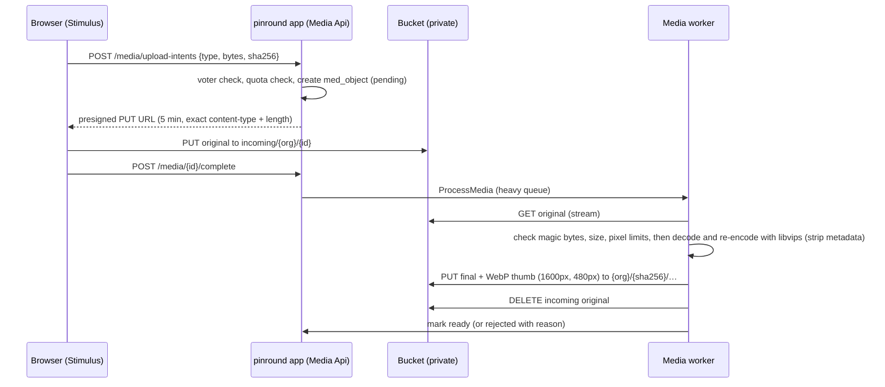

# ADR-0011 — Store screenshots in private object storage, upload directly, process in a worker

Screenshots go straight from the browser to a private S3-compatible bucket, are cleaned by a worker, and are read back only through short-lived signed URLs.

## Index

- [Status](#status) — accepted, date, deciders.
- [Context and problem statement](#context-and-problem-statement) — size, volume, and risk of images.
- [Decision drivers](#decision-drivers) — security, performance, cost.
- [Considered options](#considered-options) — database blobs, local disk via PHP, object storage via PHP, direct upload.
- [Decision outcome](#decision-outcome) — the upload flow, processing, reading, keys, retention.
- [Confirmation](#confirmation) — tests and checks.
- [Pros and cons of the options](#pros-and-cons-of-the-options) — trade-offs.
- [More information](#more-information) — links and revisit triggers.

## Status

Accepted · 2026-11-06 · Deciders: Zairan Mir (lead).

## Context and problem statement

Mia adds a 4 MB screenshot to a report and drops two pins on it. Omar adds six more
screenshots to his draft round from Claude Code. Across all customers this grows to
about 20M screenshots (about 6 TB). Screenshots show customer data, so they are sensitive.
An image file can also be an attack: a "PNG" that is really HTML or a script, an image bomb,
or GPS data in its metadata.

Where do screenshots live, how do they get there, and how are they read safely and fast?

## Decision drivers

- Sensitive content: no public URLs, access checked per request (NFR-SEC, NFR-PRIV).
- Safe files: only real PNG/JPEG/WebP ≤ 15 MB, metadata removed (NFR-SEC).
- Uploads must not tie up PHP workers or memory (NFR-PERF, [ADR-0008](0008-frankenphp-runtime.md)).
- Thumbnail first byte ≤ 150 ms (NFR-PERF); 6 TB at low cost (NFR-SCAL).
- Self-hosted orgs need a free option (MinIO).

## Considered options

1. Store images as blobs in PostgreSQL.
2. Upload through PHP to local disk.
3. Upload through PHP to object storage.
4. Browser uploads directly to private object storage with a presigned URL; a worker checks and processes.

## Decision outcome

Chosen option: **direct presigned upload to a private S3-compatible bucket, then a processing worker**.
Storage access goes through Flysystem (S3 adapter) in the Media module; presigning uses the
AWS SDK for PHP S3 client (verify the exact classes at implementation).

Upload and processing flow:

Processing rules:

- Allowed input: PNG, JPEG, WebP only. Checked by magic bytes, not by name or browser type.
- Limits: ≤ 15 MB file, ≤ 40 megapixels, ≤ 16,384 px per side (stops image bombs).
- Always decode and re-encode with libvips (through a PHP binding or the `vips` CLI; verify at implementation).
  Re-encoding removes EXIF/GPS data and any hidden payload (polyglot files).
- Stored outputs: a full-size WebP (lossless for screenshots under a size threshold, else quality 90)
  and a 480 px thumbnail.
- An optional ClamAV scan hook for orgs that require it.
- The original upload is deleted after processing; we keep only the cleaned files.

Reading:

- Templates never contain bucket URLs. They point to `/media/{id}/{variant}`.
  The app checks the voter ([ADR-0013](0013-authorization.md)) and redirects (302) to a signed GET URL that lives 5 minutes.
  Responses are served with `Content-Type: image/webp`, `Content-Disposition: inline`, `X-Content-Type-Options: nosniff`.
- For speed, the signed URL for a page's thumbnails can be issued in the page render (same check, same 5-minute life).
- Bucket: private, no public ACLs, server-side encryption on, versioning on (for restore), CORS limited to the app origin for PUT.

Keys and retention:

- Keys: `{org_id}/{sha256}/{variant}.webp`. Identical images in one org are stored once.
  Different orgs never share objects. Each upload still gets its own `med_object` row;
  a stored file is deleted only when no `med_object` row of that org points to its key.
- Deletion follows the org's data retention policy ([ADR-0026](0026-audit-log.md)); a lifecycle rule removes incoming files older than 1 day.

### Consequences

- Good: PHP never holds large uploads in memory; uploads scale with the bucket.
- Good: every served image is cleaned and access-checked.
- Good: MinIO for self-host, S3/R2 for SaaS, same code.
- Bad: more moving parts (presign, complete, worker); a screenshot shows as "processing" for a moment.
- Bad: signed URLs can be shared for 5 minutes. Acceptable with the short life; documented.
- Neutral: CDN caching of private images is limited to the signed URL life.

## Confirmation

- Tests: a polyglot file (PNG header + HTML), an oversized image, a 50k × 50k "bomb" and a JPEG with GPS
  must all be rejected or cleaned; output files must have no EXIF.
- Test: a user of another org (or without view rights on the ticket) gets 403/404 for `/media/{id}/thumb`.
- Infrastructure check (P00/P12): the bucket policy denies public access; a CI smoke test tries an unsigned GET and expects 403.
- Monitoring: processing queue age and rejected-upload rate.

## Pros and cons of the options

### Blobs in PostgreSQL

- Good, because there is one store and transactions include images.
- Bad, because 6 TB in the database makes backups, replicas and vacuum slow and costly.

### PHP to local disk

- Good, because it is simple.
- Bad, because it does not work with several app servers, and PHP workers are busy with uploads.

### PHP to object storage

- Good, because storage scales.
- Bad, because every byte passes through PHP memory and workers; slow on big files.

### Direct presigned upload + worker

- Good, because it is fast, scalable, and safe after processing.
- Bad, because the flow is more complex to build and test.

## More information

- Media details: [media-pipeline.md](../02-architecture/media-pipeline.md).
- Revisit when: thumbnail first byte p95 > 150 ms (add a signed CDN in front), or storage cost per org
  passes the plan price (add compression tiers or retention defaults).
