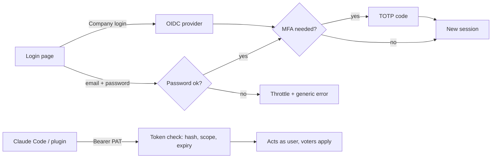

# ADR-0012 — Authentication: password + TOTP MFA + OIDC SSO, server sessions, scoped tokens

People sign in with email and password (with MFA) or with their company login; tools use personal access tokens.

## Index

- [Status](#status) — accepted, date, deciders.
- [Context and problem statement](#context-and-problem-statement) — who signs in and how.
- [Decision drivers](#decision-drivers) — security, ease, tools.
- [Considered options](#considered-options) — password only, SSO only, external identity provider, our mix.
- [Decision outcome](#decision-outcome) — methods, sessions, tokens, throttling, a flow diagram.
- [Confirmation](#confirmation) — tests and checks.
- [Pros and cons of the options](#pros-and-cons-of-the-options) — trade-offs.
- [Clarifications (2026-11-06)](#clarifications-2026-11-06) — SSO account linking, token step-up.
- [Hackathon exception (2026-11-06)](#hackathon-exception-2026-11-06) — admin MFA skipped in the demo build only.
- [More information](#more-information) — links and revisit triggers.

## Status

Accepted · 2026-11-06 · Deciders: Zairan Mir (lead).

## Context and problem statement

Sara, the admin at Acme Foods, wants everyone to use the company Microsoft login.
A small company without SSO wants simple email and password. Omar connects Claude Code
to pinround through MCP; Claude Code cannot click a login page. Admins can change roles
and export all data, so a stolen admin password must not be enough.

How do people and tools prove who they are, safely and simply?

## Decision drivers

- OWASP ASVS 5.0 Level 2 for authentication and sessions (NFR-SEC).
- MFA required for admins (NFR-SEC).
- Company login (OIDC) for orgs that have it; email+password for those that do not.
- Non-interactive access for MCP, the REST API and the browser plugin ([ADR-0021](0021-mcp-server.md)).
- No extra identity service to run for small orgs.

## Considered options

1. Email + password only.
2. SSO only (OIDC/SAML).
3. An external identity server (for example Keycloak) for everything.
4. Built-in: email + password with TOTP MFA, plus OIDC SSO per org, plus personal access tokens.

## Decision outcome

Chosen option: **built-in mix (option 4)**, owned by the Identity module.

Methods:

- **Email + password**: hashed with argon2id via Symfony PasswordHasher (`auto`, which picks
  argon2id or bcrypt; we pin argon2id where available). Minimum 12 characters, no composition rules,
  and an optional check against breached passwords (k-anonymity API; configurable, off for offline installs).
- **TOTP MFA** (RFC 6238, e.g. via `scheb/2fa-bundle`; verify version at implementation): required for org Admins,
  optional for others, an org setting can require it for everyone. 10 single-use recovery codes, hashed.
- **OIDC SSO** per org (Authorization Code flow with PKCE and `state`/`nonce`), Microsoft Entra ID
  and Google first. SSO identities are keyed by `(provider_config_id, iss, sub)` — never by email (see Clarifications).
  When an org turns on "SSO required", password login is disabled for its members (admins keep a break-glass account with MFA).
- **Invitations**: single-use links, 72 hours, bound to the invited email.
- **Personal access tokens** (PAT) for MCP, REST and the browser plugin: random 32 bytes, shown once,
  stored as a SHA-256 hash (with a server pepper) and shown as `pr_…`, with a short prefix for display, scopes (`read`, `rounds:write`, `comments:write`,
  `tickets:move`), an expiry (default 90 days, max 1 year), last-used time, and revocable. Tokens act as their user,
  with that user's voters ([ADR-0013](0013-authorization.md)).

Sessions:

- Server-side sessions in Valkey ([ADR-0010](0010-cache-sessions-locks.md)); the cookie holds only the id.
- Cookie: `__Host-` prefix, `Secure`, `HttpOnly`, `SameSite=Lax`.
- New session id at login, at MFA success and at role change; logout destroys the session.
- Idle timeout 8 hours, absolute 30 days; admin pages ask for MFA again after 1 hour (step-up).
- CSRF tokens on every form and Live Component action.

Throttling:

- RateLimiter on login: 5 failures per 15 min per account+IP, then a delay; 50 per hour per IP.
- Same for MFA codes and password reset requests. Messages never say if an email exists.

### Consequences

- Good: works for orgs with and without SSO; no extra identity service.
- Good: tools have narrow, revocable tokens instead of passwords.
- Bad: we own security-critical code paths; they need strong tests and reviews.
- Bad: SAML is not supported at first (OIDC only).
- Neutral: the audit log records logins, MFA changes, token creation and use ([ADR-0026](0026-audit-log.md)).

## Confirmation

- Functional tests: login throttling, session id rotation, MFA required for admin role, SSO-required org blocks password login,
  invitation reuse fails, expired/revoked/wrong-scope PAT gets 401/403.
- Security headers and cookie flags checked in an e2e test.
- P12 security review against ASVS L2 chapters on authentication and session management.

## Pros and cons of the options

### Password only

- Good, because it is simple.
- Bad, because companies with SSO will not accept it; it gives tools no good path.

### SSO only

- Good, because the company controls access.
- Bad, because small orgs without an identity provider are shut out.

### External identity server

- Good, because it has many features (SAML, social logins, MFA).
- Bad, because it is a heavy extra service for small orgs and self-hosters; another system to secure.

### Built-in mix

- Good, because it covers all our users with standard Symfony parts.
- Bad, because we must maintain and test it carefully.

## Clarifications (2026-11-06)

The decision is unchanged; these lines close an account-takeover hole in "match by email".

- **SSO identity key.** `idn_user` is global (one person, many orgs). An org admin controls their own IdP config, and an IdP can assert any email. So an SSO identity is stored and found only by `(provider_config_id, iss, sub)`. pinround **never auto-links** an SSO login to an existing account because the email matches.
- **Linking** an SSO identity to an existing account needs that account's current password and MFA (or a fresh invite accepted while logged in).
- **Org scope of an SSO session.** A session created through org X's identity provider opens only org X memberships. Other orgs of the same person need their own login (password + MFA, or their own SSO).
- **Allowed domains** for an org's SSO are active only after DNS TXT proof (`pinround-verify=<token>` on the domain). Without proof, SSO works only for invited users.
- **Claims.** For Microsoft Entra, the `email` and `upn` claims are never used as identity (they can be changed by tenant admins); only `iss` + `sub` (or `oid` with the tenant id; verify at implementation).
- **Token creation needs step-up:** password + MFA within the last 10 minutes. `ADMIN_*` voters deny any request authenticated by a token ([ADR-0013](0013-authorization.md)).

## Hackathon exception (2026-11-06)

For the hackathon demo (deadline 2026-11-22) TOTP is not built yet (P01.T6), but the 🏁 Admin › AI page needs an admin.

- An environment flag `APP_HACKATHON_SKIP_ADMIN_MFA=1` lets `AdminAreaVoter` skip the "MFA confirmed" check.
- The kernel **refuses to boot** when this flag is set and `APP_ENV=prod`. A test proves it.
- Every admin action taken under the flag writes an audit event with `mfa_skipped: true`.
- This exception ends when P01.T6 (TOTP) is done; the flag and its code are then deleted. It is not an exception to NFR-SEC-05 for any real deployment.

## More information

- Security overview: [security.md](../02-architecture/security.md).
- Revisit when: a customer needs SAML or SCIM provisioning, or more than 3 SSO providers are requested.
  Then consider adding SAML or an external identity server as an option.
