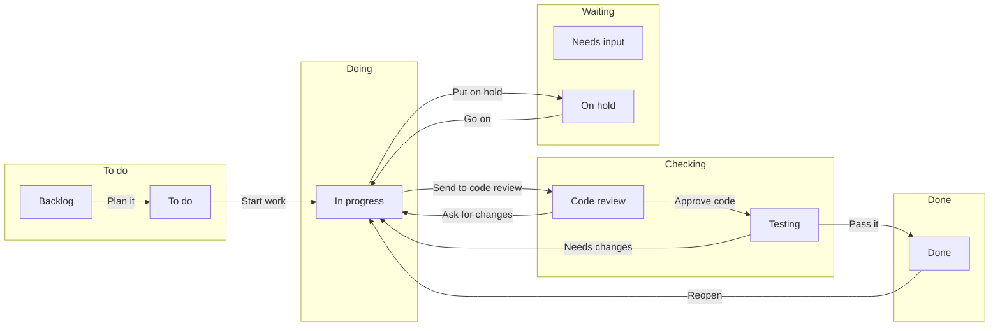

# ADR-0014 — Five fixed groups, configurable steps, verbs as transitions

Every step of every team belongs to one of five fixed groups; tickets move only through named verbs checked by rules.

## Index

- [Status](#status) — accepted, date, deciders.
- [Context and problem statement](#context-and-problem-statement) — team freedom vs. company overview.
- [Decision drivers](#decision-drivers) — clarity, manager view, flexibility.
- [Considered options](#considered-options) — free statuses, fixed statuses, Symfony Workflow config, our engine.
- [Decision outcome](#decision-outcome) — groups, steps, policies, transitions, rules, diagram.
- [Confirmation](#confirmation) — tests and checks.
- [Pros and cons of the options](#pros-and-cons-of-the-options) — trade-offs.
- [More information](#more-information) — links and revisit triggers.

## Status

Accepted · 2026-11-06 · Deciders: Zairan Mir (lead).

Superseded in part by [ADR-0037](0037-transition-engine-in-workflow-application.md): the Engine bullet naming `Workflow\Domain\TransitionEngine`; the engine is `Workflow\Application\Transition\CatalogueTransitionPolicy` behind `Workflow\Api\TransitionPolicy`. Everything else here still stands.

## Context and problem statement

Lena's Shop team wants a step "Design check" before code review. The Mobile team wants
"Waiting on store". Raj, the manager, must compare both teams at a glance without learning
their words. Mia should never see "Status: In Review (2)"; she should see a button
"Pass it" and a line "Now: Mia tests it".

How do we give teams their own steps while keeping one company-wide picture and clear actions?

## Decision drivers

- Plain, action-first UI: verbs instead of status dropdowns (NFR-USE, UX principles).
- Managers compare teams by the same five groups (FR-MGR).
- Admin chooses who may change steps: `locked`, `extend`, `team` (FR-ADM, FR-WF).
- Rules like "only the tester moves to Done" must be enforced on the server.
- Steps are data per org and per team, created at runtime.

## Considered options

1. Free statuses per team (like Jira), no grouping.
2. One fixed list of statuses for everyone.
3. Symfony Workflow component with statuses in YAML config.
4. Five fixed groups + steps as data + a small transition engine of our own.

## Decision outcome

Chosen option: **five fixed groups, steps as data, our own small transition engine (option 4)**.

Groups (fixed, colours fixed in the design tokens): **To do**, **Doing**, **Checking**, **Waiting**, **Done**.

Core steps (every org has them, cannot be deleted):

| Step | Group |
|---|---|
| Backlog, To do | To do |
| In progress | Doing |
| Code review, Testing | Checking |
| Needs input, On hold | Waiting |
| Done | Done |

Company steps (added by Admin) and team steps (added by a team Lead) are rows in `wf_step` with
`origin` = `company` or `team`, and always a `group`. The org setting `step_policy` controls them:

- `locked` — only core and company steps; leads cannot add.
- `extend` (default) — leads add team steps inside the groups; they cannot remove company steps.
- `team` — leads add steps and also change the team's rules.

Transitions are **named verbs** with a from-step set, a to-step, who may do it, and guards:

| Verb | From → to | Who |
|---|---|---|
| Plan it | Backlog → To do | Lead |
| Give it to… | (any open) → same step, sets assignee | Lead |
| Start work | To do → In progress | Assignee |
| Send to code review | In progress → Code review | Assignee |
| Send to testing | In progress → Testing | Assignee, only if rule `reviewFirst` is off |
| Approve code | Code review → Testing | Reviewer (not the assignee if `noSelfReview`) |
| Ask for changes | Code review → In progress | Reviewer |
| Pass it | Testing → Done | Tester (or Lead if `testerDone` is off) |
| Needs changes | Testing → In progress | Tester |
| Input given · go on | Needs input → previous step | Turn holder or Lead |
| Go on | On hold → previous step | Lead |
| Put on hold | (open) → On hold | Lead |
| Reopen | Done → In progress | Lead or Tester |
| Move on to {next core step} | custom step → next core step of its group | Assignee or Lead |
| Move to another step… | any → any (except guard rules) | Lead |

Rules (guards), stored per org and per team when the policy is `team`:
`testerDone`, `noSelfReview`, `reviewFirst` (all on by default).

The core steps inside the five groups, and the main verbs between them:

Engine:

- `Workflow\Domain\TransitionEngine` is pure PHP. Input: ticket state, actor permissions, team step set,
  rules. Output: the list of allowed verbs (for the "Your next step" box) or a refusal with a plain reason
  ("Team rule: nobody approves their own code").
- Every move writes a `tkt_ticket_event` row and a `TicketMoved` event ([ADR-0009](0009-async-messaging-and-outbox.md)),
  and updates the turn read model ([ADR-0015](0015-turn-read-model.md)).
- Removing a step that tickets still use requires choosing a target step; tickets move in one transaction.
- Jira statuses map to steps by a table per org ([ADR-0025](0025-jira-integration.md)).

### Consequences

- Good: teams get their words; managers always read five groups.
- Good: rules are enforced on the server and explained in plain language.
- Good: the same engine answers "what can I do now?" for the UI and MCP.
- Bad: we write and maintain our own engine instead of reusing Symfony Workflow.
- Bad: a group cannot be renamed or added; some teams may want a sixth group.
- Neutral: the verb list is code; adding a verb needs a release.

## Confirmation

- Unit tests: a table of (step, role, rules) → allowed verbs, covering every row above.
- Property test: no transition ever leaves a ticket in a step without a group.
- Test: under `locked`, a Lead's request to add a step returns 403.
- Test: the manager overview sum per group equals the count of open tickets.

## Pros and cons of the options

### Free statuses per team

- Good, because teams have full freedom.
- Bad, because managers cannot compare teams; it leads to the cluttered status lists we want to avoid.

### One fixed list for everyone

- Good, because it is the simplest.
- Bad, because teams with extra checks (design, store review) cannot show them.

### Symfony Workflow with YAML

- Good, because it is a mature component with guards and events.
- Bad, because places and transitions are static config; our steps are runtime data per team.
  We would have to build workflow definitions dynamically per request, which is more complex than our small engine.

### Five groups + data steps + own engine

- Good, because it fits the product exactly and is small and testable.
- Bad, because it is our own code to maintain.

## More information

- Engine details: [workflow-engine.md](../02-architecture/workflow-engine.md).
- Revisit when: more than 3 customers ask for a sixth group, or verbs need per-team configuration.
