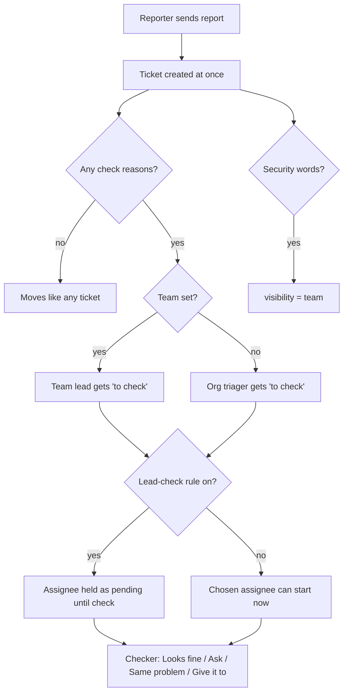

# ADR-0016: Reports become tickets at once; unclear ones get check flags instead of an approval gate

A report becomes a real ticket the moment it is sent. A lead takes a quick look only when something is unclear.

## Index

- [Status and people](#status-and-people): status, date, deciders.
- [Context and problem statement](#context-and-problem-statement): the scene, and why a triage inbox fails.
- [Decision drivers](#decision-drivers): what the decision must achieve.
- [Considered options](#considered-options): inbox gate, direct creation with flags, direct creation with no checks.
- [Decision outcome](#decision-outcome): the rules for check reasons, checker routing, visibility and the optional gate.
  - [Consequences](#consequences): good, bad and neutral effects.
- [Confirmation](#confirmation): tests and metrics that prove we follow this.
- [Pros and cons of the options](#pros-and-cons-of-the-options): details per option.
- [More information](#more-information): links and when to revisit.

## Status and people

- Status: Accepted
- Date: 2026-11-06
- Deciders: Zairan Mir (lead)

## Context and problem statement

Mia, a tester at Acme Foods, finds that the order total on the checkout page is doubled. She takes a screenshot, drops two pins and sends the report. Lena, the team lead, is in meetings all day. In a tool with a triage inbox, Mia's report waits in "Reports" until Lena accepts it. Omar, the developer, could have fixed it before lunch, but he cannot see it. Mia does not know if anyone has read it.

The first prototype had such an inbox ("Round 0 triage"). The team found three problems with it:

1. The lead becomes a bottleneck. Nothing moves while the lead is busy.
2. The reporter waits and cannot see what happens.
3. Anyone in a company should be able to report a problem, not only people who know the triage rules.

But a check still has value. New reports often repeat an older ticket, miss steps, have no team, or mention something risky such as a data leak.

How can a report start moving at once and still get a check when it needs one?

## Decision drivers

- Nobody waits on a person for a normal, clear report.
- The reporter always sees where the report is (see "My reports").
- Duplicates, missing information, missing team and risky content are still caught.
- Sensitive reports are hidden from people outside the team from the first second.
- The lead's Home shows only the reports that really need a look.
- Admins can choose a stricter rule for teams that get many reports from outside, for example from support.

## Considered options

1. **Triage inbox (gate).** Reports wait in a separate list until a lead accepts them. Accepting creates the ticket.
2. **Direct creation with check flags (chosen).** Every report is a ticket at once. The system stores "check reasons". A checker sees only flagged tickets. An optional admin rule holds the assignment until the check.
3. **Direct creation without checks.** Every report is a ticket. Nobody looks at it unless they open the list.

## Decision outcome

Chosen option: **2, direct creation with check flags**, because it removes the bottleneck and still catches the risky cases.

### Rules

When a report is sent, the Ticketing module creates the ticket in the same transaction and computes `check_reasons` (a text array on the ticket):

| Reason | When it is set |
|---|---|
| `dupe` | Duplicate search (ADR-0022) finds a similar open ticket and the reporter still creates a new one. |
| `info` | The text is shorter than 40 characters and there are no pins, or the AI says key information is missing (ADR-0018). |
| `team` | The reporter chose "Not sure" for the team. |
| `risk` | The text matches the risk word list (security, leak, password, data loss, crash, outage, and similar), or the AI marks it risky. |
| `rule` | The organization setting "Every new ticket needs a lead check" is on. |

- A ticket **needs a check** when `check_reasons` is not empty, `checked_at` is null and the ticket is not done.
- **Checker:** the lead of the ticket's team. If the ticket has no team, the organization's "triager" (chosen by an admin).
- **Assignment:** if the reporter picked a person, that person can start at once. Exception: when the `rule` reason is set, the chosen person is stored as `pending_assignee_id`. The ticket is given to them after the check.
- **Visibility:** if the text matches the security word subset (security, leak, password, unauthenticated, token, permission, privacy, other tenant), the ticket gets `visibility = team`. Who can see it is decided by the canonical [ticket visibility predicate](../02-architecture/data-model.md#ticket-visibility-predicate): team members, org admins, the people working on it (the reporter keeps seeing their own report, even from outside the team), and the triager while it has no team. Managers outside the team cannot. The word check runs **before** any cloud AI call on the draft (FR-AI-07).
- **Before sending:** the form shows a "When you send:" sentence. It says what will happen and who takes a look.
- **Checker actions:** Looks fine, Give it to…, Ask the reporter for more (a question, see ADR-0024), Same problem · close this one (closes as duplicate and comments on both tickets), Move to team (when there is no team).
- **Whose turn:** an unchecked ticket without an assignee is the checker's turn (ADR-0015). An unchecked ticket with an assignee is the assignee's turn. The checker also gets a "New tickets to check" item on Home.

Flow of one report:

### Consequences

- Good: reports never wait on one person, and work can start in minutes.
- Good: the reporter sees the ticket key and status at once.
- Good: the lead looks only at unclear tickets, not at every report.
- Good: sensitive reports are restricted from the first write. There is no window where everyone can see them.
- Bad: some duplicates will exist for a short time before the checker closes them. The duplicate search while typing reduces this.
- Bad: a word list makes false positives, for example "dropdown" near "down". We use word boundaries and keep the list in data so admins can tune it later.
- Neutral: the ticket count includes tickets later closed as duplicates. Reports must separate "closed as duplicate".

## Confirmation

- Unit tests for the reason calculator: one test per reason, plus combinations.
- Integration test: create a report with security words as a member of team A. A manager outside team A gets 404 on the ticket page, and it is absent from lists and search.
- Integration test: with the `rule` setting on, the assignee is null and `pending_assignee_id` is set. After "Looks fine" the assignee is set.
- Voter tests for CHECK: only the checker (team lead or triager) or an org admin may perform check actions.
- Metric: the median time from report to first action is shown on the admin dashboard. Target under 1 working day.

## Pros and cons of the options

### 1. Triage inbox (gate)

- Good, because every report gets human eyes before work starts.
- Bad, because the lead is a single point of delay.
- Bad, because the reporter has no ticket key and no status.
- Bad, because it needs a second data type ("report") with its own lifecycle and a conversion step.

### 2. Direct creation with check flags

- Good, because clear reports move at once and unclear ones still get a look.
- Good, because there is one data type: the ticket.
- Good, because the optional admin rule covers orgs that need a gate.
- Bad, because the rules (reasons, routing) must be explained in the UI. The "When you send" sentence does this.

### 3. Direct creation without checks

- Good, because it is the simplest.
- Bad, because duplicates and risky reports go unnoticed.
- Bad, because tickets with no team have no owner.

## More information

- Turn rules: [ADR-0015](0015-turn-read-model.md). Duplicate search: [ADR-0022](0022-search-and-duplicates.md). AI suggestions: [ADR-0018](0018-ai-provider-abstraction.md) and [ADR-0020](0020-ai-safety-and-prompt-injection.md). Visibility and voters: [ADR-0013](0013-authorization.md).
- Architecture: [workflow-engine.md](../02-architecture/workflow-engine.md), [security.md](../02-architecture/security.md).
- Revisit when more than 20% of new tickets in an org are closed as duplicates within 7 days, or when admins turn on the lead-check rule in more than half of the orgs. Either means the default is wrong.
