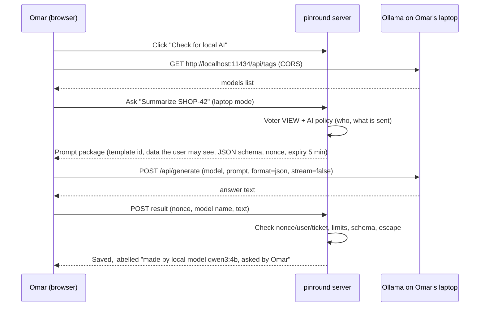

# ADR-0019: Laptop AI runs in the browser, which talks to Ollama on the same laptop

In laptop mode the server never talks to anyone's laptop. The browser does, and the server treats the answer like text the user typed.

## Index

- [Status and people](#status-and-people): status, date, deciders.
- [Context and problem statement](#context-and-problem-statement): the scene and the network problem.
- [Decision drivers](#decision-drivers): cost, privacy, security, browser limits.
- [Considered options](#considered-options): browser-to-localhost, server-to-laptop tunnel, shared office server only.
- [Decision outcome](#decision-outcome): the flow, browser rules, trust rules, sequence diagram.
  - [Consequences](#consequences): good, bad and neutral effects.
- [Confirmation](#confirmation): tests and checks.
- [Pros and cons of the options](#pros-and-cons-of-the-options): details per option.
- [More information](#more-information): links and when to revisit.

## Status and people

- Status: Accepted
- Date: 2026-11-06
- Deciders: Zairan Mir (lead)

Superseded in part by [ADR-0042](0042-laptop-result-refusal-status-codes.md): the sentence "A wrong or used nonce returns 409 and writes an audit event"; an unknown, another person's or another organization's package answers 404, a used or expired one 410, a rejected text or model 422 and a policy refusal 403, and every refusal writes the `local_ai.result_refused` audit entry. Everything else here still stands.

## Context and problem statement

Acme Foods has no money for an AI subscription. Sara, the admin, sets "Where the AI runs: each person's laptop". Omar installs Ollama and pulls `qwen3:4b`. Ollama listens on `http://localhost:11434` on Omar's laptop.

pinround runs on a server. The server cannot reach Omar's `localhost`, and it should never try: that would mean opening laptops to the internet. But Omar's browser runs on the same laptop as Ollama, and Omar is already allowed to see the ticket text.

How can pinround use a model on the laptop without the server connecting to the laptop, and without trusting whatever comes back?

## Decision drivers

- Zero AI cost for orgs that choose it. Ticket text stays on the laptop.
- The server must never open a connection to a user's device.
- Browser security rules must be respected: CORS, Local Network Access permission, mixed content.
- The AI result is produced on a device the server does not control, so it must be treated as untrusted user input.
- The org AI policy (ADR-0018) still applies: who may use AI, and what is sent.

## Considered options

1. **Browser calls Ollama on localhost (chosen).** The server gives the browser a prompt package. The browser calls Ollama and posts the result back.
2. **Server-to-laptop tunnel.** An agent on each laptop opens a tunnel, and the server calls through it.
3. **Only a shared server-side Ollama.** No laptop mode. Orgs run one Ollama host (this stays available as `server_ollama`).

## Decision outcome

Chosen option: **1**, with option 3 kept as a separate policy value.

### Flow

### Browser rules

- Detection runs **only after a user click** ("Check for local AI"). Never on page load. Recent Chrome versions ask the user before a public site may call local-network or loopback addresses (Local Network Access). We want that prompt to follow a clear user action. Verify the exact browser behaviour and any needed fetch options at implementation time.
- An `https` page calling `http://localhost` is allowed by browsers because loopback is treated as a "potentially trustworthy origin". Verify per browser (Chrome, Edge, Firefox, Safari) at implementation time. Unsupported browsers show the setup sheet with "not available in this browser".
- Ollama must allow our origin: the user or IT sets `OLLAMA_ORIGINS` to the pinround address and restarts Ollama. The setup sheet explains this in 4 steps.
- Our Content-Security-Policy `connect-src` adds `http://localhost:11434` and `http://127.0.0.1:11434` **only** for orgs whose policy is `laptop` or `laptop_then_cloud`.

### Server trust rules

- The prompt package contains only data the user can already see (voter VIEW). It respects `send = title only`. It is signed with a single-use nonce bound to user, ticket, use case and a 5-minute expiry.
- The posted result is **user-provided text**:
  - Max length per use case (summary 1,200 characters, explanation 4,000).
  - Unicode normalized and control characters stripped.
  - Always HTML-escaped on output, never rendered as HTML or Markdown-to-HTML without sanitizing.
  - JSON use cases are validated against the schema (ADR-0020).
- The result is labelled with the model name the browser reported, marked "reported by the browser", plus the user and time. We do not claim it is verified.
- A rate limit applies per user (ADR-0010). A wrong or used nonce returns 409 and writes an audit event.
- With `laptop_then_cloud`, if detection fails or Ollama errors, the request goes through the cloud gateway instead (ADR-0018), and the label says so.

### Consequences

- Good: free AI, and ticket text does not leave the laptop for AI.
- Good: no inbound connections to laptops, and no agent to install besides Ollama.
- Bad: setup per laptop (Ollama, model, `OLLAMA_ORIGINS`). IT can automate it, but it is friction.
- Bad: quality and speed depend on the laptop. A 4B model on CPU is slow for long texts. We keep prompts short and use it for summaries and intake suggestions only.
- Bad: a user could post fake "AI" text. This is acceptable: they could also type the same text as a comment, and it is labelled as user-reported.
- Neutral: server-side features that need AI with no browser present (summaries on Jira sync, embeddings) do not run in pure `laptop` mode. They run on the next view by a user with local AI, or not at all.

## Confirmation

- Unit tests: nonce binding (wrong user, ticket or use case, expired, reused → rejected), length limits, escaping.
- Functional test: `send = title only` → the package has no description.
- Playwright test with a fake local endpoint (a stub server on port 11434): detect → summarize → saved and labelled.
- Header test: `connect-src` contains localhost only when the org policy needs it.
- Security review item in phase 12: try stored XSS through the result endpoint.

## Pros and cons of the options

### 1. Browser calls localhost

- Good, because there is no inbound connection and the user only shares what they already see.
- Bad, because it depends on browser rules that are still changing.

### 2. Server-to-laptop tunnel

- Good, because server-side jobs could use laptops.
- Bad, because it is a large attack surface (the server reaches into laptops), needs an agent, and is hard to run.

### 3. Shared server Ollama only

- Good, because it is simple and works for jobs too.
- Bad, because the org needs a machine, and the cost is not zero. It is still offered as `server_ollama`.

## More information

- Related: [ADR-0018](0018-ai-provider-abstraction.md), [ADR-0020](0020-ai-safety-and-prompt-injection.md), [ADR-0027](0027-secrets-and-encryption.md) (CSP).
- Architecture: [ai-architecture.md](../02-architecture/ai-architecture.md), [security.md](../02-architecture/security.md).
- Recommended laptop models: `qwen3:4b` (about 2.5 GB, good at JSON) and `phi4-mini` (lighter). Test both on the slowest laptop before choosing.
- Revisit when browsers block loopback calls from public sites by default with no permission path, or when in-browser models (WebGPU) are good enough to remove the Ollama step.
