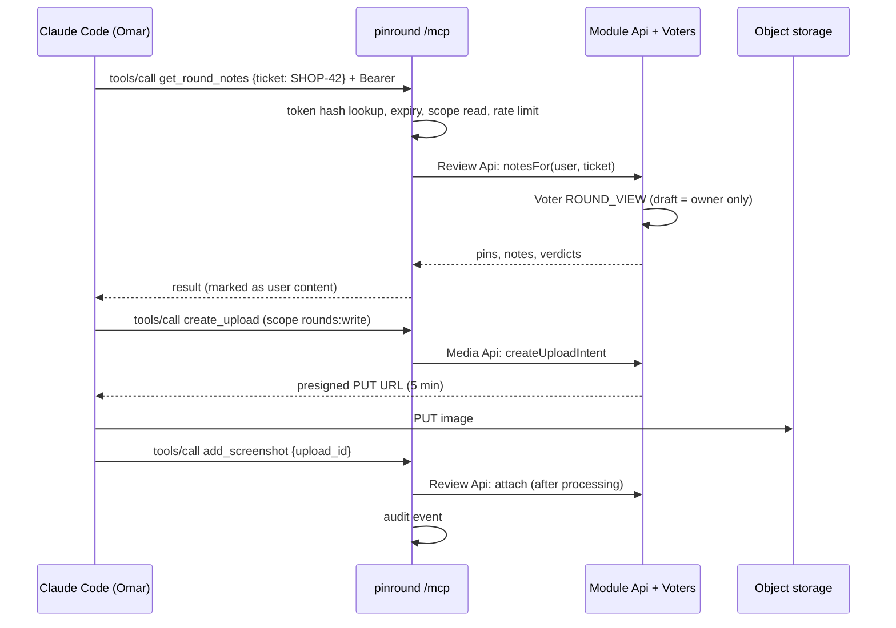

# ADR-0021: An MCP server built on symfony/mcp-bundle lets Claude Code work with pinround as the user

Claude Code connects to pinround with a personal token. It can do only what that user can do, and only within the token's scopes.

## Index

- [Status and people](#status-and-people): status, date, deciders.
- [Context and problem statement](#context-and-problem-statement): the scene: the draft-round loop with Claude Code.
- [Decision drivers](#decision-drivers): security, same rules as the UI, hackathon.
- [Considered options](#considered-options): MCP over HTTP, REST only, stdio CLI.
- [Decision outcome](#decision-outcome): transport, auth, scopes, tools, limits, audit, sequence.
  - [Consequences](#consequences): good, bad and neutral effects.
- [Confirmation](#confirmation): tests and checks.
- [Pros and cons of the options](#pros-and-cons-of-the-options): details per option.
- [Clarifications (2026-11-06)](#clarifications-2026-11-06): token step-up, admin actions, uploads.
- [More information](#more-information): links and when to revisit.

## Status and people

- Status: Accepted. Superseded in part by [ADR-0039](0039-agents-file-report-drafts-a-person-sends-them.md) (scope `reports:write`, tool `create_report`) by [ADR-0045](0045-evidence-is-captured-where-the-person-works.md) (tool `find_tickets` and the prompt `report_while_investigating`), by [ADR-0046](0046-notebooks-and-scenarios-for-understanding-an-app.md) (scope `notebooks:write`, tools `list_my_notebooks`, `get_notebook`, `save_scenarios`) and by [ADR-0043](0043-api-token-hash-is-hmac-sha256.md) (the "Stored as SHA-256 of (token + server-side pepper from secrets)" line: the hash is HMAC-SHA256 keyed by the `API_TOKEN_PEPPER` environment variable)
- Date: 2026-11-06
- Deciders: Zairan (lead), Toyib (developer), Anka (tester)

## Context and problem statement

Omar works on SHOP-42 in Claude Code. He says: "Read my pinround notes for SHOP-42 and fix what is marked Not right yet." Claude Code needs to read the draft round (ADR-0017), fix the code, take new screenshots, upload them, and set verdicts. Later Mia might ask her own Claude Code: "List my tickets waiting for test."

The Model Context Protocol (MCP) is the standard way for Claude Code to call outside tools. The hackathon also requires the official PHP MCP SDK (`mcp/sdk`).

How do we expose pinround to AI clients without creating a second, weaker way into the data?

## Decision drivers

- Exactly the same permission rules as the web UI (voters, tenant isolation, visibility, draft privacy).
- Tokens that can be limited, expired and revoked, and are never stored in plain text.
- No browser-session use (CSRF and DNS rebinding risks).
- Every call is auditable.
- Meets the hackathon rule: `mcp/sdk`, through `symfony/mcp-bundle`.

## Considered options

1. **Remote MCP server over Streamable HTTP with personal access tokens (chosen).**
2. **REST API only.** Claude Code would call it with curl or a custom skill.
3. **Local stdio MCP server** (a CLI the user runs) that calls our REST API.

## Decision outcome

Chosen option: **1**. The REST API `/api/v1` still exists for the browser capture plugin (P10), with the same tokens and scopes.

- **Transport:** MCP Streamable HTTP at `https://<host>/mcp`, served by `symfony/mcp-bundle` on `mcp/sdk`. Check the exact bundle configuration keys at implementation time, because the packages are young.
- **Authentication:** `Authorization: Bearer <personal access token>` only. Cookies are ignored on `/mcp` (stateless firewall), so a logged-in browser cannot be abused through CSRF.
- **Tokens** (Identity module, `idn_api_token` table):
  - Created by the user in Settings, with a name, scopes and an expiry (default 90 days, max 1 year). A token made for Claude Code defaults to scopes `read` + `rounds:write`.
  - Shown **once**.
  - Stored as SHA-256 of (token + server-side pepper from secrets) with a short public prefix for lookup, for example `pr_ab12…`.
  - Revocable, with `last_used_at` tracking.
  - Org admins can list and revoke tokens but cannot see them.
  - Format has a fixed prefix (`pr_`) so secret scanners can detect leaked tokens.
- **Scopes:** `read` (default), `rounds:write` (draft rounds: create_upload, add_screenshot, set_verdict, pin notes), `comments:write`, `tickets:move`. A tool call without the needed scope gets an MCP error, never a partial action.
- **Tools (v1):**
  - `list_my_tickets`: tickets where it is my turn, with "Now" text.
  - `get_ticket`: summary, ask, current step, Now/Next, open questions. Text the user may see.
  - `get_round_notes`: pins, notes and verdicts of a round, including the caller's own draft.
  - `create_upload` + `add_screenshot`: never image bytes in the MCP body. `create_upload` returns a presigned upload intent (`upload_id` + URL, ADR-0011); the client PUTs the file to storage; then `add_screenshot` is called with the `upload_id` only. The worker checks size and type as for any upload.
  - `set_verdict`: per screenshot or pin, in the caller's draft or in a round they test.
  - `add_comment`.
  - `move_ticket`: only verbs the user could click.
- Each tool is a thin adapter calling module `Api` services, which call the same voters as the UI. No tool reads repositories directly.
- **Request checks:**
  - Validate `Origin` when present (reject foreign browser origins, which protects against DNS rebinding) and `Host` against the configured host list.
  - Request body max 1 MB (screenshots go to object storage, not through MCP).
  - JSON schema validation of tool inputs.
- **Limits:** a rate limit per token (for example 60 calls/min, 600/hour) and per org (ADR-0010). Returns 429 with `Retry-After`.
- **Audit:** every tool call writes an audit event: user, token id, tool, target ids, result code. No content (ADR-0026).
- **Untrusted content:** tool results contain user text. The client's model sees it, so the warnings in ADR-0020 apply on the client side. We mark text fields as user content in tool descriptions.
- **Setup:** Claude Code connects with `claude mcp add --transport http pinround https://<host>/mcp --header "Authorization: Bearer <token>"`. Check the exact flags against the Claude Code documentation at implementation time.

### Consequences

- Good: Claude Code can close the fix → screenshot → verdict loop inside pinround.
- Good: one permission system for web, REST and MCP.
- Good: tokens can be limited, revoked and audited.
- Bad: one more public endpoint to harden and monitor.
- Bad: young libraries. We pin versions and keep adapters thin.
- Neutral: no OAuth flow for MCP in v1. If Claude Code's remote-MCP OAuth support is needed later, add an ADR.

## Confirmation

- Integration tests per tool: wrong tenant → not found, missing scope → error, draft of another user → not found, expired or revoked token → 401.
- Test: a request with a session cookie and no Bearer token → 401 (cookies ignored).
- Test: a foreign `Origin` header → 403.
- Rate-limit test, and audit-event test for every tool.
- Secret scanning in CI includes the `pr_` prefix pattern.
- Phase 12 security review: MCP endpoint against OWASP ASVS L2 API checks.

## Pros and cons of the options

### 1. Remote MCP over HTTP

- Good, because Claude Code supports it natively, it meets the hackathon rule, and it is central and auditable.
- Bad, because it is a new public surface.

### 2. REST only

- Good, because it is a familiar, simple surface.
- Bad, because Claude Code needs glue (a skill or curl), and the model gets no tool descriptions or schemas.

### 3. Local stdio MCP server

- Good, because it adds no new endpoint on the server.
- Bad, because every user must install and update a CLI, and tokens end up in local config files on every laptop anyway.

## Clarifications (2026-11-06)

- **Step-up to create a token.** Creating a token needs a password + MFA check from the last 10 minutes, so a stolen session alone cannot mint a long-lived token.
- **No admin work through tokens.** `ADMIN_*` voter attributes deny every request authenticated by a token ([ADR-0013](0013-authorization.md)). Admin pages need an MFA-checked browser session.
- **Uploads.** `add_screenshot` takes an `upload_id` from a presigned intent only; base64 image data in a tool call is refused (the 1 MB body limit stays).
- **Token format** is `pr_` + random value everywhere (docs, scanners, UI).
- **Visibility.** Every tool filters with the canonical [ticket visibility predicate](../02-architecture/data-model.md#ticket-visibility-predicate); a token never sees more than its user.

## More information

- Related: [ADR-0012](0012-authentication.md), [ADR-0013](0013-authorization.md), [ADR-0017](0017-private-draft-rounds.md), [ADR-0020](0020-ai-safety-and-prompt-injection.md), [ADR-0026](0026-audit-log.md).
- Architecture: [integrations.md](../02-architecture/integrations.md), [security.md](../02-architecture/security.md).
- Revisit when MCP authorization (OAuth) is stable in Claude Code and `symfony/mcp-bundle`, when a tool needs bulk access (more than 100 items per call), or when tool calls exceed 20% of total API traffic.
