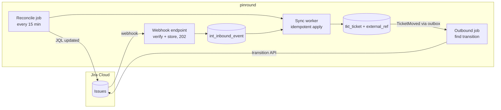

# ADR-0025: Jira is an integration: we import and sync status, and pinround owns its own data

Teams can start using pinround next to Jira. Tickets and statuses sync; rounds, pins and pinround comments stay in pinround.

## Index

- [Status and people](#status-and-people): status, date, deciders.
- [Context and problem statement](#context-and-problem-statement): the scene: a team that lives in Jira today.
- [Decision drivers](#decision-drivers): adoption, correctness, security.
- [Considered options](#considered-options): one-time import, two-way status sync, full two-way mirror.
- [Decision outcome](#decision-outcome): auth, import, webhooks, mapping, sync back, conflicts, flow diagram.
  - [Consequences](#consequences): good, bad and neutral effects.
- [Confirmation](#confirmation): tests and metrics.
- [Pros and cons of the options](#pros-and-cons-of-the-options): details per option.
- [Clarifications (2026-11-06)](#clarifications-2026-11-06): webhook trust, outbound URL safety, restricted imports.
- [More information](#more-information): links and when to revisit.

## Status and people

- Status: Accepted
- Date: 2026-11-06
- Deciders: Zairan (lead), Toyib (developer), Anka (tester)

## Context and problem statement

Acme Foods runs its work in Jira Cloud. Product people and support still create tickets there. Lena's team wants to work in pinround now. If pinround cannot show Jira tickets, nobody switches. If a move in pinround does not reach Jira, the product owner sees old statuses. If we try to mirror everything both ways (comments, attachments, custom fields), we spend months on edge cases and break both tools.

## Decision drivers

- A team can adopt pinround without the whole company leaving Jira.
- Jira statuses match pinround steps (no surprise for people who stay in Jira).
- Credentials are stored safely, with the least scopes.
- Sync is idempotent and safe to retry. A broken webhook never corrupts data.
- pinround-only concepts (rounds, pins, verdicts, check flags, pings) are not forced into Jira.

## Considered options

1. **One-time import.** Copy tickets once, then cut over.
2. **Import + ongoing inbound sync + outbound status transitions (chosen).**
3. **Full two-way mirror** of fields, comments and attachments.

## Decision outcome

Chosen option: **2**.

- **Auth:** OAuth 2.0 (3LO) Atlassian app with the smallest read/write scopes for issues and webhooks (check the scope names at implementation time). A Jira API token (user email + token) is a fallback for self-hosted orgs. Tokens and refresh tokens are encrypted at rest with field encryption (ADR-0027) and never logged.
- **Link projects:** a team lead links Jira projects to the team (Team page). Each link stores `jira_project_key`, the `step mapping` (Jira status → pinround step; admins edit it on the Connections page) and the sync state.
- **Import:** a background job pages through issues with JQL (`project = X ORDER BY updated`). It creates or updates tickets with `external_ref(system=jira, external_id, version=updated timestamp)`. Imported fields: key, summary, description (converted from Atlassian Document Format to plain text/Markdown), type, priority, status → step, assignee and reporter (matched by email to pinround users, else stored as an external name), fix versions, components, parent, created, updated.
- **Inbound changes:** Jira webhooks (issue created, updated, deleted) call `/integrations/jira/{connectionId}/webhook`. Verify the request with the shared secret or signature mechanism Jira provides, checked at implementation time. The webhook is a **trigger only**: the handler stores the issue key and event type in a queue table and returns 202; the worker then **re-fetches the issue over the REST API** with the connection's own credentials and applies that, never the webhook body. A worker applies it idempotently: skip if `version` ≤ stored version. A reconciliation job runs every 15 minutes (JQL `updated >= last_sync - 5m`) and catches missed webhooks.
- **Outbound:** when a ticket moves in pinround, an outbox event triggers a job. The job finds a Jira transition whose target status maps to the new step and executes it. If none exists, the ticket shows "Not synced: no Jira transition to <status>", and an admin alert is raised.
- **Ownership:** pinround owns rounds, pins, verdicts, check flags, pings, private drafts and pinround comments. These are **not** written to Jira. Optionally, a link comment "Review rounds for this ticket: <pinround URL>" is posted once.
- **Conflicts:** last writer wins per field, by timestamp; when both sides change the same field within 60 seconds, the Jira value wins. Each overwrite writes a ticket event ("Updated from Jira: priority Major → Critical"), so people can see what changed.
- **Limits:** respect Jira rate-limit headers with backoff (Messenger retry with jitter). Max concurrency per connection: 2.

### Consequences

- Good: a team can start at once, and Jira users still see correct statuses.
- Good: the sync is retry-safe and observable.
- Bad: comments made in Jira after import are not mirrored in v1. People who live in Jira see a link instead.
- Bad: status mapping needs care when Jira workflows have many statuses. The admin mapping table and the "not synced" banner make problems visible.
- Neutral: unmatched Jira users appear as external names until they join.

## Confirmation

- Contract tests with recorded Jira payloads (anonymized fixtures): create, update, out-of-order delivery (older version ignored), deleted issue.
- Test: a webhook with a wrong secret → 401 and no stored event.
- Test: no credentials appear in logs (log capture assertion).
- Metric: sync lag p95 (Jira updated → pinround applied) under 2 minutes. Failed outbound transitions per day shown on the admin page.

## Pros and cons of the options

### 1. One-time import

- Good, because it is simple.
- Bad, because the whole company must switch at once, which is unrealistic.

### 2. Import + status sync

- Good, because teams can adopt gradually with correct statuses.
- Bad, because the sync code needs care and monitoring.

### 3. Full two-way mirror

- Good, because "everything everywhere".
- Bad, because of endless edge cases (custom fields, ADF formatting, attachments, permissions), and pinround's UX gets pulled toward Jira's model.

## Clarifications (2026-11-06)

- **Webhook trust.** A forged webhook can at most cause one extra REST fetch: the body is never applied. Unknown `connectionId` values are resolved through the `resolve_jira_connection` resolver function ([data-model.md › Row-level security](../02-architecture/data-model.md#row-level-security)) and get 404 with no detail. The route is `/integrations/jira/{connectionId}/webhook`.
- **Outbound URL safety (SSRF).** The Jira `base_url` must be `https` and match the allow-list `*.atlassian.net` or `api.atlassian.com` (Jira Cloud). Every outbound HTTP client (Jira, OIDC discovery, a server Ollama) resolves DNS and **blocks private, loopback and link-local addresses at connect time**, and follows **no redirects** ([security.md](../02-architecture/security.md)).
- **Restricted imports.** An issue with a Jira security level, or whose title/description matches the security word list, is imported with `visibility = 'team'`.
- **Conflicts:** same field changed on both sides within 60 seconds → the Jira value wins (logged as a ticket event).

## More information

- Related: [ADR-0009](0009-async-messaging-and-outbox.md), [ADR-0014](0014-status-model-five-groups.md), [ADR-0027](0027-secrets-and-encryption.md), [ADR-0006](0006-identifiers.md).
- Architecture: [integrations.md](../02-architecture/integrations.md).
- Revisit when more than 30% of users ask for Jira comment sync, or when an org wants pinround as the only system (then add "disconnect Jira" with a final import).
