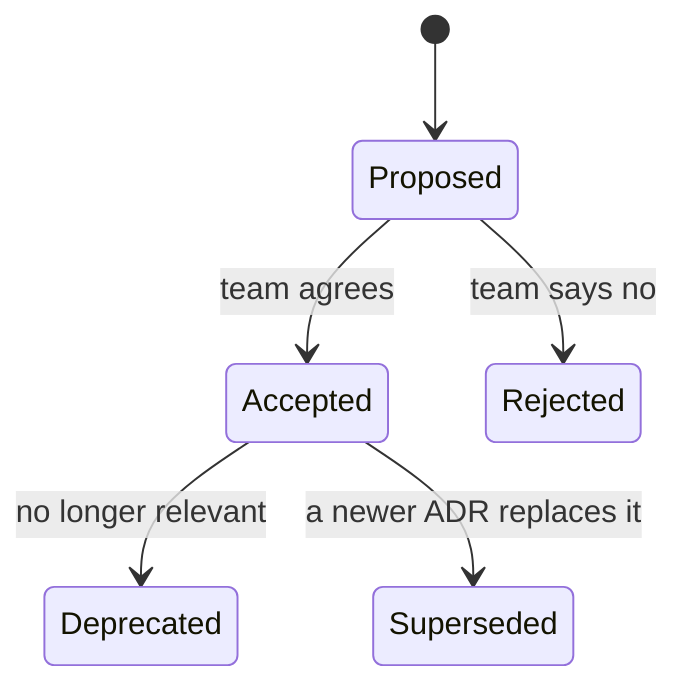

# Architecture decision records

This folder holds every important architecture decision for pinround, why we made it, and the options we did not choose.

## Index

- [What an ADR is](#what-an-adr-is) — the purpose of these files.
- [When to write one](#when-to-write-one) — which decisions need an ADR.
- [Status lifecycle](#status-lifecycle) — Proposed, Accepted, Deprecated, Superseded.
- [Naming and format](#naming-and-format) — file names, numbering, the template.
- [How to change a decision](#how-to-change-a-decision) — superseding instead of editing.
- [All decisions](#all-decisions) — the index table of ADR-0001 to ADR-0033.

## What an ADR is

An ADR (architecture decision record) is a short file about one decision.
It says what we decided, why, which other options we looked at, and what the decision costs us.

A new team member, or a new Claude Code session, reads the ADR instead of guessing why the code looks the way it does.

## When to write one

Write an ADR when a decision:

- is hard or expensive to change later (database, tenancy, auth, module boundaries);
- changes security, performance or data handling;
- adds a new runtime service (a queue, a store, a third-party API);
- adds a dependency that many modules will use;
- breaks or changes an earlier ADR.

Do not write an ADR for small, local choices that one pull request can undo.

## Status lifecycle

- **Proposed** — written, open for review in a pull request.
- **Accepted** — merged; the code must follow it.
- **Rejected** — kept for history, so nobody proposes the same thing without new facts.
- **Deprecated** — the problem is gone (for example a feature was removed).
- **Superseded** — a newer ADR replaces it; both files link to each other.

## Naming and format

- File name: `NNNN-short-slug.md`, four digits, lower-case slug, for example `0005-multi-tenancy.md`.
- Numbers only grow. Never reuse a number.
- Use [template.md](template.md). It follows MADR 4.0 with one pinround rule:
  the context starts with a short scene with real users, then the problem.
- Every ADR has a **Confirmation** section: how we check, ideally automatically, that the code follows it.
- Every ADR has revisit triggers with numbers, for example "p95 search time above 300 ms".

## How to change a decision

1. Do not rewrite an accepted ADR. Small fixes (typos, broken links) are fine.
2. Write a new ADR with the new decision. In its context, link the old one.
3. Set the old ADR status to `Superseded by ADR-XXXX` and link the new file.
4. Update the table below in the same pull request.

## All decisions

All ADRs below are **Accepted** on **2026-11-06** (ADR-0033 on 2026-11-07) (deciders: Zairan Mir, lead, with the team).

| ADR | Title | Decision in one line |
|---|---|---|
| [0001](0001-record-architecture-decisions.md) | Record architecture decisions | Keep ADRs in MADR 4.0 format in `docs/03-adr`, with status Proposed → Accepted → Superseded. |
| [0002](0002-modular-monolith.md) | Modular monolith | One Symfony app split into modules (bounded contexts) with public APIs, own tables, and Deptrac checks. |
| [0003](0003-php-and-symfony-versions.md) | PHP and Symfony versions | PHP 8.4 minimum (run 8.5), Symfony 8.1 now, 8.2 on release, then 8.4 LTS in Nov 2027. |
| [0004](0004-postgresql.md) | PostgreSQL | PostgreSQL 18 is the only primary database: JSONB, full-text search, pg_trgm, RLS, pgvector, partitions. |
| [0005](0005-multi-tenancy.md) | Multi-tenancy | Shared schema with `organization_id` on every row, Doctrine filter plus PostgreSQL row-level security. |
| [0006](0006-identifiers.md) | Identifiers | UUIDv7 primary keys; human ticket keys like `SHOP-123` from a per-project counter. |
| [0007](0007-server-rendered-ui.md) | Server-rendered UI | Twig with Symfony UX (Turbo, Stimulus, Live Components, AssetMapper); no SPA, no Node build. |
| [0008](0008-frankenphp-runtime.md) | FrankenPHP runtime | FrankenPHP worker mode with its built-in Mercure hub; the same image for SaaS and self-host. |
| [0009](0009-async-messaging-and-outbox.md) | Async messaging and outbox | Symfony Messenger; domain events go to an outbox in the same transaction; heavy jobs on Valkey. |
| [0010](0010-cache-sessions-locks.md) | Cache, sessions, locks | Valkey 8 for cache, sessions, locks, rate limits and jobs, split by eviction policy. |
| [0011](0011-screenshot-storage-and-processing.md) | Screenshot storage and processing | Private S3-compatible bucket, presigned uploads, libvips re-encoding, short-lived signed reads. |
| [0012](0012-authentication.md) | Authentication | Password (argon2id) + TOTP MFA + OIDC SSO, sessions in Valkey, scoped personal access tokens. |
| [0013](0013-authorization.md) | Authorization | Org roles + per-team roles, Symfony voters per action, deny by default, owner-only private data. |
| [0014](0014-status-model-five-groups.md) | Status model with five groups | Five fixed groups; steps per policy; transitions are named verbs with guard rules, run by our own small engine. |
| [0015](0015-turn-read-model.md) | Turn read model | Whose turn, kind, base score and waiting-since are stored per ticket and updated in the same transaction. |
| [0016](0016-direct-ticket-creation-with-check-flags.md) | Direct ticket creation with check flags | Reports become tickets at once; unclear ones get check reasons and go to a checker; no approval inbox. |
| [0017](0017-private-draft-rounds.md) | Private draft rounds | Draft rounds are visible only to their owner until shared; the choice is made at hand-off. |
| [0018](0018-ai-provider-abstraction.md) | AI provider abstraction | All server-side AI goes through Symfony AI behind an AiGateway that enforces the org AI policy. |
| [0019](0019-browser-local-ai.md) | Browser-local AI | In laptop mode the browser calls Ollama on localhost; the server treats the result as user-provided text. |
| [0020](0020-ai-safety-and-prompt-injection.md) | AI safety and prompt injection | Ticket content is untrusted data; validated JSON output; AI never writes without a human click. |
| [0021](0021-mcp-server.md) | MCP server | `symfony/mcp-bundle` on `mcp/sdk` at `/mcp`, personal access tokens with scopes, same voters as the UI. |
| [0022](0022-search-and-duplicates.md) | Search and duplicates | PostgreSQL full-text search + pg_trgm for search and duplicates; optional pgvector embeddings. |
| [0023](0023-realtime-mercure.md) | Real-time with Mercure | Mercure private topics with per-user JWT; Turbo Streams for live updates; never push unseen data. |
| [0024](0024-notifications-and-pings.md) | Notifications and pings | Pings with rate limits, grouping, auto-clear and quiet hours; in-app plus email digest. |
| [0025](0025-jira-integration.md) | Jira integration | Jira Cloud REST via OAuth 2.0 (3LO); import, webhooks, mapped status sync; pinround owns its own data. |
| [0026](0026-audit-log.md) | Audit log | Append-only, partitioned audit table; INSERT/SELECT only for the app; retention and async export. |
| [0027](0027-secrets-and-encryption.md) | Secrets and encryption | TLS + HSTS, libsodium field encryption for credentials, no content in logs, strict CSP. |
| [0028](0028-testing-and-quality-gates.md) | Testing and quality gates | PHPUnit, Foundry, Playwright, PHPStan max, Deptrac, CS, audit, isolation tests; CI blocks merges. |
| [0029](0029-observability.md) | Observability | OpenTelemetry traces and metrics, JSON logs without content, health checks, SLO alerts. |
| [0030](0030-deployment-model.md) | Deployment model | Docker images; Compose for small orgs, managed services for SaaS; expand/contract migrations; PITR. |
| [0031](0031-minio-built-from-pinned-source.md) | Build MinIO from pinned source | MinIO stays the store; we build `minio` and `mc` from pinned tags and commits in `docker/minio`. |
| [0032](0032-module-call-edges-follow-modules-catalogue.md) | Module call edges follow the modules catalogue | Api calls follow the "Depends on" lines in `modules.md`; any module may listen to any module's events. Supersedes only the ADR-0002 dependency diagram. |
| [0033](0033-valkey-transports-workers-and-outbox-relay.md) | Valkey transports, workers and the outbox relay | Four `async_*` Valkey streams, three workers (outbox, short, heavy), an at-least-once relay polled every 0.5 s, longer retries for AI and Jira. Supersedes part of ADR-0009. |
