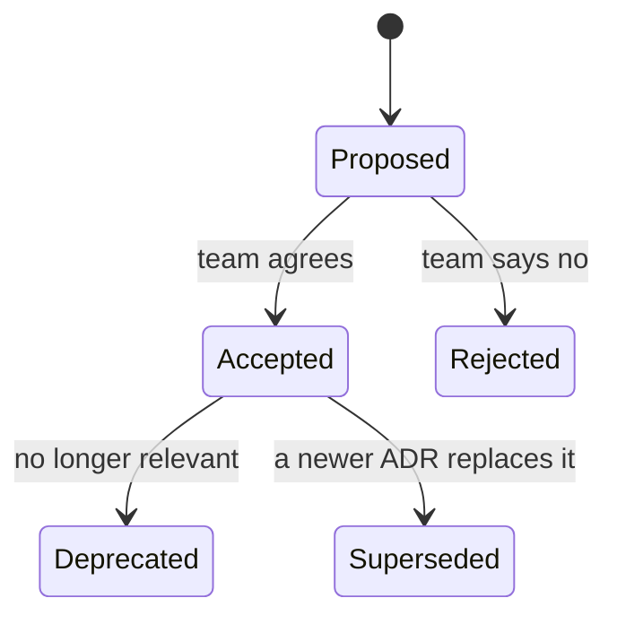

# Architecture decision records

This folder holds every important architecture decision for pinround, why we made it, and the options we did not choose.

## Index

- [What an ADR is](#what-an-adr-is) — the purpose of these files.
- [When to write one](#when-to-write-one) — which decisions need an ADR.
- [Status lifecycle](#status-lifecycle) — Proposed, Accepted, Deprecated, Superseded.
- [Naming and format](#naming-and-format) — file names, numbering, the template.
- [How to change a decision](#how-to-change-a-decision) — superseding instead of editing.
- [All decisions](#all-decisions) — the index table of ADR-0001 to ADR-0050.

## What an ADR is

An ADR (architecture decision record) is a short file about one decision.
It says what we decided, why, which other options we looked at, and what the decision costs us.

A new team member, or a new Claude Code session, reads the ADR instead of guessing why the code looks the way it does.

## When to write one

Write an ADR when a decision:

- is hard or expensive to change later (database, tenancy, auth, module boundaries);
- changes security, performance or data handling;
- adds a new runtime service (a queue, a store, a third-party API);
- adds a dependency that many modules will use;
- breaks or changes an earlier ADR.

Do not write an ADR for small, local choices that one pull request can undo.

## Status lifecycle

- **Proposed** — written, open for review in a pull request.
- **Accepted** — merged; the code must follow it.
- **Rejected** — kept for history, so nobody proposes the same thing without new facts.
- **Deprecated** — the problem is gone (for example a feature was removed).
- **Superseded** — a newer ADR replaces it; both files link to each other.

## Naming and format

- File name: `NNNN-short-slug.md`, four digits, lower-case slug, for example `0005-multi-tenancy.md`.
- Numbers only grow. Never reuse a number.
- Use [template.md](template.md). It follows MADR 4.0 with one pinround rule:
  the context starts with a short scene with real users, then the problem.
- Every ADR has a **Confirmation** section: how we check, ideally automatically, that the code follows it.
- Every ADR has revisit triggers with numbers, for example "p95 search time above 300 ms".

## How to change a decision

1. Do not rewrite an accepted ADR. Small fixes (typos, broken links) are fine.
2. Write a new ADR with the new decision. In its context, link the old one.
3. Set the old ADR status to `Superseded by ADR-XXXX` and link the new file.
4. Update the table below in the same pull request.

## All decisions

All ADRs below are **Accepted** on **2026-11-06** (ADR-0033 and ADR-0034 on 2026-11-07, ADR-0035 on 2026-11-08, ADR-0036 and ADR-0037 on 2026-11-10, ADR-0038 on 2026-11-11, ADR-0039 on 2026-11-14, ADR-0040 and ADR-0041 on 2026-11-15, ADR-0042 and ADR-0043 on 2026-11-18) (deciders: Zairan Mir, lead, with the team), ADR-0044 to ADR-0047 on 2026-11-19, and ADR-0048 on 2026-11-20 (amended 2026-11-21 before merge). ADR-0049 and ADR-0050 are **Proposed**: the product owner has not accepted them yet.

| ADR | Title | Decision in one line |
|---|---|---|
| [0001](0001-record-architecture-decisions.md) | Record architecture decisions | Keep ADRs in MADR 4.0 format in `docs/03-adr`, with status Proposed → Accepted → Superseded. |
| [0002](0002-modular-monolith.md) | Modular monolith | One Symfony app split into modules (bounded contexts) with public APIs, own tables, and Deptrac checks. |
| [0003](0003-php-and-symfony-versions.md) | PHP and Symfony versions | PHP 8.4 minimum (run 8.5), Symfony 8.1 now, 8.2 on release, then 8.4 LTS in Nov 2027. |
| [0004](0004-postgresql.md) | PostgreSQL | PostgreSQL 18 is the only primary database: JSONB, full-text search, pg_trgm, RLS, pgvector, partitions. |
| [0005](0005-multi-tenancy.md) | Multi-tenancy | Shared schema with `organization_id` on every row, Doctrine filter plus PostgreSQL row-level security. |
| [0006](0006-identifiers.md) | Identifiers | UUIDv7 primary keys; human ticket keys like `SHOP-123` from a per-project counter. |
| [0007](0007-server-rendered-ui.md) | Server-rendered UI | Twig with Symfony UX (Turbo, Stimulus, Live Components, AssetMapper); no SPA, no Node build. |
| [0008](0008-frankenphp-runtime.md) | FrankenPHP runtime | FrankenPHP worker mode with its built-in Mercure hub; the same image for SaaS and self-host. |
| [0009](0009-async-messaging-and-outbox.md) | Async messaging and outbox | Symfony Messenger; domain events go to an outbox in the same transaction; heavy jobs on Valkey. |
| [0010](0010-cache-sessions-locks.md) | Cache, sessions, locks | Valkey 8 for cache, sessions, locks, rate limits and jobs, split by eviction policy. |
| [0011](0011-screenshot-storage-and-processing.md) | Screenshot storage and processing | Private S3-compatible bucket, presigned uploads, libvips re-encoding, short-lived signed reads. Superseded in part by ADR-0041 (how pages read images). |
| [0012](0012-authentication.md) | Authentication | Password (argon2id) + TOTP MFA + OIDC SSO, sessions in Valkey, scoped personal access tokens. |
| [0013](0013-authorization.md) | Authorization | Org roles + per-team roles, Symfony voters per action, deny by default, owner-only private data. |
| [0014](0014-status-model-five-groups.md) | Status model with five groups | Five fixed groups; steps per policy; transitions are named verbs with guard rules, run by our own small engine. |
| [0015](0015-turn-read-model.md) | Turn read model | Whose turn, kind, base score and waiting-since are stored per ticket and updated in the same transaction. |
| [0016](0016-direct-ticket-creation-with-check-flags.md) | Direct ticket creation with check flags | Reports become tickets at once; unclear ones get check reasons and go to a checker; no approval inbox. |
| [0017](0017-private-draft-rounds.md) | Private draft rounds | Draft rounds are visible only to their owner until shared; the choice is made at hand-off. Superseded in part by ADR-0044 (who may start a draft) and ADR-0048 (a refused share, the latest try, the hand-off choices). |
| [0018](0018-ai-provider-abstraction.md) | AI provider abstraction | All server-side AI goes through Symfony AI behind an AiGateway that enforces the org AI policy. |
| [0019](0019-browser-local-ai.md) | Browser-local AI | In laptop mode the browser calls Ollama on localhost; the server treats the result as user-provided text. Superseded in part by ADR-0042 (the status codes of a refused result). |
| [0020](0020-ai-safety-and-prompt-injection.md) | AI safety and prompt injection | Ticket content is untrusted data; validated JSON output; AI never writes without a human click. |
| [0021](0021-mcp-server.md) | MCP server | `symfony/mcp-bundle` on `mcp/sdk` at `/mcp`, personal access tokens with scopes, same voters as the UI. Superseded in part by ADR-0039 (scopes and tools), ADR-0043 (the token hash), ADR-0045 (`find_tickets`, prompt), ADR-0046 (notebook scope and tools) and ADR-0047 (`create_report_upload`). |
| [0022](0022-search-and-duplicates.md) | Search and duplicates | PostgreSQL full-text search + pg_trgm for search and duplicates; optional pgvector embeddings. |
| [0023](0023-realtime-mercure.md) | Real-time with Mercure | Mercure private topics with per-user JWT; Turbo Streams for live updates; never push unseen data. |
| [0024](0024-notifications-and-pings.md) | Notifications and pings | Pings with rate limits, grouping, auto-clear and quiet hours; in-app plus email digest. |
| [0025](0025-jira-integration.md) | Jira integration | Jira Cloud REST via OAuth 2.0 (3LO); import, webhooks, mapped status sync; pinround owns its own data. |
| [0026](0026-audit-log.md) | Audit log | Append-only, partitioned audit table; INSERT/SELECT only for the app; retention and async export. |
| [0027](0027-secrets-and-encryption.md) | Secrets and encryption | TLS + HSTS, libsodium field encryption for credentials, no content in logs, strict CSP. |
| [0028](0028-testing-and-quality-gates.md) | Testing and quality gates | PHPUnit, Foundry, Playwright, PHPStan max, Deptrac, CS, audit, isolation tests; CI blocks merges. |
| [0029](0029-observability.md) | Observability | OpenTelemetry traces and metrics, JSON logs without content, health checks, SLO alerts. |
| [0030](0030-deployment-model.md) | Deployment model | Docker images; Compose for small orgs, managed services for SaaS; expand/contract migrations; PITR. |
| [0031](0031-minio-built-from-pinned-source.md) | Build MinIO from pinned source | MinIO stays the store; we build `minio` and `mc` from pinned tags and commits in `docker/minio`. |
| [0032](0032-module-call-edges-follow-modules-catalogue.md) | Module call edges follow the modules catalogue | Api calls follow the "Depends on" lines in `modules.md`; any module may listen to any module's events. Supersedes only the ADR-0002 dependency diagram. |
| [0033](0033-valkey-transports-workers-and-outbox-relay.md) | Valkey transports, workers and the outbox relay | Four `async_*` Valkey streams, three workers (outbox, short, heavy), an at-least-once relay polled every 0.5 s, longer retries for AI and Jira. Supersedes part of ADR-0009. |
| [0034](0034-allow-list-log-redaction.md) | Keep only allow-listed ids in log records | Log records keep only allow-listed id and shape keys; exception messages are withheld; the org id is `organization_id`. Supersedes part of ADR-0027 and ADR-0029. |
| [0035](0035-web-owns-its-ui-preferences.md) | Web owns its UI preferences | Web gets the `web_` prefix for per-user, per-organization UI preference tables under RLS, first `web_home_focus`. Supersedes the Web row of ADR-0002's module table. |
| [0036](0036-organization-setup-steps-in-the-creating-transaction.md) | Set up a new organization's required data in the transaction that creates it | Other modules implement `Organization\Api\OrganizationSetupStep`; `CreateOrganization` runs each step in the transaction that creates the organization, chosen over an `OrganizationCreated` event so no organization exists without its core steps. |
| [0037](0037-transition-engine-in-workflow-application.md) | The transition engine lives in Workflow's Application layer | The verb catalogue is data in `Workflow\Domain`; the guards, `MoveRights` and `CatalogueTransitionPolicy` live in `Workflow\Application\Transition` behind `Workflow\Api\TransitionPolicy`, which takes plain `ActorInTeam` and `RuleSetView`. Supersedes the Engine bullet of ADR-0014. |
| [0038](0038-create-ticket-team-form-needs-team-role.md) | Create ticket: team form needs a team role, Report a problem is open to every role | The team ticket form (`/tickets/new`, `TicketCreationVoter`) grants `TICKET_CREATE` only to a Lead, Member or Viewer of the team; the intake's "Report a problem" (P06) stays open to every role. Supersedes ADR-0013's create ticket row. |
| [0039](0039-agents-file-report-drafts-a-person-sends-them.md) | Agents file report drafts; a person sends them | A new MCP tool `create_report` (scope `reports:write`) creates an owner-only report draft; only a person clicking Send in the app creates the ticket with Round 0; no token endpoint, MCP or REST, creates a ticket. Review owns the draft (`rvw_report_draft`). Adds to ADR-0017 and ADR-0020; supersedes the scope and tool lists of ADR-0021 in part. Superseded in part by ADR-0040 (where the UI lives, signatures, storage) and ADR-0047 (the upload tool of a report's pictures). |
| [0040](0040-report-drafts-live-in-review.md) | Report drafts live in Review | Review's UI (`src/Review/UI`) owns the drafts list, edit page and Send, so Ticketing never calls Review's Api; `ReportDrafts` signatures use strings and SharedKernel ids; Send turns the project key into an id with `ProjectQueries::projectByKey` and calls `TicketCommands::create`; a draft keeps its screenshots as one jsonb array, at most 10. Supersedes part of ADR-0039. Superseded in part by ADR-0047 (Send calls `TicketCommands::report`, not `create`). |
| [0041](0041-sign-page-images-at-render-time.md) | Sign page images at render time | A page signs view and thumb URLs while it renders, in one batched read, after its own visibility check; signing times are rounded to the minute and URLs ask for `Cache-Control: private, max-age=240, immutable`. Supersedes the reading rules of ADR-0011 in part. |
| [0042](0042-laptop-result-refusal-status-codes.md) | Laptop result refusals: 404 for an unknown package, 410 for a used or expired one | An unknown, another person's or another organization's laptop package answers 404, a used or expired one 410, a rejected text or model 422, a policy refusal 403; every refusal writes the `local_ai.result_refused` audit entry. Supersedes ADR-0019's 409 sentence in part. |
| [0043](0043-api-token-hash-is-hmac-sha256.md) | The personal access token hash is HMAC-SHA256 keyed by API_TOKEN_PEPPER | `token_hash` is `hash_hmac('sha256', token, pepper, true)`; the pepper is the plain environment variable `API_TOKEN_PEPPER`, at least 32 bytes, and prod refuses to start without a real one. Supersedes in part the token storage line of ADR-0021, ADR-0012 and ADR-0027. |
| [0044](0044-whose-turn-it-is-may-keep-a-draft-round.md) | The person whose turn it is may keep a draft round | The assignee, or the person whose turn it is, may start a private draft round; shared at hand-off with any verb it becomes "Round N · findings by Mia" with one checklist item per pin; "Make it a new ticket" turns it into a report draft. Supersedes the "who may start" rule of ADR-0017 in part. Superseded in part by ADR-0048 (the hand-off choices). |
| [0045](0045-evidence-is-captured-where-the-person-works.md) | Evidence is captured where the person works | Claude Code or the extension keeps an evidence log while checking and files it in one step at the end, as a report draft or into the person's draft round; new tool `find_tickets` and MCP prompt `report_while_investigating`; extension pin overlay and session target. |
| [0046](0046-notebooks-and-scenarios-for-understanding-an-app.md) | Notebooks and scenarios | An owner-only notebook (`rvw_notebook`) holds pins for questions; Claude Code saves data-only scenarios (fixed step types, `save_scenarios`, scope `notebooks:write`) that the extension plays live on allowed hosts and never as code. |
| [0047](0047-a-sent-report-draft-is-a-report-and-its-pictures-upload-by-project.md) | A sent report draft is a report, and its pictures upload by project | A report draft's Send calls `Ticketing\Api\TicketCommands::report`, so a sent draft gets the same check reasons, team-only rule and checker as Report a problem; an agent begins a report's pictures with the MCP tool `create_report_upload` (scope `reports:write`, also `POST /api/v1/uploads` with `project`) on the Media upload target kind `new_report`, keyed by the project. Supersedes in part ADR-0040 (Send) and ADR-0039 (the upload line). |
| [0048](0048-tries-in-a-draft-and-one-open-round-per-ticket.md) | Tries in a draft, and one open shared round per ticket | A retake is a try of the same screenshot (`retake_of`, at most 5); share copies the latest try; a ticket has one open shared round, which closes when the person whose turn it is moves the ticket on (a findings round when the assignee moves it on or shares the next), not on anyone else's move; after a lead's move, whoever's turn it is now closes it; an empty share or a share over an open round is refused with the reason; old open rounds are left as they are. Supersedes in part ADR-0017 (share, hand-off choices) and ADR-0044 (hand-off choices). Amended 2026-11-21 before merge. |
| [0049](0049-demo-switch-for-two-step-login.md) | **Proposed.** A dev-only switch skips two-step login on a local demo | `PINROUND_DEMO_SKIP_2FA`, off by default, read only in `dev` and only by `RecentAuth`, which `AdminAreaVoter` (through `LoginAssurance`) and token creation use; the kernel refuses to boot with it set in any other environment; a banner shows while it is on. Would supersede ADR-0012's "no exception" rule in part. |
| [0050](0050-one-click-connect-with-oauth.md) | **Proposed.** One-click connect with OAuth | OAuth 2.1 authorization code with PKCE in Identity, a consent page, 1-hour access tokens with rotating refresh tokens, the same scopes as personal tokens, for the extension, Claude Code and a Claude connector; pasted tokens keep working. Would supersede ADR-0021's "no OAuth flow for MCP in v1" in part. |
