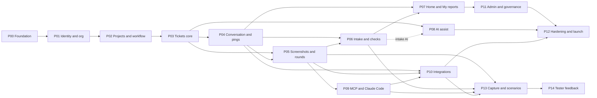

# Build plan

How pinround gets built: 15 phases, each split into tasks that fit one Claude Code session.

## Index
- [How the plan works](#how-the-plan-works) — one task = one session, how to start a session
- [The prototype](#the-prototype) — link, how to read it in Claude Code, the fallback docs
- [Phases](#phases) — table of P00–P14 with goal, dependencies, task count and 🏁 tasks
- [Dependency graph](#dependency-graph) — which phase needs which
- [Hackathon slice](#hackathon-slice) — what we build by 22 Nov 2026 18:00 CET and what we cut
- [Hackathon schedule](#hackathon-schedule) — who built it and how a slipped day is handled
- [What the demo shows](#what-the-demo-shows) — the 5-minute story for the judges
- [After the hackathon](#after-the-hackathon) — the order of the remaining work
- [Definition of done for every task](#definition-of-done-for-every-task) — the global checklist
- [How to update the plan](#how-to-update-the-plan) — ticking boxes, hand-off notes, changing scope

## How the plan works
- **One task = one Claude Code session.** A task has an id like `P05.T3`. Its size is S (about 1–2 hours), M (half a day) or L (one full session, about a day).
- **Start a session like this:** "Open `docs/05-plan/phase-05-screenshots-pins-and-rounds.md` and do task P05.T3." Claude Code reads [CLAUDE.md](../../CLAUDE.md) first, then the phase file.
- **Every phase file is self-sufficient.** Its **Before you start** list names the prototype screens, requirement IDs, ADRs and architecture sections to read. You should not need anything else.
- **Order:** do the tasks of a phase in their number order, unless the task says it can run in parallel.
- **Tests come with the task**, not later. A task without its tests is not done.
- **Phase files:** [P00](phase-00-foundation.md) · [P01](phase-01-identity-and-organization.md) · [P02](phase-02-projects-and-workflow.md) · [P03](phase-03-tickets-core.md) · [P04](phase-04-conversation-and-pings.md) · [P05](phase-05-screenshots-pins-and-rounds.md) · [P06](phase-06-intake-and-checks.md) · [P07](phase-07-home-and-my-reports.md) · [P08](phase-08-ai-assist.md) · [P09](phase-09-mcp-and-claude-code.md) · [P10](phase-10-integrations.md) · [P11](phase-11-admin-and-governance.md) · [P12](phase-12-hardening-and-launch.md) · [P13](phase-13-capture-explore-and-scenarios.md) · [P14](phase-14-tester-feedback.md)

## The prototype
The product must look and behave like the clickable prototype. Every task names the screens to compare with.

- **Link:** in your git-ignored `CLAUDE.local.md` (private to its owner, not in the repository).
- **Read it in Claude Code:** use the Artifact tool with `action: "read"`, `url` = the prototype link and `path` set to one of:
  - `project/Main.dc.html` — the app (Home, Tickets, ticket page, Report a problem, My reports, Team, Admin);
  - `project/Review.dc.html` — a review round;
  - `project/Focus.dc.html` — full-screen review;
  - `project/Shot.dc.html` — the simulated screenshot.
- **Fallback:** if you cannot open the link, use [the prototype guide](../04-prototype/prototype-guide.md). It describes every screen, text, state and rule, one file per screen in [04-prototype/screens](../04-prototype/screens).
- **Prototype-only:** the "view as" switch, the "Big team" toggle, the simulated screenshot and the made-up pings are demo devices. Do not build them ([prototype-only devices](../04-prototype/prototype-guide.md#prototype-only-devices)).
- The prototype is private. Never copy names, ticket keys or text from it. Use Acme Foods, SHOP, Lena, Omar, Mia, Raj, Sara.

## Phases
| Phase | Goal | Depends on | Tasks (= sessions) | 🏁 |
|---|---|---|---|---|
| [P00 Foundation](phase-00-foundation.md) | Running app skeleton, Docker, CI gates, modules, tenancy, design tokens, outbox, minimal audit store | — | 9 | 🏁 T1–T7 |
| [P01 Identity and organization](phase-01-identity-and-organization.md) | Login, MFA, invites, orgs, teams, roles, voters, nav and Home shell | P00 | 7 | 🏁 T1, T3, T4, T5 |
| [P02 Projects and workflow](phase-02-projects-and-workflow.md) | Projects and keys, steps, groups, policy, rules, verbs, whose turn, Now/Next | P01 | 8 | 🏁 T1, T2, T4, T6, T7 |
| [P03 Tickets core](phase-03-tickets-core.md) | Ticket create, visibility predicate, list, Whose turn?, search, ticket page, queue | P02 | 10 | 🏁 T1–T4, T6, T7, T8 (steps 1–2) |
| [P04 Conversation and pings](phase-04-conversation-and-pings.md) | Comments, questions, replies, resolve, pings, bell, live updates, digest | P03 | 8 | — |
| [P05 Screenshots, pins and rounds](phase-05-screenshots-pins-and-rounds.md) | Media pipeline, Round 0/1, review rounds, full screen, draft rounds | P03, P04 | 10 | 🏁 T1–T5, T8, T9 |
| [P06 Intake and checks](phase-06-intake-and-checks.md) | Report a problem, duplicates, check reasons, checker, team-only visibility | P04, P05 | 7 | — |
| [P07 Home and My reports](phase-07-home-and-my-reports.md) | Needs-you score, grouped Home, queues, My reports, manager and admin cards | P04, P06 | 8 | — |
| [P08 AI assist](phase-08-ai-assist.md) | Symfony AI gateway, summaries, explanations, intake AI, laptop AI | P03, P06 (intake AI) | 11 (T11 optional) | 🏁 T1–T4, T7; T8–T9 stretch |
| [P09 MCP and Claude Code](phase-09-mcp-and-claude-code.md) | Tokens, MCP tools, draft-round loop with Claude Code, REST API | P05 | 8 | 🏁 T1–T5, T8 |
| [P10 Integrations](phase-10-integrations.md) | Jira import and sync, OIDC SSO, browser capture extension | P04, P05, P09 | 9 | — |
| [P11 Admin and governance](phase-11-admin-and-governance.md) | All admin pages, activity log, retention, export, big-team checks | P07 | 9 | — |
| [P12 Hardening and launch](phase-12-hardening-and-launch.md) | Load tests, security review, backups drill, accessibility audit, runbooks | all | 12 | — |
| [P13 Capture, notebooks and scenarios](phase-13-capture-explore-and-scenarios.md) | Tester findings drafts, filing from a Claude Code check, live pins in the extension, notebooks, scenario player (ADR-0044–0046) | P05, P06, P09, P10 | 10 | — |
| [P14 Tester feedback](phase-14-tester-feedback.md) | Fixes from the first hands-on test: pins and previews, round rules and tries, round page and full screen, recipient on Send, screenshot context, Claude Code capture, Whose turn? toolbar, My reports, honest Home, phone layout, demo two-step switch, floating dock, one-click connect (ADR-0048–0050) | P05, P06, P09, P10, P13 | 20 | — |

One task is one Claude Code session. Sizes inside a phase file: S ≈ 1–2 hours, M ≈ half a day, L ≈ a full day. Use them to plan, not as a promise.

## Dependency graph
Arrows point from a phase to the phases that need it.

The hackathon slice breaks this order on purpose: it builds only the 🏁 tasks, and those were written so they do not call code from cut tasks (for example P05's 🏁 tasks do not need P04).

## Hackathon slice
**Deadline:** Symfony AI & MCP Hackathon, **Sunday 22 Nov 2026, 18:00 CET**. Required tech: Symfony AI, `mcp/sdk`, Hugging Face ([C-01](../01-requirements/constraints.md#c-01-hackathon-deadline-and-required-technology)).

**The rule:** build one complete, honest story end to end, not many half screens. Every 🏁 task is in the slice; everything else waits. Every step of the demo below is covered by a 🏁 task.

**In the slice (41 🏁 tasks + 2 stretch):**
- **P00:** T1 skeleton and Docker, T2 modules and CI, T3–T4 tenancy and RLS, T5 tokens and layout, T6 components, T7 outbox and minimal audit store.
- **P01:** T1 password login, T3 seeded org and team (Lena lead, Omar developer, Mia tester), T4 roles and voters (with the dev-only MFA flag), T5 nav and Home shell. No MFA, SSO or invites.
- **P02:** T1 projects and keys, T2 core steps, T4 engine with the eight hackathon verbs, T6 turn read model, T7 Now/Next.
- **P03:** T1 ticket and simple create form, T2 visibility predicate, T3 list, T4 search, T6 ticket page header, T7 next-step box and verbs, T8 steps 1–2 (Give it to).
- **P05:** T1 upload intents, T2 processing worker, T3 pins, T4 round model, T5 screenshot on the create form, T8 draft round, T9 hand-off dialog.
- **P08:** T1 gateway and providers, T2 prompt builder and metering, T3 minimal AI policy, T4 summaries on demand, T7 intake suggestions (no embeddings). **Stretch:** T8–T9 laptop AI.
- **P09:** T1 tokens, T2 MCP skeleton, T3 `list_my_tickets`, T4 `get_round_notes` + `set_verdict`, T5 `create_upload` + `add_screenshot`, T8 Claude Code guide.

**Cut on purpose (not in the demo):** MFA (dev-only flag instead, never in prod), SSO, invites, company/team steps, rules editing UI, the rest of the verb catalogue, Whose turn view, project rail, questions and pings, Mercure (pages poll), Round 1 checklist, review round board, full-screen review, Report a problem page, duplicate UI, Home scoring, My reports, manager and admin pages, Jira, email.

**Effort check:** with the sizes above (S = ¼ day, M = ½ day, L = 1 day), the 41 🏁 tasks are about 21 developer-days and the 2 stretch tasks 1 more. Two developers have 28 developer-days from 7 to 20 Nov, which leaves about 6 days for bugs, review and rework, plus the 21 Nov buffer day. Where two tasks on one day depend on each other (for example P01.T4 and P01.T5 on 10 Nov), do them in that order.

**Risk control:** if a day slips, cut in this order: laptop AI (stretch) → server-side Ollama provider (keep Hugging Face only) → P03.T4 search → `set_verdict` (the developer sets verdicts in the UI) → P05.T1/T2 presigned upload (fall back to a size-limited upload controller that still runs the processing worker; write it in the hand-off notes as a hackathon shortcut). Never cut tenancy, voters, the visibility predicate or the tests of what is built.

## Hackathon schedule
One person, Zairan, built pinround with Claude Code sessions, in the order of the 🏁 tasks above. If a 🏁 task slips, the next day starts by deciding what to cut (see [risk control](#hackathon-slice)).

## What the demo shows
Every step names the 🏁 tasks it needs.
1. Lena logs in. Home shows her name and the menu for her roles. (P01.T1, P01.T5)
2. Mia creates a ticket with a screenshot and two pins on the New ticket form. (P03.T1, P05.T1–T5) She presses "Check with AI": Hugging Face suggests type and priority (marked ✦). (P08.T7) On the ticket, "Summarize with AI" writes the "In short" summary. (P08.T4)
3. Lena gives it to Omar. The page says "Now: Omar starts building. Next: Omar builds it, Lena reviews, Mia tests." (P03.T8 steps 1–2, P02.T7, P03.T6)
4. Omar presses "Start work". (P03.T7) In Claude Code he runs `list_my_tickets` and `get_round_notes`, fixes the bug, and Claude Code uses `create_upload` and `add_screenshot` to put a screenshot into Omar's private draft round. (P09.T1–T5)
5. Omar marks the screenshot "Not right yet" with a note. Claude Code reads the note, fixes it, adds a new screenshot, and calls `set_verdict` "Looks right". (P05.T8, P09.T4–T5)
6. Omar presses "Send to code review" and picks "Share and move to Code review". Lena sees "Round 1 · self-check by Omar". (P05.T9, P05.T4)
7. Close: the tenant isolation suite, the visibility leak suite and the voter tests run green in CI. (P00.T3–T4, P03.T2)
8. Stretch, only if done: Sara switches AI to "Each person's laptop" and Omar's summary comes from Ollama on his laptop. (P08.T8–T9)

## After the hackathon
Order after 22 Nov: first remove the hackathon shortcuts (replace any upload shortcut; the admin MFA flag is already gone with P01.T6), then finish the non-🏁 tasks of P00–P03 → P04 → P05 → P06 → P07 → P08 → P09 → P10 → P11 → P12. P13.T1 and P13.T3 can start now; the rest waits for P06.T1, P09.T7, P09.T9 and P10.T7–T8; only P13.T10 waits for the P11 retention job. P14 (tester feedback) can start now with T1–T3; T5, T6, T18 and T20 wait for their ADRs (P14.T4). P08 and P09 can run in parallel with P06/P07 when two developers are free. Move to Symfony 8.2 in the first week after its release ([ADR-0003](../03-adr/0003-php-and-symfony-versions.md)).

## Definition of done for every task
- [ ] All acceptance criteria of the task are ticked in the phase file.
- [ ] The task's **Prototype check** was done: same words, layout and states, or the difference is written in hand-off notes with the reason.
- [ ] Tests written: unit for rules, integration for queries/repositories/voters, functional or e2e for the journey ([testing-strategy.md](../02-architecture/testing-strategy.md#definition-of-done-for-any-task)).
- [ ] New tables have `organization_id`, RLS and an isolation test; new actions have a voter and voter tests.
- [ ] Query counts on hot pages stay within budget (Home ≤ 8, list ≤ 5, ticket page ≤ 10).
- [ ] Every new read path of tickets uses the TicketVisibility predicate (`Ticketing\Api\TicketVisibility`) and has a case in the visibility leak suite.
- [ ] `composer test`, `composer phpstan`, `composer deptrac`, `composer cs`, `composer audit` are green.
- [ ] No ticket text, prompts, AI answers or tokens in logs.
- [ ] Docs updated (with their Index) if the task changed what they describe; a new ADR if a decision changed.
- [ ] Hand-off notes written. Commit with a clear message.

## How to update the plan
- **Tick** acceptance criteria (`- [x]`) as you finish them. Tick the task title line too.
- **Hand-off notes:** each phase file ends with a `## Hand-off notes` section. Add a dated bullet: what changed from the plan, shortcuts taken, follow-up work and where it belongs.
- **Scope change:** never delete a task. Mark it "Moved to PNN.Tn" or "Dropped: reason". New work gets a new task id at the end of the phase.
- **New decisions:** write an ADR ([03-adr/README.md](../03-adr/README.md)) and link it from the task.
- **Files over 100 lines** keep their `## Index` up to date.
