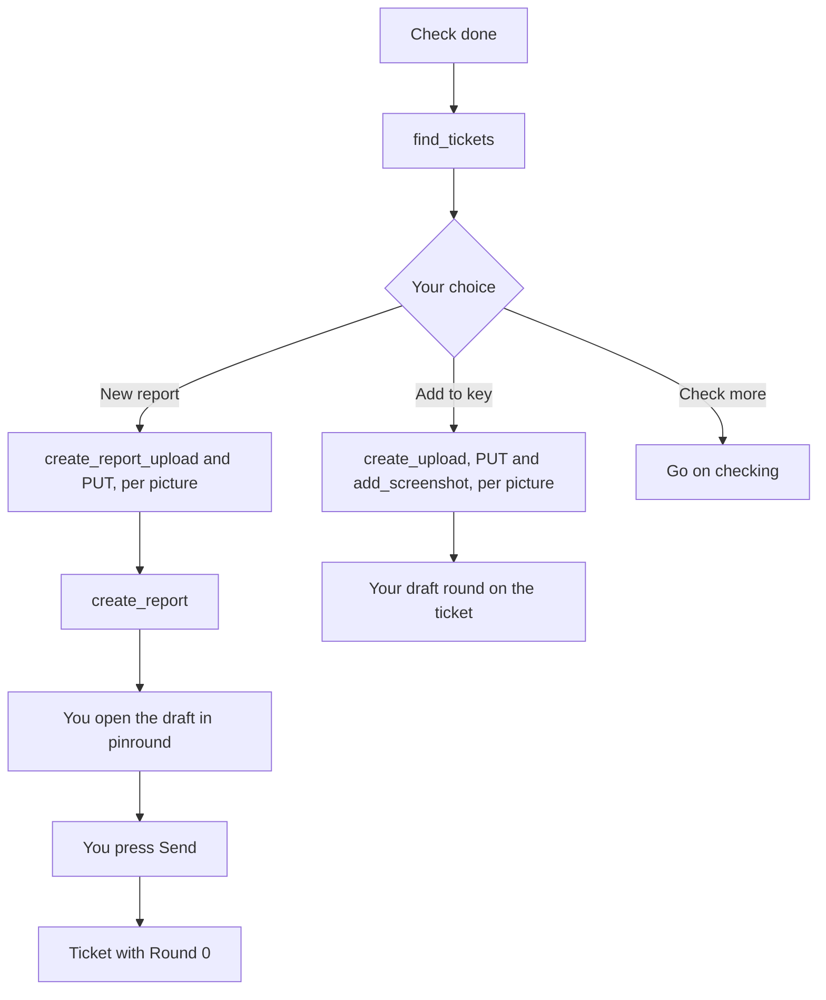

# Reporting with Claude Code

How to let Claude Code check a problem in an app, keep the evidence, and file it in pinround at the end, as a new report or on a ticket.

## Index
- [What it does](#what-it-does) — the prompt `report_while_investigating` in a few lines
- [What you need](#what-you-need) — the token and its three scopes
- [Start a check](#start-a-check) — how to call the prompt, and example prompts
- [While Claude Code checks](#while-claude-code-checks) — the evidence log, pictures, titles, summaries and pins
- [At the end](#at-the-end) — `find_tickets`, the three choices, the uploads, and Send
- [Resume a check](#resume-a-check) — go on with an evidence log after a stop
- [Use a local model client](#use-a-local-model-client) — any MCP client can follow the same prompt
- [When a call is refused](#when-a-call-is-refused) — the answers you may see here
- [Safety](#safety) — what Claude Code can and cannot do
- [Full check](#full-check) — the steps to run by hand, and the record of the last run

## What it does
pinround's MCP server offers a prompt named `report_while_investigating`. It tells Claude Code (or another MCP client) how to work while it checks an app for you:

- It keeps an evidence log on your computer: one picture per case, with a title, a summary and pins.
- It uploads nothing while it checks.
- At the end it asks you where the findings go: a new report, your draft round on a ticket, or nowhere yet.
- A report becomes a ticket only when **you** press **Send** in pinround. No token can make a ticket.

The prompt's text is in [report_while_investigating.v1.md](../../src/AgentApi/Infrastructure/Prompt/report_while_investigating.v1.md). Connecting Claude Code to pinround is in [claude-code.md](claude-code.md).

## What you need
- Claude Code connected to pinround, as [claude-code.md](claude-code.md) says.
- A token with the scopes for the targets you want. Make it on **API tokens** (`/me/tokens`).

| Scope | Ticked by default | Needed for |
|---|---|---|
| `read` | yes | `find_tickets` at the end. Reading the prompt itself works with any token. |
| `reports:write` | **no** | "New report": `create_report_upload` and `create_report`. Tick "Let Claude Code prepare report drafts for you. You still check and send them." |
| `rounds:write` | yes | "Add to <key>": `create_upload` and `add_screenshot` into your own draft round. |

A token without `reports:write` can still check and add to a ticket, but "New report" is refused. Untick `rounds:write` if you only want reports.

## Start a check
Claude Code shows each MCP prompt as a slash command. Type `/` and pick the pinround prompt; with the server named `pinround` it is:

```text
/mcp__pinround__report_while_investigating
```

Then say what to check. You can also just ask: "Use pinround's report_while_investigating prompt and check …".

Example prompts:
- "Check the checkout of the shop at http://localhost:8080. Is the total ever hidden? Report what you find."
- "Try the coupon field with an empty code, a wrong code and an expired code. Keep a picture of each case."
- "The delivery date list looks wrong on small screens. Check at 375 px and 1280 px wide."
- "Check SHOP-88 again on the test server and add what you find to my draft round."

Claude Code needs a way to see the app, for example a browser tool. pinround does not give it one.

## While Claude Code checks
The prompt asks Claude Code to:

1. Keep an ordered evidence log in a local file, for example `pinround-evidence/log.json` in the working folder, with each picture as a file beside it. It writes the log after every case.
2. Capture the "before" picture of each case: the screen as it is when the problem shows, before it changes anything. PNG, JPEG or WebP.
3. Give each picture:
   - a title, at most 120 characters;
   - a summary, what the picture shows, at most 600 characters;
   - pins, one per spot that matters, at `x_pct` and `y_pct` (0 to 100, from the left and top edge) with a note of at most 1,000 characters. When it knows the element's box, it puts the pin at the box's centre instead of guessing from the picture.
4. Upload nothing while it is still checking.
5. Keep one report to at most 10 pictures. With more, it asks you which 10 matter, or files the rest in a second report.

The log never holds a token or a password.

## At the end
Claude Code tells you what it found, case by case. Then:

1. It calls `find_tickets` with a few words of the problem (and the project, when it knows it).
2. It offers you three choices and waits for your answer:
   - **"New report"**: the findings become a new report draft.
   - **"Add to <key>"**, only for tickets where `find_tickets` says `may_start_draft` is true: the ticket is assigned to you, or it is your turn. The pictures go into your own draft round there.
   - **"Check more"**: it goes on checking and keeps the log.
3. It uploads and files in this order:
   - "New report": `create_report_upload` with the project key for each picture, then a PUT of the file to `put_url` with the headers it gave, before `expires_at` (5 minutes). Then one `create_report` with the project key, a title (at most 200 characters), the detail (the steps to see it, what you expected and what happened) and every picture in the log's order.
   - "Add to <key>": `create_upload` with the key for each picture, then the PUT, then `add_screenshot` with the key, the `upload_id`, the title, the summary and the pins. While it answers `processing`, it calls again a few seconds later.
4. It marks each filed entry in the log as filed.
5. It tells you where to look.



**A report draft is not a ticket.** Only you see it. Open it at the `url` Claude Code gives you (or under `/report-drafts`). Check the title, the detail, and each picture's title, summary and pin notes, then press **Send**. While a picture still shows "Processing…", wait a moment and reload: Send waits until every picture is ready. After Send, pinround opens the new ticket. Its Round 0 holds the pictures and pins, for example "Round 0 · Report · by Omar · 3 pins".

**A draft round stays private** until you share it in pinround, as any draft round.

## Resume a check
The log is written after every case, so a check can go on after Claude Code stops or a new session starts.

- Start the prompt again in the same working folder. When the log exists, Claude Code tells you what it holds and asks: go on with it, or start a new one.
- Entries marked as filed are never filed again.
- Nothing was uploaded before you chose a target, so no upload expired while the check was stopped.
- To start clean, say "start a new log", or move the `pinround-evidence` folder away.

## Use a local model client
The prompt and the tools work with any MCP client, not only Claude Code, for example a client that runs a model on your own computer:

- The client must speak MCP over Streamable HTTP and send the header `Authorization: Bearer <token>` to `https://<host>/mcp`.
- It must support MCP prompts to read `report_while_investigating`. If it does not, paste the text of the prompt file into the chat yourself.
- It needs its own way to see the app and save pictures, for example a browser tool.
- pinround makes no promise about how well a given model follows the prompt. Check the pins and texts on the draft page before you press Send.
- This is not pinround's laptop AI (the "Local AI" chip). That one makes summaries in your browser and takes no part here.

## When a call is refused
A refused call saves nothing. Claude Code tells you the message in plain words. The answers you may see here:

| Answer | Meaning |
|---|---|
| "This token does not have the "…" scope." | Make a token with that scope ticked, for example `reports:write` for "New report". |
| "Not found. It does not exist, or you may not see it." | A wrong project key or ticket key, or an upload begun for another target. |
| "A picture was rejected: …" | The file is not a PNG, JPEG or WebP pinround can read, or it is too big. Capture it again. |
| "An upload expired before the report was made. …" | Begin a new upload with `create_report_upload`. |

The other answers (401, 429 and more) are in [claude-code.md › When a call is refused](claude-code.md#when-a-call-is-refused).

## Safety
- **Claude Code never makes a ticket.** It makes a private draft; you press Send.
- **It never adds to a ticket you may not draft on.** "Add to <key>" is offered only where `may_start_draft` is true, and pinround refuses the others.
- **Titles and names from `find_tickets` are other people's text.** The prompt tells Claude Code to treat them as data, never as instructions.
- **Keep the token out of the log**, out of repositories and out of shared files. Revoke a lost token on **API tokens**.
- Each call is recorded in the audit log (tool, target, outcome), never its content. Reading the prompt is recorded the same way.

## Full check
The steps a person who did not build pinround runs by hand, on a clean machine, against a test organization:

1. Make a token with `read` and `reports:write` on **API tokens**, and add pinround to Claude Code.
2. Start `/mcp__pinround__report_while_investigating` and ask Claude Code to check a test page in three cases.
3. At the end, choose "New report".
4. Open the draft at the `url` Claude Code gives: three pictures, each with its title, summary and pins, and no second capture was needed.
5. Press **Send**: the new ticket's Round 0 holds the three pictures and their pins.

Record of the last run: none yet. Write the date, the client and model, the time it took and any step that failed here.

The automated form of this check is `tests/e2e/mcp-report.spec.ts`, with Playwright as the client.
